

   
  <strong>AETHER AI · PREDATOR</strong>

  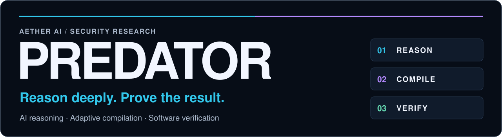

  
  
  

# Predator

**AI security research, software repair, and authorized VM workflows.**

### Where Predator is today (November 2026)

| When | What happened | What it showed |
| :--- | :--- | :--- |
| **March 2026** | Predator starts as a [Gen2](#generations-in-plain-english) project: AI- and quantum-assisted vulnerability analysis. | The idea. |
| **October 2026** | A one-week sprint. Predator Drive ran end to end through MCP for the first time, across several private security sprints and Predator's first bounty missions outside open-source research. | Predator can run a full mission and turn up findings within days. |
| **Late October – November** | Gen3 [quantum comm ops](#gen3-quantum-comm-ops): the briefings for a 400-agent mission went out in one IBM job billed at 5 seconds, and 400 of 400 arrived intact, repeated on three message sets (*measured on IBM hardware*). | Many agents can be coordinated cheaply through IBM hardware, with every message checked. No quantum advantage is claimed: the saving is IBM's billing for batched circuits. |
| **November 2026** | Training our own small models, round by round, on results the software has verified (Experiments K–O). | A 2-billion-parameter model trained on 138 replies from a 9-billion-parameter model went from 5 to 62 correct on 108 new fixture tasks, above the larger model's own 39.8 % (*measured on fixtures*). It learned the expected answer format, not a general new skill. |

**Not there yet.**
- **No bounty has paid.** The October reports were closed as informational because they did not show impact inside each program's rules. Next: a written authorization boundary for every program, and a stricter evidence check before anything is submitted.
- **The trained model is not stable.** It ran to the length limit more often (3.8 % → 12.2 % of prompts), so its preregistered check failed (**NOT MET**). A version trained to stop at the goal is *built, not yet run*.
- **Comm ops is not yet inside the everyday mission path.** Bringing it in is designed but *built, not yet run*.

Source pins: the model result is `bench/qcomms/o_frame/REPORT_O.md` at private AETHER-PREDATOR-M commit `58ecf3db412feef68022cc4e88372567dd588f11`; the IBM numbers are in [Gen3 Quantum Comm Ops](#gen3-quantum-comm-ops).

### Start here

- **What Predator is.** A security research and software repair system that gives AI models persistent context and reviewed tool use, then banks only the results the software itself confirms.
- **What is public.** This repository is the public showcase and evidence collection. The CLI and operator engines are private, with [reviewed research access](#developers-join-the-research-program).
- **Two kinds of text.** This page mixes *measurements* (numbers from runs, each labelled with how it was measured) and *how we think about it* (method, plans, hypotheses). The legend below gives the labels; sections headed "Built, not yet run" or "as far as we can see" are the second kind.
- **Where the evidence lives.** Each study has a plain-English guide in [`docs/research/`](docs/research/) and a JSON file of public aggregate data with source pins; the [Read the evidence](#read-the-evidence) table at the end lists them.

### How to read our numbers

| Label | Meaning |
| :--- | :--- |
| **MET** / **NOT MET** / **NOT RUN** | Every gate was preregistered before the run; the verdict is reported either way, including the misses. |
| **measured on IBM hardware** | A run on a real IBM quantum device, with IBM's billed time and signed receipt. |
| **measured on a simulator** | A run on a classical simulator of a quantum circuit (FakeFez models one IBM device). No hardware time. |
| **measured on fixtures, no quantum-computer time** | A run on fixture tasks. A fixture is a task with a known answer scored by a deterministic checker. |
| **modelled** | Arithmetic from measured per-unit costs; not a run. |
| **built, not yet run** | Code exists and passed offline tests; nothing paid has executed. |
| **scripted agents** | Stand-ins that follow a fixed script; not reasoning models. |

Predator brings AI reasoning, persistent context, and reviewed tool use into security research and software repair. Its research engine, **Crucible**, works like a lockpick: it holds verified evidence steady, proposes candidate chains, checks them against the real software, and banks only supported results.

[How search works](#how-predator-chooses-the-next-move) · [P-BOX / HTB training](#p-box-htb-training) · [Gen3 Private Security](#gen3-private-security) · [Crucible](#crucible-adaptive-quantum-threat-modeling) · [MITRE chains](#mitre-attck-chain-library) · [CVE catalog](#cve-research-catalog) · [CodePro & System-2](#codepro-and-system-2) · [Generations](#generations-in-plain-english) · [Quantum Comm Ops](#gen3-quantum-comm-ops) · [joint5 & IBM Fez](#joint5-compiler-the-ibm-fez-hardware-result) · [Results](#banked-scientific-results) · [Work with Aether](#ways-to-work-with-aether) · [Gen3 access](#predator-r3d-and-predator-blu3) · [Glossary](#glossary) · [Docs](docs/README.md)

## How Predator chooses the next move

**Keep Predator’s ordinary computer search in charge, make quantum experiments cheaper, and require evidence before trusting them with decisions.** The [tests described here](docs/research/search-scaling.md) have not demonstrated a quantum advantage.

Think of Predator choosing from a menu of possible next moves. Some moves work well together. Some require another move first. Others conflict. The goal is to pick the best allowed combination.

A **QUBO** is the scorecard for those yes/no choices and how they interact. **Energy** is the score—lower is better. The score helps rank candidates; checks against the actual software establish whether a proposed result holds. Each run records the solver it used, including any quantum simulation or hardware.

[See the joint5 charts and measured limits →](#joint5-compiler-the-ibm-fez-hardware-result)

## P-BOX / HTB training

### [P-BOX] Predator's disposable Linux VM

**Give Predator a goal, confirm the VM, and follow along as it works.**

P-BOX is Predator's disposable Linux pwnbox for authorized CTF and HTB missions. Predator can spawn the VM when a hosted Pwnbox is unavailable, giving it a place to work that you can watch and control.

| What you can do | How it works |
| :--- | :--- |
| **Confirm and start** | You confirm the VM before Predator begins work within the approved mission. |
| **Work toward longer goals** | Predator works autonomously through reviewed terminal actions, reads fresh guest output, and chooses the next step within the approved mission. |
| **Watch, take over, and resume** | Watch the guest live, take control yourself, hand it back to Predator, or stop the mission. |
| **Clean up automatically** | The VM's disk is removed when you stop it or its lease expires. |

*The recording below includes challenge spoilers and visible lab command history.*

  <a href="docs/htb/machines/ghostlink/README.md">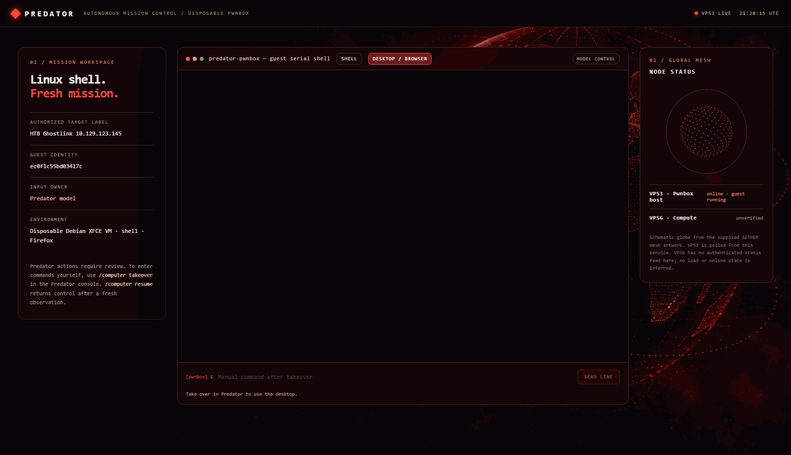</a> 
  P-BOX in action · Predator / GLM-5.3 · 670 recorded guest frames · <a href="docs/htb/machines/ghostlink/README.md">Ghostlink evidence and execution roles</a>

<strong>About this GLM-5.3 replay</strong>

The featured GIF comes from **Predator's GLM-5.3 Ghostlink mission in P-BOX**. It contains 670 recorded guest frames at 1600 × 920, with blank browser-loading frames removed. The [frame provenance](docs/htb/machines/ghostlink/replay-provenance.json) records the retained source-frame hashes and GIF hash.

The [machine guide](docs/htb/machines/ghostlink/README.md) records GLM-5.3's research and the operator's later actions. The screen recorder stopped before the final user and root challenge-file reads; those observations are documented separately.

### Hack The Box: training and evidence

**HTB is a test and training ground for Predator's agent and VM workflows.** These two examples show autonomous VM command work and saved lab research, with completion records and execution roles in their guides.

*The Satellite replay includes challenge spoilers. Both GIFs are assembled evidence replays.*

<table>
  <tr>
    <th width="50%">Nmap course · autonomous VM work</th>
    <th width="50%">Satellite Exploitation · recorded lab work</th>
  </tr>
  <tr>
    <td width="50%" valign="top"><a href="docs/htb/academy/README.md">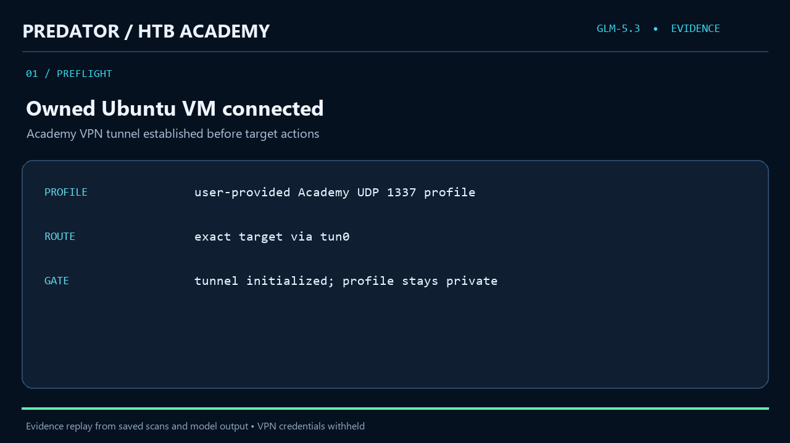</a></td>
    <td width="50%" valign="top"><a href="docs/htb/satellite-exploitation/README.md">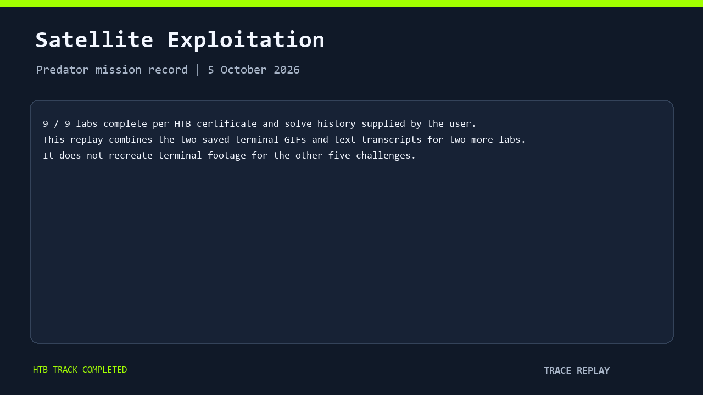</a></td>
  </tr>
  <tr>
    <td width="50%" valign="top"><strong>12/12 Academy sections completed.</strong> Predator through GLM-5.3 ran the VM commands autonomously. The owner supplied prompts and exercise questions, then entered the answers. <a href="docs/htb/academy/README.md">Course record and replays →</a></td>
    <td width="50%" valign="top"><strong>9/9 labs completed.</strong> The certificate and account activity support completion; the replay covers four saved lab records. <a href="docs/htb/satellite-exploitation/README.md">Certificate, lab list, and replays →</a></td>
  </tr>
</table>

<strong>More HTB records and replay notes</strong>

| Module or track | Recorded progress | Open the guide |
| :--- | :--- | :--- |
| **Academy: Network Enumeration with Nmap** | **12/12 sections completed** · October 3, 2026 | [Completion record and two replays](docs/htb/academy/README.md) |
| **Satellite Exploitation** | **9/9 labs completed** · October 5, 2026 | [Certificate, lab list, and replays](docs/htb/satellite-exploitation/README.md) |
| **AI and ML Exploitation** | **1/17 labs HTB-accepted** · in progress | [Lab status and three replays](docs/htb/ai-ml-exploitation/README.md) |
| **Machine: BlockSynergy** | **User and root challenge files read** · October 5, 2026; owner confirmed | [Machine record and sanitized replay](docs/htb/machines/blocksynergy/README.md) |
| **Machine: Ghostlink** | **User and root challenge files read** · October 5, 2026; HTB submission unobserved | [Machine record and full-screen pwnbox replay](docs/htb/machines/ghostlink/README.md) |

The [earlier Pwnbox console preview](docs/media/predator-pwnbox-ttl-preview.gif) shows a separate reviewed guest-session check. AI/ML counts only HTB-accepted results toward completion. The machine guides distinguish Predator research from operator execution and explain what their recordings contain.

**[Browse all HTB modules, certificates, and replays →](docs/htb/README.md)**

## Gen3 Private Security

**Gen3** is the name for Predator's current research workflow and the evidence it leaves behind. It describes a method, not a measured quantum advantage.

Five scoped research records from October 2026, each with its validation and disclosure status kept separate. The Crucible research workflow is described in the next section:

| Target | Public material | Status |
| :--- | :--- | :--- |
| **Vercel AI SDK** | [Redacted local P-BOX replay](docs/pbox-vercel-ai-sdk-showcase.md) | Verified local result with synthetic values; no production access. |
| **Gemini CLI** | [Sanitized Crucible sprint graphic](docs/assets/gemini-cli-crucible-sprint.svg) | Three private Google Cloud VRP reports under triage; no assigned severity or reward. |
| **GitLab Duo** | [Private-research tactic map](docs/assets/gitlab-duo-crucible-private.svg) | Owner-controlled local validation; no vulnerability report filed. |
| **GitLab for VS Code** | [VPS3 Predator P-BOX research visual](docs/pbox-gitlab-extension-research-visual.md) | Private report filed; technical record remains private. |
| **Anthropic SDK** | [Conditional AX research map](docs/assets/anthropic-sdk-crucible-private.svg) | Three owner-controlled local paths from one shared boundary; no vulnerability report filed. |

### Vercel AI SDK: redacted local P-BOX replay

Predator's VPS3 P-BOX also supported a **local security test of the Vercel AI SDK**. The public replay shows the disposable Linux desktop and a verified local result. It uses synthetic values; no Vercel production account or service was accessed.

  <a href="docs/pbox-vercel-ai-sdk-showcase.md">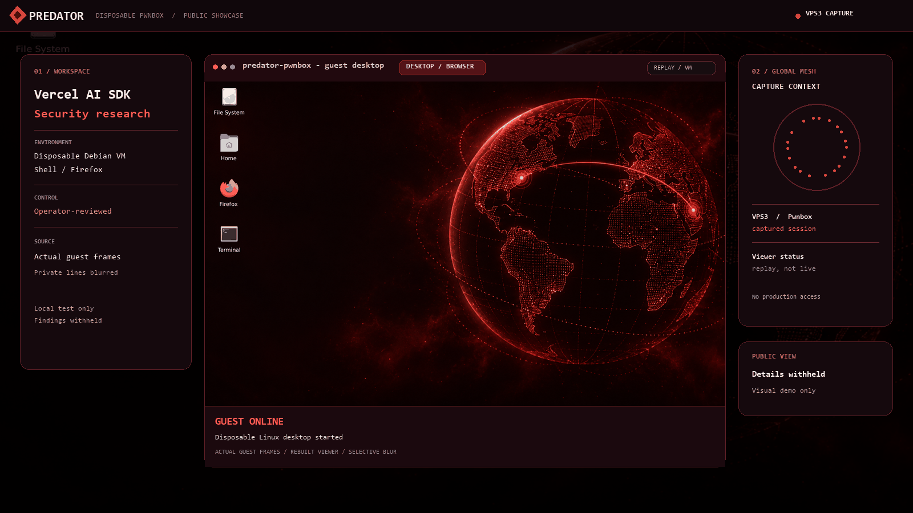</a> 
  Five actual guest captures · seven replay frames · selective FFmpeg blur · <a href="docs/pbox-vercel-ai-sdk-showcase.md">provenance and disclosure limits</a>

### Gemini CLI: private Crucible sprint

On **October 9, 2026**, Predator's manual research workflow ran a deep Gemini CLI Crucible sprint across the **C1 → Q173 checkpoint span**. Three separate reports were filed privately with Google Cloud VRP during the day. They remain under triage; no severity or reward has been assigned.

  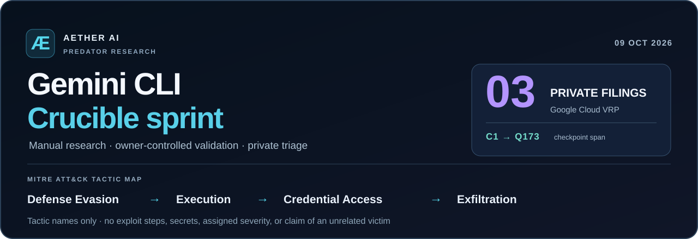 
  Public taxonomy only: Defense Evasion → Execution → Credential Access → Exfiltration. No reproduction details or credential material.

#### Sanitized research energy

  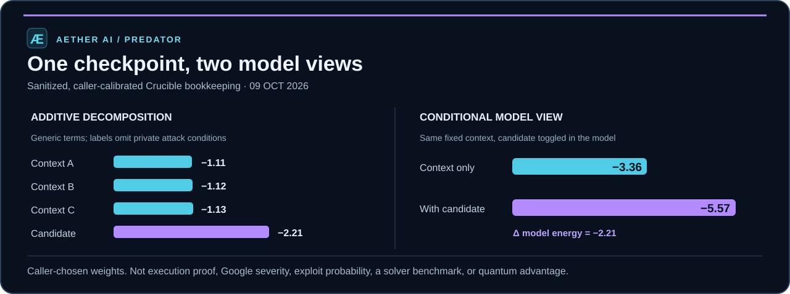

The two views show **one caller-calibrated model checkpoint**, with private attack-condition labels removed. Its weights are research bookkeeping; they do not independently verify a finding, measure exploit probability, establish quantum advantage, or set a Google bounty tier. Validation evidence remains in the private reports while triage is pending.

### GitLab Duo: private Crucible research

Predator began an owner-controlled GitLab Duo research sprint on **October 9, 2026**. The graphic below is a **C1 → Q48 snapshot from October 10**; later manual checkpoints remain private. These labels identify research checkpoints, not executed quantum interventions or a paid CFC run. The local result maps at the [MITRE ATT&CK](https://attack.mitre.org/tactics/) tactic level to **Execution → Credential Access → Exfiltration**. This is a research map of an owned test, not a claim about an attack on another user.

**Private findings: technical details have not been disclosed and no vulnerability report has been filed.** No severity or bounty has been assigned. The saved evidence does not establish zero-click execution or a sandbox escape.

  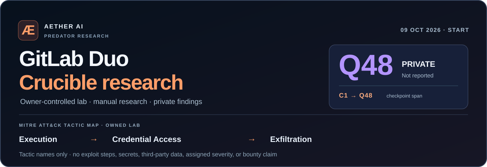 
  October 10 snapshot · owner-controlled validation · tactic names only · no reproduction steps, secrets, or third-party data

### GitLab for VS Code: private report filed

Predator banked an owner-controlled GitLab for VS Code research record and filed a private report. Technical details and evidence remain private while disclosure is coordinated.

### Anthropic SDK: private Crucible research

On **October 10, 2026**, Predator banked **AX001–AX003** as three conditional outcomes of one shared trust boundary in owner-controlled local fixtures. Their public [MITRE ATT&CK](https://attack.mitre.org/tactics/) tactic lenses are **Collection**, **Credential Access**, and **Execution**. These are parallel research paths, not one completed attack sequence or three independently confirmed vulnerabilities.

The saved evidence does not establish a deployed lower-trust writer route, Claude-selected tool action, real credential exposure, or deployed code execution. **No vulnerability report has been filed, and no severity or bounty has been assigned.** Technical reproduction details remain private.

  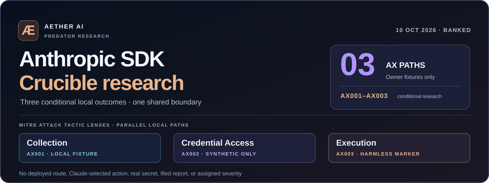 
  Owner-controlled fixtures · parallel tactic lenses · no reproduction steps, secrets, or third-party data

## Crucible: adaptive quantum threat modeling

**Think of a lockpick. Hold tension, test one pin at a time, and keep every pin that sets.**

Crucible is Predator's software research and repair loop. It starts with a pinned source revision, a defined question, and fixed acceptance checks. The easiest way to picture it is a lock being picked: one hand holds tension so nothing already gained can slip, the other tests pins until one clicks, and a pin that sets stays set while the next one is worked.

  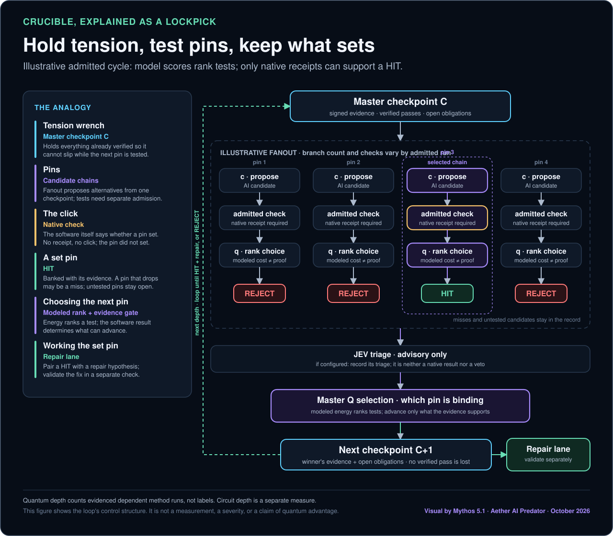 
  One depth step of the loop, drawn as a lockpick. Visual by Mythos 5.1.

The four pins illustrate a **research design**, not four measured workers or native checks in every run. The [execution and evidence guide](docs/research/crucible-evidence-contract.md) separates the CFC selector, an admitted exploit ratchet, and manual research. It also defines the minimum candidate record and the native effect needed for a zero-click claim. A model score, a worker proposal, and a native result are different records.

<strong>The lock, part by part</strong>

### The lock, part by part

| In the lock | In Crucible | What it does |
| :--- | :--- | :--- |
| **Tension wrench** | **Master checkpoint (C)** | Holds verified evidence with its provenance, signatures where present, the passes that must not be lost, and obligations still open. A manual checkpoint is not signed merely because it has a C label. |
| **Pins** | **Candidate chains** | Fanout proposes alternatives from a checkpoint. A proposal and its QUBO ranking do not imply that a native check ran. |
| **The click** | **Native check** | The software itself says whether a pin set. A chain with no native receipt did not click, whatever the model thought of it. |
| **A set pin** | **HIT** | Banked only with an appropriate native receipt. Misses, refutations, and inconclusive results stay in the record with their limits. |
| **Choosing the next pin** | **QUBO selection and evidence gate** | A modeled energy can rank a test; native outcomes determine what is supported. JEV participates only when an admitted stage records a typed call and its usage. Its decision is advisory, not an independent software result. |
| **Working the set pin** | **Repair lane** | Pair a supported attack observation with a repair hypothesis and regression plan. A fix counts as validated only after its own check. |

<strong>What happens in one cycle</strong>

### What happens in one cycle

| Step | What happens |
| :--- | :--- |
| **Pin** | Freeze the source revision, scope, evidence, and acceptance checks. This is the tension. |
| **Fan out** | Open several small candidate chains from the checkpoint. Each proposes a threat path or repair. |
| **Model** | State the target facts, candidate choices, constraints, and provenance. A bounded QUBO can rank tests; not every library chain has a populated energy profile. |
| **Search** | Record the solver actually used. A classical minimum is one valid selection method; a simulator or quantum device is a separate, explicitly evidenced run. |
| **Validate** | Run the admitted native check and retain its receipt. A proposal without that check remains a hypothesis. Record HIT, miss, refutation, or inconclusive outcome accurately. |
| **Select and carry** | Carry the supported evidence and open obligations into the next checkpoint. Pair an attack observation with a repair record; verify the repair separately. |

<strong>Quantum depth: how cycles chain together</strong>

### Quantum depth

Each cycle leaves a checkpoint, and each checkpoint seeds the next intervention. A failed check is not wasted: it can reveal a missing constraint or a repair obligation that shapes the next pin.

**C0 → Q1 → C1 → Q2 → C2 → Q3 → C3**

| Label | Meaning |
| :--- | :--- |
| **C** | A saved evidence checkpoint. The tension at that depth. |
| **Q** | A dependent quantum-method intervention when one actually ran. Manual C/Q shorthand can label research stages, but the label alone is not an execution receipt. |
| **Quantum depth** | How many evidenced, dependent quantum-method interventions ran in one chain. Circuit depth is a different number: the size of the circuit inside one intervention. |

The **ratchet** is the rule that verified earlier results and negative evidence remain visible while the next candidate is checked. It does not guarantee that a later candidate will pass. In the [CharLS case](docs/research/charls-q3.md), Q3 used C2's remaining repair obligation to move from **16/24 to 24/24** protected test passes, retaining all 16 earlier passes.

[Generations in plain English, triggers for Gen4, sources →](docs/research/generations.md)

<strong>Methods, evidence, and current limits</strong>

QUBO stands for quadratic unconstrained binary optimization. Its energy is the modeled cost to minimize; a low energy is a reason to test a candidate, not proof that it works. Only the native check on the software sets a pin.

The public CharLS and QPACK studies used quantum-circuit simulation. The [joint5 pilot](docs/research/ibm-fez-pilot.md) supplies a separate hardware record. [Jev](https://docs.typesafe.ai/introduction) can provide structured triage only after the stage path is enabled, qualified, and deployed. A `NOT_CONFIGURED` field, an adapter in source, or an offline preflight is not a provider call. A participating run must record its typed decision, call count, and spend; JEV never terminates a chain on its own.

Where issued, signed custody binds research stages to source and artifacts. Manual research notes and C/Q labels are not signed receipts. Live signed acceptance, server-side stage minting, and variable-depth custody remain under validation. Each continuation needs its own scope, budget, and admission.

Gen3 seeks attributable quantum advantage over credible AI-only and classical alternatives, with matched resources and independent replication. Quantum advantage and a measured Jev contribution remain unestablished. The lockpick figure illustrates the loop's control structure; it is not a measurement, a severity, or a claim of advantage.

### Where the pins come from: the ATT&CK chain library

**424 source-bank chains · 18 routing buckets · October 10, 2026 V16 registry snapshot**

A pin is only as good as its source and test. The library provides chain definitions, prerequisites, and references for candidate generation; a new source-grounded hypothesis can also be proposed. The 424 count is **catalog coverage**, not 424 tested exploits or 424 calibrated energy models. Most profile slots are explicitly unmodeled. The map shows the [15 current MITRE ATT&CK Enterprise tactics](https://attack.mitre.org/tactics/) alongside Aether's AI injection, [MCP](https://owasp.org/www-project-mcp-top-10/), and memory-safety research areas. Predator's routing labels are maintained separately from MITRE's tactic names.

  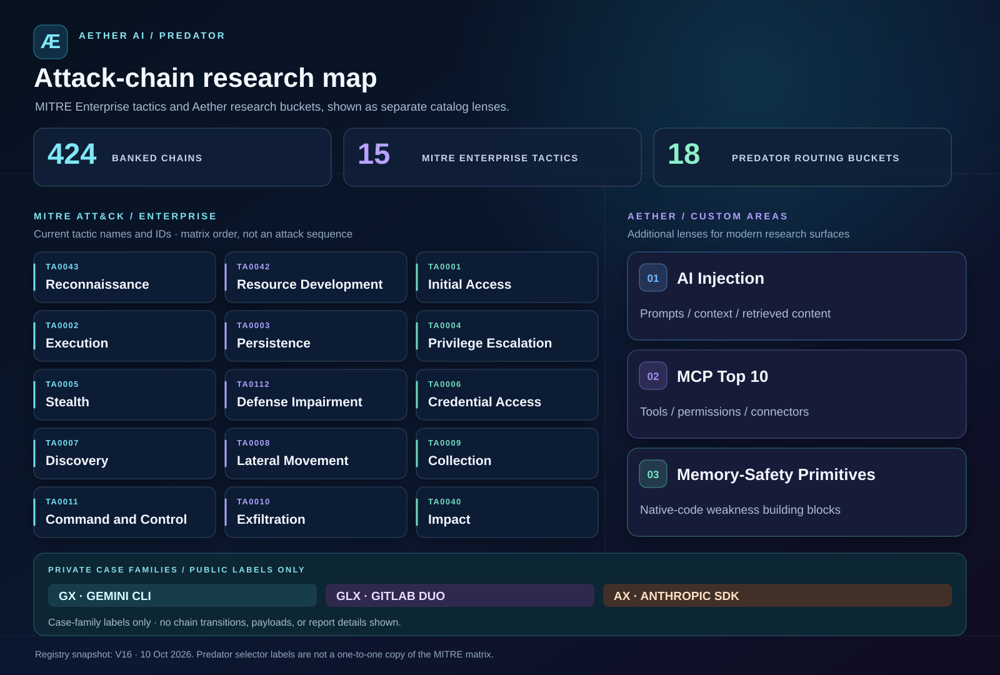 
  <a href="docs/assets/attack-buckets-v16.svg">Open the full-size research map</a> · GX, GLX, and AX are public case-family labels; no exploit steps are shown.

| What a chain contains | Why it helps |
| :--- | :--- |
| **Connected steps** | Show how a proposed path depends on earlier conditions. |
| **Prerequisites and references** | Keep the model tied to stated assumptions and cited sources. |
| **Routing category** | Organize the review around the relevant research surface. |

**Research mode** follows chain and CVE references to develop cited hypotheses, counterexamples, and proposed extensions; it is the c-stage of a pin. Source review and appropriate checks on the software must establish observed behavior before a modeled path becomes a finding.

#### AX · Anthropic SDK

AX001, AX002, and AX003 mark conditional local research paths with **Collection**, **Credential Access**, and **Execution** tactic lenses. The paths share one underlying trust boundary and are shown separately in the [Anthropic research card](docs/assets/anthropic-sdk-crucible-private.svg). The public map does not claim a sequential exploit, a deployed integration, or a vendor-confirmed finding.

### CVE catalog and database

**The vulnerability records the chains anchor to.**

Alongside the chain library, Predator maintains a catalog of CVE records, affected products, advisories, problem types, and scoring data. CVE IDs connect those records to chain anchors so an investigation can follow the underlying evidence.

| Part of the catalog | What it contributes |
| :--- | :--- |
| **CVE source records** | [CVE JSON 5.x](https://github.com/CVEProject/cvelistV5) imports and affected-product information. |
| **Separate enrichment** | NVD, CISA KEV, and FIRST EPSS data alongside the source records. |
| **Research review** | Deep-cycle integration reads shortlisted full CVE cards before ranking and records what was reviewed. |

**Drive** uses the approved mission's pinned evidence for investigation and validation. Catalog coverage and freshness depend on completed imports and pinned snapshots.

## CodePro and System-2: how the fanout runs

**Many workers, one evidence trail.** When Crucible fans out, it needs a way to give several workers the right context at once and to read their answers back as one record. That is CodePro.

| Part | What it does, in plain terms |
| :--- | :--- |
| **CodePro fanout** | In an admitted run, starts scoped workers and records each returned claim and provider receipt. A manual research turn or unavailable dispatch path is not a completed fanout. |
| **System-2 shared IR** | Aligns claims, evidence references, and open questions from workers that use the same intermediate representation. |
| **Clean model worktrees** | Source-backed runs can isolate model work in pinned Git worktrees. The run record identifies the actual checkout and revision rather than assuming isolation. |
| **[Unlimited Context (UCL)](https://github.com/AetherAI3/Unlimited-Context-LLM)** | Keeps source-backed evidence in named memory pools across sessions and models. “Unlimited” describes retrieval reach: relevant slices enter the model’s normal attention window. |

**Evidence-accounting update:** a tested System-2 draft counts supporting sources rather than repeated statements; integration remains pending. [What was tested and what remains open →](docs/research/quantum-comm-ops.md#system2-evidence-accounting)

<strong>CodePro implementation links</strong>

[System-2 orchestration](https://github.com/AetherAI3/AETHER-CLOUD/tree/main/lib/orchestrator/system2) · [Native compiler](https://github.com/AetherAI3/AETHER-CLOUD/tree/main/native) · [Benchmarks](https://github.com/AetherAI3/AETHER-CLOUD/tree/main/bench)

*Implementation links require repository access.*

<strong>The private CLI around it</strong>

### The private CLI around it

The private **Predator CLI** brings research, tools, and persistent evidence into one conversation. Choose an available Aether model, keep each run attached to its sources and approved scope, and continue from saved work. Restart checks verify the task, worktree, and memory-pool identity.

| Capability | What it does |
| :--- | :--- |
| **Research and Drive** | Cross-reference chains and CVEs, review candidates, and run approved investigation and validation stages. |
| **Predator RC** | Follow browser and CLI activity through an encrypted relay, take over, and hand control back. |
| **[P-BOX](#p-box)** | Spawn a disposable Linux pwnbox for a confirmed mission, with live viewing, operator control, and automatic cleanup. |
| **Guest consoles** | Work through supported Pwnbox/noVNC sessions or an owned VM in an authorized training lab. |

<strong>Browser, RC, and guest-session status</strong>

Supported Pwnbox/noVNC sessions have recorded attachment, observation, reviewed input, human takeover, resume, and cleanup. An owned Ubuntu VM supplied the Academy workflow shown earlier. Other CTF, Sherlock, VM, and VPN environments need their own scope and validation.

RC is in controlled private preview. The production viewer and relay have been exercised in an owner validation; the complete sign-in, mission selection, and controller hand-back journey remains under validation. Browser and guest sessions require a fresh check after interruption.

## Generations in plain English

These are Aether's own labels for how its own work has evolved. They are not an industry standard, and they do not rank anyone else's work.

| Generation | What it means |
| :--- | :--- |
| **Gen1** | Chat and copilot style help: one model, one answer. |
| **Gen2** | Agent loops: models that use tools, run multi-step tasks and check their own work. Most public agent work today is here. |
| **Gen3** | **Where Aether works now.** AI and quantum workflows run together across the whole Aether stack (Aether Agent, Aether Cloud, Nano, ATLAS, UCL, CodePro, AQRC, Predator) with a shared verified evidence bank, signed receipts, swarm coordination of hundreds of small agents, and Predator lanes for bounty, open-source (OSS), mission and training work. Predator is the public showcase. |
| **Gen4** | Conditional. It starts when one of the triggers below fires; no date is predicted. |

**What Gen3 is, concretely.** Aether does not train models from scratch. It builds systems around models:

- **Weight adaptation.** A frontier model proposes an edit to at most 1 % of a small local model's weights; a separate judge it cannot see scores the result on hidden tasks; only a clean gain is promoted. *Built, not yet run* on the real model.
- **API model systems** (CodePro, AQRC, Predator). Fanout, compilation and evidence accounting around models called through an API. *Measured on IBM hardware* (the joint5 pilot and the 400-agent delivery below), *measured on a simulator* (CharLS, QPACK, search scaling) and *measured on fixtures, no quantum-computer time* (the agent lanes).
- **Local model modifications.** Patch and model-switch plumbing for small open-weight models that run locally. The packet and package plumbing is *measured on fixtures, no quantum-computer time*; the patch itself is *built, not yet run*.
- **Quantum cybersecurity research.** Crucible, the chain library, and matched comparisons of classical and quantum selection on security tasks. *Measured on a simulator* and *measured on IBM hardware*; the comparisons so far show no quantum route beating the classical one.

**What ends Gen3.** Any one of these observable events, whoever causes it:

- Predator shows a quantum route beating the best classical route on a security task, preregistered, at matched budget, reproduced independently. Not shown so far; nothing in this repository claims quantum advantage.
- Another team shows the same on a relevant workload.
- A lab demonstrates models that improve themselves without human-written training runs, and the result holds up under review.

Another lab may reach Gen4 first; that is why the map is drawn now. For context, model labs now publish threat-intelligence reports on AI-assisted operations and the security field is reacting; sources are collected in [why now](docs/research/generations.md#why-now).

**Gen4, as far as we can see.** This is a direction, not a measurement:

- Quantum-safe and post-quantum defense for the evidence bank and receipts, using the NIST post-quantum standards (FIPS 203, 204 and 205, finalized August 2024).
- Authorized research into when quantum hardware becomes relevant to cryptography: resource estimation and testing post-quantum implementations.
- The central hypothesis: hybrid AI/quantum workflows may matter before raw quantum hardware does.
- No date is predicted. Gen4 starts when a trigger above fires.

[The long version: generations, triggers and sources →](docs/research/generations.md#plain-english)

## Gen3 Quantum Comm Ops

**It sends each agent's briefing through a quantum computer and checks that it arrived intact.**

**What it is.** Quantum Comm Ops is Predator's research into coordinating hundreds of small AI agents at once: a shared evidence bank holds the verified findings, a compiler turns them into a short briefing for each agent, and each agent checks a tamper seal on its briefing before using it. Adaptive Custom Fanout Controls (CFC) then decide which leads get more attention next. The delivery route runs through **Nano → ATLAS → an IBM backend**: first **FakeFez** (*measured on a simulator* configured to model an IBM device), and since October 31 the real devices **ibm_fez** and **ibm_kingston** on IBM's free open plan (*measured on IBM hardware*).

A briefing is a compact packet that selects or reconstructs a record from the shared bank; whether a model can reason well from that record is a separate step, measured on fixtures.

  <a href="docs/research/quantum-comm-ops.md">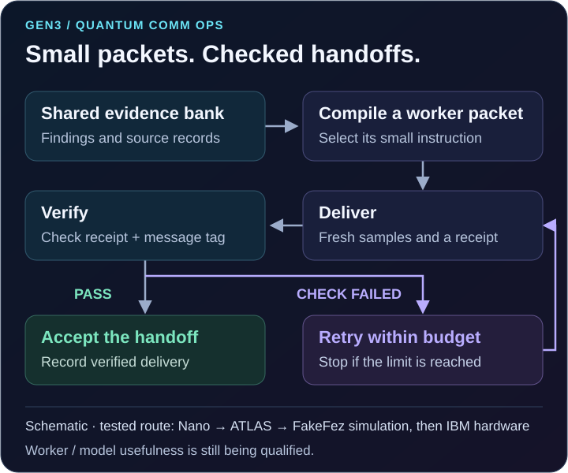</a>

### Measured on IBM hardware: 400 agents, 400 messages, one IBM job, five seconds

**What the mission is, in plain words.** Picture a team of **400 AI worker agents**. Each one needs its own short briefing before it can start its task. Quantum Comm Ops writes those 400 briefings, sends each one through an IBM quantum computer, and checks that every agent received exactly the briefing meant for it.

- Each briefing is a **96-bit message**. It is cut into three small pieces and each piece becomes one tiny quantum circuit, so a mission is **1,200 circuits**.
- The quantum computer runs each circuit a few times (**shots**) and reports the bits it read. A majority vote over those readings gives the bits of the message.
- Each message carries a **check code** (a 32-bit tag), like a tamper seal. The receiving agent recomputes the code with its key; if it does not match, the message is refused and that agent's pieces are re-sent.
- IBM also returns a **signed receipt** for the job. Predator stores it so the delivery can be re-checked later.
- **"400/400 verified"** means all 400 agents got a message whose check code matched, so every briefing arrived intact. **"First try"** means no agent needed a re-send.

In this research the 400 agents are **scripted agents** (stand-ins, not 400 reasoning language models). The test measures message delivery. Whether a model can use the briefing well is tested separately (see "Evidence flows onward" below).

**What happened, October 31 – November 1, 2026.** The mission that previously ran on a simulator now runs on real IBM quantum hardware, and the whole thing fits in **one IBM job billed 5.0 seconds of quantum-computer time**. Every run was preregistered and rehearsed on the simulator first; the attempts that missed their targets or did not run are listed below and in the [guide](docs/research/quantum-comm-ops.md#ibm-hardware-missions).

| What we measured | Measured on a simulator (Oct 31) | Measured on IBM hardware (Oct 31 – Nov 1) |
| :--- | :--- | :--- |
| **Agents whose message arrived intact on the first try** (out of 400) | 400, 400 and 399 on three runs | **400 on all five runs**: three different message sets on ibm_kingston, then two runs with a secret key (ibm_kingston, then ibm_fez) |
| **After one re-send** | 400 on every run | 400 on every run; no re-send was needed |
| **IBM jobs per mission** | 1,200–1,203 | **1** (all 1,200 circuits in one request) |
| **Quantum-computer time IBM billed** | — (simulator) | **5.0 seconds**, down from **162 seconds in 81 jobs** when the same mission first ran on ibm_fez |
| **Wrong bits after the majority vote** | 1 wrong piece in three runs | **0 wrong bits in 480,000 readings** across the five runs; before the vote, 0.41–0.52% of single readings were wrong |
| **Secret key check** | — | With the wrong key, **0 of 400** messages pass the check (as intended); a scan of the run's files found the secret nowhere |
| **Does packing save money? Three circuits, same device** | — | Sent as one job: **2.0 s**. Sent as three jobs: **6.0 s**. Same result in both orders (ibm_fez) |

**Why it got cheaper.** IBM bills by the second of quantum-computer time, and it charges much less for 1,200 small circuits in one job than for the same circuits spread over many jobs. The saving is **IBM's billing for batched circuits**, not a quantum speed-up: the circuits here carry ordinary, known bit patterns. The 162 → 5 s comparison also mixes different devices, days and shot counts; the clean like-for-like test is the three-circuit row above.

**What did not work.** A one-job run at three shots had 395 and 392 of 400 messages arrive intact on the first try, below its target of 396 (a re-send fixed the rest; five shots fixed the problem for good). A compiler setting that looked better on paper did no better on the real device and was dropped. One ibm_kingston job waited eleven hours in the queue and was cancelled. One ibm_marrakesh job was stopped by a time limit we had set too low. IBM finalized both on November 2: the cancelled job at 0 seconds (its 30-second reservation released) and the stopped job at 5 seconds (settled), so the hardware programme total stays at **254 of the 600 free seconds**.

  <a href="docs/research/quantum-comm-ops.md#ibm-hardware-missions">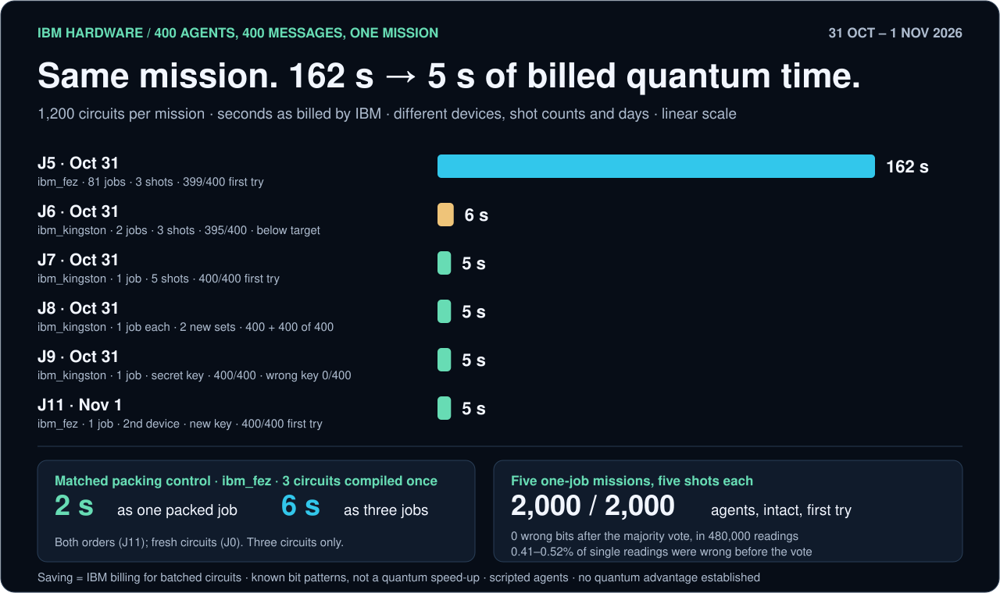</a>

**Evidence flows onward.** Four of the hardware-delivered briefings (one from ibm_fez, three from ibm_kingston under the secret key) were re-checked from their signed receipts, decoded, matched to the shared evidence bank, turned into a compact typed message, read by a frontier model, and the model's answer was scored by a deterministic checker: **4 of 4 correct end to end**. The typed-message format itself passed **12 of 12 held-out tasks** with zero formatting errors. The whole hardware programme used **254 of the 600 free seconds** on IBM's open plan and about **$18.65 of a $50 model budget**.

The simulator milestone it builds on, **three fresh 400-agent runs at three shots with a capped six-shot re-send** (1,199 of 1,200 intact on the first try, 1,200 of 1,200 after re-send), remains the research baseline and is kept in full in the [guide](docs/research/quantum-comm-ops.md#earlier-simulator-milestone).

### Measured on fixtures, no quantum-computer time: what the agents measured

The delivery step is measured on IBM hardware (five one-job missions, 400 of 400 each). On November 1 the programme measured the **agents** on either side of it. Everything in this table is *measured on fixtures, no quantum-computer time*: fixture tasks with known answers, scored by a deterministic checker. The work follows the same [lockpick](#crucible-adaptive-quantum-threat-modeling) that Crucible already uses. In plain words:

| Lockpick | What it means for the 400-agent loop | Measured November 1 (fixtures, no quantum-computer time) |
| :--- | :--- | :--- |
| **Hold tension** | The shared evidence bank holds every verified record with its receipt; a stronger **encoder** picks each agent's briefing from it, and the **compiler** filters what reaches the agent | **MET for the encoder; the selection-to-agent gate was met only with the compiler filter, not as first registered.** The encoder put about **87%** of an agent's relevant records in its top eight within the agent's evidence pool (keyword search: 38%). A scripted agent verified **5 of 110** briefings without the compiler filter and **99 of 110** with it. [Details in the guide](docs/research/quantum-comm-ops.md#agent-lanes-november-1-2026-evening) |
| **Feel many pins** | 400 cheap agents each take one briefing (one IBM job, 5 s) and report **HIT / MISS / REJECT** with a short reason | **NOT MET on price.** The best mid-cost model verified **12 of 12** test tasks at about **63%** of the frontier model's price; a free-tier model **7 of 12** at about **2%**. The target was 11 of 12 at a quarter of the price or less. [Details in the guide](docs/research/quantum-comm-ops.md#agent-lanes-november-1-2026-evening) |
| **Keep the pins that bind** | The program's own check decides; a verdict is recorded only when it type-checks and its receipt matches, and agents that disagree are recorded as a split rather than averaged away | **MET.** A plain majority was right on **9 of 12** test tasks; a reliability-weighted vote reached **12 of 12**. [Details in the guide](docs/research/quantum-comm-ops.md#agent-lanes-november-1-2026-evening) |
| **Set the binding pin** | Stop narrowing once the few real leads are known; each survivor gets a **deep cell**: a "think longer" model plus a frontier model working that one lead | **NOT MET for the "think longer" model.** It verified **0 of 12** at every depth tried, so deep cells stay frontier-only. A harder task family was found where the frontier model alone verifies **2 of 12**. [Details in the guide](docs/research/quantum-comm-ops.md#agent-lanes-november-1-2026-evening) |
| **Only as many hands as we have** | Deep cells open only up to the machines we actually have; leads that cannot be deepened yet wait with their evidence intact | **NOT RUN.** The narrow-then-deepen comparison stopped at its **$5** cap before any deep cell opened; the mid-cost model verified **9 of the 9** leads it reached and 15 are waiting. [Details in the guide](docs/research/quantum-comm-ops.md#agent-lanes-november-1-2026-evening) |
| **Next cycle** | Each cycle's verified records feed the next cycle's briefings, so the bank deepens where the lock is binding | **MET on fixtures.** Three cycles over the same 40 fixture chains: first-try verified **24 → 38 → 39 of 40**, cost per verified record **0.45×** of cycle one. Fresh, non-fixture tasks are still open. [Details in the guide](docs/research/quantum-comm-ops.md#agent-lanes-november-1-2026-evening) |

  <a href="docs/research/quantum-comm-ops.md#agent-lanes-november-1-2026-evening">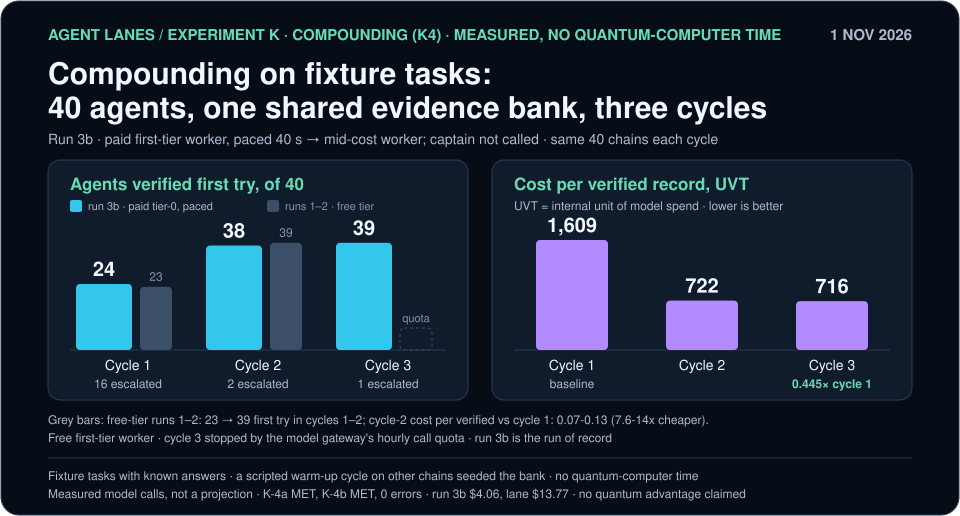</a>

**What one cycle looks like now.** The shared bank feeds the encoder; the compiler filters what each agent sees; the 400 briefings go out in one IBM job; verified records come back into the bank with their receipts; disagreements go to a weighted vote; and the next cycle starts from a deeper bank. The delivery step is *measured on IBM hardware*; the encoder, filter, vote and compounding steps are *measured on fixtures, no quantum-computer time*; the deep cells on surviving leads are **NOT RUN**. The stages were measured separately; no cycle has yet run with the hardware delivery step inside it.

  

Why this matters for a real security mission: a cheap agent that cannot tell a hard lead is real discards it, so a loop that only narrows would find the easy findings and lose the hard ones; deepening on survivors is the untested hypothesis for setting those. For scale, the worker survey projects about **$4 of model calls plus 5 seconds of quantum-computer time** for a 400-agent round with the first-tier worker alone (one call per agent, no escalation), against about **$18** with a frontier model on every agent; the measured third cycle above implies roughly **$9–10** per 400 verified records with escalation. These figures are *modelled* from measured per-call costs, not a measured 400-agent mission.

The agent lanes cost about **$24** of model calls; **$42.50** of the model budget has been used in total (the cap was $50 at the time; see the November 3 raise below).

### First compounding mission (November 3–4, 2026)

**One 40-agent, three-cycle mission ran all four lanes and sealed them into one package**: 249 records that verify **PASS** with the mission key and **PASS_UNSEALED** without it (Merkle root `sha256:63468836…`; the key is held off-repo).

- **Attack** (*measured on fixtures, no quantum-computer time*): Qwen3.5-27B on one rented H100; first-try verified **27 → 33 → 34 of 40**, cost per verified 652 → 490 → 467 units (GPU time expressed in the gateway's cost unit, UVT); K-4a **NOT MET** (0.716× where 0.5× was needed), K-4b **MET**.
- **Repair** (*scripted*): a deterministic re-route of each verified path, 100 counterfactual pairs; no model is involved.
- **Model** (*measured on fixtures, no quantum-computer time*): the frontier model may edit the weights of Qwen3.5-0.8B, which loops to its 512-token cap on 756 of 756 generations (252 tasks × 3 seeds), on CPU and GPU (L-1a **MET**: the failure is reproducible, the precondition for a repair attempt). Both cycles spent their caps on diagnosis and proposed no patch (L-1b **NOT MET**). **No model was changed.**
- **Communication** (*measured on IBM hardware*): 397 signed control frames carrying evidence references only, sent over ibm_fez in 6 jobs (3 first-pass, 3 re-send). On the first pass **371 of 397** arrived intact; the other 26 failed their tag check (bit errors caught, never accepted) and all 26 were recovered by a re-send at 10 shots, giving **397 of 397** decoded bit-exact and verified after rescue, in **23.0 s** of a 60 s line on IBM's free open plan. A transport test, not a speed claim.
- **Hosted economics, M2** (*measured on fixtures, no quantum-computer time*): on one rented H100 at $4.41 per GPU-hour, one 40-agent cycle of the 27B verified 32 of 40 at **$0.0217** of GPU time per verified agent (the 9B: 18 of 40 at $0.0118). The gateway's November 1 reference cycle (a mini first-tier model with GLM-5.3 on escalation) verified 40 of 40 at $0.0536. The hosted figures count only each phase's GPU time; setup, model loading and idle time (about $5 of the estimated $9.08 rental) are left out, so this is not a full cost comparison. M-2a **NOT MET** (best survey 6 of 12 with thinking off; 11 needed). The deep-cell lane stays **NOT RUN**: it needs a promoted patch first.
- **Spend**: model API ledger **$46.68** across the whole programme ($4.18 of it in this mission) against the $70 stop; GPU about **$9.08** estimated (invoice pending); **23.0 s** of quantum-computer time.

[What ran, how to check the package, and what it does not show →](docs/research/quantum-comm-ops.md#first-compounding-mission)

### Built and reviewed offline: Experiments L and M (November 3, 2026)

Two experiments were built and reviewed offline on November 3, before anything paid ran (0 new IBM seconds, 0 GPU hours at that review). Since then the model lane and the GPU rental have run in the [first compounding mission](#first-compounding-mission) above; the rest stands as reviewed. Each item below carries its legend label.

**Experiment L: four parts** (they carry the attack, repair, model and communication lineages).

- **Model lane** (*built, not yet run* on November 3; *measured on fixtures, no quantum-computer time* since November 4, in the [first compounding mission](#first-compounding-mission)). A frontier model is allowed to propose an exact edit to at most 1 % of the weights of a 0.8-billion-parameter open-weight local model that keeps failing the same way (looping, invalid output, invented steps). A separate judge process, which the proposer never sees, scores the patched model on hidden tasks (36 unseen, 3×40 adjacent). Promotion needs at least 4 more unseen tasks solved, at most 1 adjacent task lost, and no rise in the output-length cap rate. An offline rehearsal with a stand-in model promoted one patch and rejected a repeat. On the real model it has now run: the baseline (L-1a **MET**) and two programmer cycles that proposed no patch (L-1b **NOT MET**), so no model has been changed. The promotion receipt is sealed with a key kept out of the repository. An independent review found that the proposer's sandbox could reach the repository and the hidden tests; that was closed before any run.
- **Control packets** (*measured on fixtures, no quantum-computer time*). 96-bit signed messages carrying a lane, an operation, a cycle number, a 32-bit fingerprint of the evidence record, and a 32-bit tag. A packet carries a reference, never a payload. **1,200 of 1,200 accepted; wrong key, 0 accepted; any flipped bit, 0 accepted; replays, 0 accepted** (gate L-2a **MET**). Of those, 378 packets point at real earlier records and 822 at ids minted for the test (*scripted*).
- **Sealed research package** (*measured on fixtures, no quantum-computer time*). Every patch, evaluation and message is chained by hashes under one root; a 15-check verifier refuses a package in which a rejected patch was used as a parent. **147 records PASS; corrupting any one of the 87,304 bytes of its lineage and manifest files fails it** (gate L-3a **MET**).
- **Scale model** (*modelled*, plus one fixture dry run). A 400-agent, three-lane round costs about **$30 of model calls (modelled)**; the limits are the model gateway's hourly call quota (about 90 calls an hour, so about 10.7 hours per round) and the frontier model's monthly allowance (one round uses about 0.4 of a month), not IBM time. The IBM part is about **4 jobs, about 20 seconds (modelled from the measured 5-second job)** (the IBM-leg preregistration later corrected this to about 9 jobs, because a control frame needs 8 circuits). A 40-agent, three-lane dry run passed: 379 packets, 8 of 8 operations, package verified (gate L-4a **MET**, *measured on fixtures, no quantum-computer time*).

**Experiment M: economics and the model switch.**

- **Economics** (*modelled, not measured*). No measured token counts exist yet, so internal cost proxies are used. Calling a mid-cost model through the gateway costs about **$0.063 per verified result**. That is cheaper than renting GPUs for a full-size open-weight model (about **$0.118 per verified result** on twelve rented GPUs) unless GPU rent falls to about **$1.25 per GPU-hour** or the gateway's per-call cost rises about threefold above its calibration (about 1.6× above the projected in-situ cost). The gateway's rate limit (about 90 calls an hour) makes a single-lane 400-agent round take about **6 hours** (three lanes: about 10.7 hours, as above). A batched 9-billion-parameter model would cost about **$1.72 per round**, but its verified rate is unmeasured. The one-GPU rental that measures this (M2) has now run on one H100 (M-2a **NOT MET**; see the [first compounding mission](#first-compounding-mission)).
- **Model switch plumbing** (*measured on fixtures, no quantum-computer time*). A registry names sections of a model's weights. Two new packet operations: "switch model" and "carry this patch's intent to another model". Weights never move between models; knowledge moves as a patch specification that is re-derived in the destination model. A Q-step (a small QUBO selection, the scorecard described at the top of this page) picks the model and section. **40 + 40 packets, 462 frames, 0 unexpected rejects, 10 of 10 operations, package verified** (M-3a **MET**). The Q-step agreed with the plain rule on 10 of 12 cases, matched a classical control that sees the same evidence-size factor (lowest cost per expected gain plus a knapsack fill) on 12 of 12, and modelled about 1 % lower cost per expected verified result (M-3b **MET**). Honest reading: it wins only because it sees evidence size, which the plain rule ignores.

**Tests and budget.** 300 tests across L and M, all passing offline at the M pin. **$42.50** of model spend used; the cap was raised from $50 to $75 on November 3 to fund the first real model-lane cycle. 0 new IBM seconds, 0 GPU hours at that review (the mission's spend is listed above).

[Details and source pins →](docs/research/quantum-comm-ops.md#experiments-l-m)

**Still open, in order:** a model-lane cycle that reaches a patch the evaluator can judge (it is also the entry condition for the deep-cell lane); the 400-agent rung with the communication lane on hardware; the narrow-then-deepen comparison at matched budget (it needs a higher cap than the $5 it ran under); the stronger encoder *inside* a live compounding loop; gating or replacing the cheap first-tier worker above about 20 evidence rows; then the repeat on ibm_kingston after a fresh calibration, packing beyond three circuits, real key management, and production dispatch. The tested **superposition multiplexing** idea (several messages in one circuit) ran on hardware but did not beat ordinary packing as a way to *carry* messages; whether it helps *choose* between disagreeing agents is still to be tested against a plain vote on hardware (on a classical simulator a quantum-style selector only matched the weighted vote).

As of November 3:
**Status, November 3, 2026:** the 400-agent delivery mission is measured on IBM hardware, including what IBM billed, and the two reserved hardware attempts are finalized by IBM. No quantum advantage is claimed or demonstrated: the saving is IBM's billing for batched circuits that carry known bit patterns. Scripted agents, one synthetic message generator, two devices, one day each; the agent lanes are measured on fixtures, no quantum-computer time. Experiments L and M are built and reviewed offline; nothing paid has run. The separate joint5 compiler pilot is described below.

**Update, November 4, 2026:** parts of L and M have now run in the [first compounding mission](#first-compounding-mission): one sealed 40-agent, three-cycle package, with the communication lane's 397 frames carried over ibm_fez in 23.0 s (371 on the first pass; the other 26 failed their tag check and were rescued by a re-send; 397 of 397 after rescue). No model was changed, and the deep-cell lane is NOT RUN.

**[Plain-English guide, hardware missions and open questions →](docs/research/quantum-comm-ops.md)** · [Public aggregate data and source pins](docs/research/quantum-comm-ops.json)

## joint5 compiler and the IBM Fez result

**joint5 changes how a quantum circuit is built.** AQRC translates the QUBO scorecard into instructions that a simulator or device can run. joint5 is an alternative compilation path. Fewer native two-qubit gates mean fewer hardware instructions involving a pair of qubits. Answer quality is measured separately against the same scoring problem.

### The IBM Fez hardware pilot

**What was measured.** The joint5 pilot compared ordinary and joint5 compilation on IBM Fez: one six-variable fixture, its vulnerable and fixed poles, four circuits, and 1,024 shots per circuit in one hardware job (3 seconds of billed QPU time).

| Measurement | Ordinary → joint5 | Change |
| :--- | :--- | :--- |
| Native two-qubit gates, each pole | **144 → 103** | **28.5% fewer** |
| Distance from ideal output, vulnerable pole | **0.3952 → 0.3165** | **19.9% lower** |
| Distance from ideal output, fixed pole | **0.4039 → 0.3080** | **23.7% lower** |

Lower total-variation distance means closer agreement with the ideal output distribution. **Expected energy worsened on both poles.** The pilot records one acquisition without independent confirmation. Improved minimization and quantum advantage remain unestablished.

[Measurements and uncertainty →](docs/research/ibm-fez-pilot.md) · [Full-precision data →](docs/research/ibm-pilot.json)

<strong>How the search and compiler scale (measured on a simulator)</strong>

### How the search and compiler scale

An **October 20, 2026 synthetic sweep** asked two separate questions: how close do the sampled answers get to the best score, and does joint5 save hardware instructions as the choices grow? These were simulator and compilation tests, separate from the IBM Fez acquisition above.

  <a href="docs/research/search-scaling.md">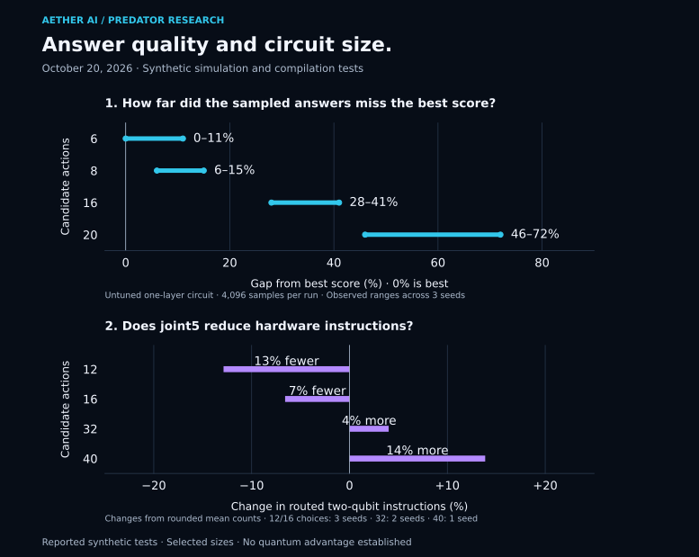</a> 
  Answer quality and circuit size are different measurements. Selected sizes shown; full tables, methods, and limits are linked below.

The proposed upgrade is simple: **compare both circuit layouts, keep the smaller one, and use a suitable local simulator for quantum experiments.** Ordinary computer search keeps choosing the next move until another method earns that role in a fair comparison. These are design recommendations; the sweep does not establish that the upgrades have shipped.

[Scaling tests: plain-English guide and full tables →](docs/research/search-scaling.md) · [Chart data →](docs/research/search-scaling.json)

## Gen3 OSS: banked scientific results

**Two open-source test cases, published with their data and their limits.** CharLS and QPACK carry deliberately introduced faults, so the loop can be scored against a known answer. “Banked” means the result and its evidence are retained and can be checked.

<table>
  <tr>
    <th width="50%">CharLS Q3 repair</th>
    <th width="50%">QPACK feedback study</th>
  </tr>
  <tr>
    <td width="50%" valign="top"><a href="docs/research/charls-q3.md">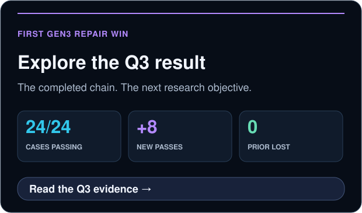</a></td>
    <td width="50%" valign="top"><a href="docs/research/gen3-qpack-experiment1.md">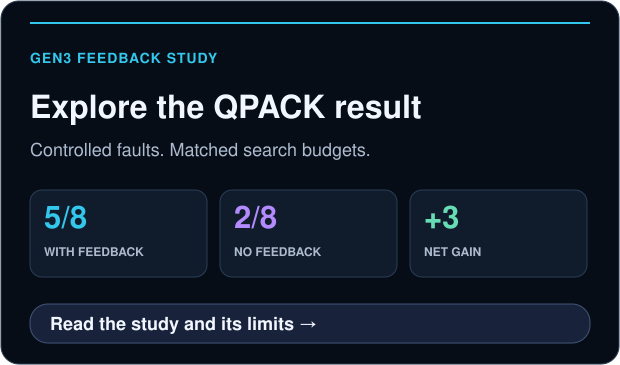</a></td>
  </tr>
</table>

| Study | Recorded result | What it shows |
| :--- | :--- | :--- |
| **[CharLS Q3 repair](docs/research/charls-q3.md)** | **16/24 → 24/24** protected passes; eight gained, all earlier passes retained | The ratchet working as described above: a dependent repair at depth 3 closed the obligation left by depth 2, on real C++ source, without dropping a single earlier pass. |
| **[QPACK feedback study](docs/research/gen3-qpack-experiment1.md)** | **5/8** controlled faults found with feedback, versus **2/8** without it | A second pass at the pins, informed by the first pass's native checks, found more than one pass alone in this exploratory campaign. The adaptive classical comparison was incomplete, so the quantum selector's own contribution was not isolated. |

Both studies used deliberately introduced faults. A newly discovered CVE finding has not been published. Discovery, matched comparisons, and quantum advantage remain active research objectives.

## Ways to work with Aether

Commission a focused repository mission, qualify a repeatable security profile, or scope an authorized live assessment.

<table>
  <tr>
    <td width="50%" valign="top"><a href="https://aethersystems.net/strikes/">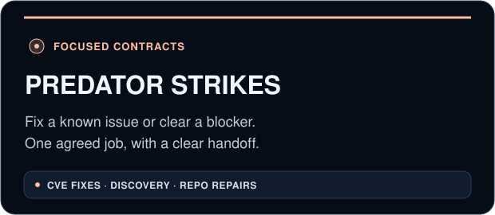</a></td>
    <td width="50%" valign="top"><a href="https://aethersystems.net/actions/design-partner">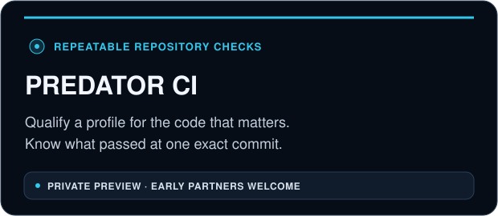</a></td>
  </tr>
</table>

| Path | Best fit | Start here |
| :--- | :--- | :--- |
| **Predator Strikes** | A known CVE fix, focused discovery, or chain analysis for one agreed repository surface | [Discuss a Strike →](https://aethersystems.net/strikes/) |
| **Predator CI** | Repeatable checks against a qualified repository profile and exact commit; private preview | [Qualify a profile →](https://aethersystems.net/actions/design-partner) |
| **Predator Red Team** | An authorized assessment of a live environment, with reviewed findings and remediation | [Scope an assessment →](https://aethersystems.net/defense-stack) |

Agree on the surface, acceptance checks, and handoff before work begins. Live assessments also require approved targets, methods, timing, contacts, and stop conditions. The linked service pages list current pricing and terms; broader engineering work starts with a [project inquiry](https://aethersystems.net/contact).

> **[Read the safety model →](SAFETY.md)** Human-approved scope and budgets bound each run. Memory, model suggestions, and quantum results supply evidence; authority comes from the approved mission. The guide distinguishes required policy from controls proven in code.

## Join the community

Ask about the published studies, suggest a public demo, or share feedback in [GitHub Discussions](https://github.com/AetherAI3/Predator/discussions). Use [issues](https://github.com/AetherAI3/Predator/issues/new/choose) for concrete documentation corrections.

[Contributing guide](CONTRIBUTING.md) · [Community guidelines](CODE_OF_CONDUCT.md) · [Security reporting](SECURITY.md)

## Developers: join the research program

Help build the CLI, repair chains, verification tools, or classical/quantum comparisons. Tell us what you have built and where you want to contribute. Private research access is reviewed separately.

[Apply to join →](https://aethersystems.net/contact?intent=general&product=site_wide&cta=footer_updates_contact)

### Predator R3D and Predator BLU3

  
  

**Two authorization gates for Gen3 in the private Predator CLI.** Request access to **Predator R3D** or **Predator BLU3** from the CLI. Access requests are reviewed separately from developer-program applications.

  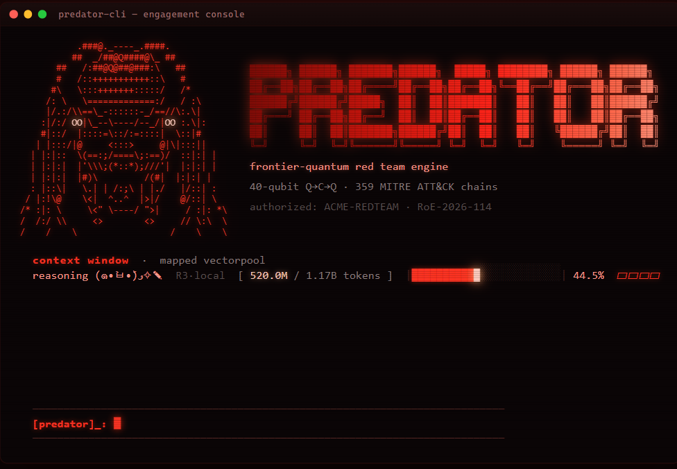 
  Predator CLI console preview · illustrative layout and counters

## Glossary

| Term | Plain English |
| :--- | :--- |
| **shots** | How many times one quantum circuit is run and read out; a majority vote over the readings gives the answer. |
| **receipt** | A signed record that a step happened (an IBM job, a verdict, a message), kept so it can be re-checked later. |
| **fixture** | A task with a known answer, scored by a deterministic checker; used to measure agents without paying for quantum-computer time. |
| **scripted agent** | A stand-in that follows a fixed script; it is not a reasoning model. |
| **frontier model** | One of the strongest commercial models available; this page never names the product. |
| **mid-cost / free-tier model** | Cheaper models called through a model gateway; mid-cost is priced well below the frontier model, free-tier costs almost nothing. |
| **CFC** | Custom Fanout Controls: the settings that decide how many candidates to open, how long to look, and when to stop. |
| **QUBO / energy** | A scorecard for yes/no choices that interact; energy is the score, and lower is better. |
| **packet** | A short signed message (96 bits) that tells an agent which record to use; it carries a reference, never the record itself. |
| **lane** | One stream of Predator work: bounty, open-source (OSS), mission or training. |
| **evidence bank** | The shared store of verified records, each with its receipt, that briefings are built from. |
| **promotion** | Accepting a change, such as a weight patch, because it passed the judge's preregistered gates. |
| **modelled** | Arithmetic from measured per-unit costs; not a run. |

## Read the evidence

| Start with | Then explore |
| :--- | :--- |
| **[P-BOX feature showcase](#p-box)** | VM lifecycle, operator control, and recorded guest session |
| **[HTB training evidence](docs/htb/README.md)** | Courses, tracks, machines, certificates, and replay index |
| **[Crucible](#crucible-adaptive-quantum-threat-modeling)** | The loop explained as a lockpick, with [MITRE chains](#mitre-attck-chain-library) and the [CVE catalog](#cve-research-catalog) it draws on |
| **[CodePro and System-2](#codepro-and-system-2)** | How the fanout runs, and the private CLI around it |
| **[Quantum Comm Ops](docs/research/quantum-comm-ops.md)** | Agent mailboxes, adaptive CFC, packing and multiplexing; [the 400-agent message mission on IBM hardware](docs/research/quantum-comm-ops.md#ibm-hardware-missions), [Experiments L and M, built and not yet run](docs/research/quantum-comm-ops.md#experiments-l-m), and [aggregate data with source pins](docs/research/quantum-comm-ops.json) |
| **[CharLS Q3](docs/research/charls-q3.md)** | [Public data](docs/research/charls-q3.json) and the completed dependent repair |
| **[QPACK study](docs/research/gen3-qpack-experiment1.md)** | [Episode data](docs/research/gen3-qpack-experiment1.json), comparisons, and missing outcomes |
| **[joint5 IBM Fez pilot](docs/research/ibm-fez-pilot.md)** | [Public data](docs/research/ibm-pilot.json), uncertainty, and the energy regression |
| **[Generations](docs/research/generations.md)** | [Generations in plain English](#generations-in-plain-english), the triggers for Gen4, sources, and the requirements for promoting research into qualified profiles |
| **[Predator safety model](SAFETY.md)** | Required boundaries and the status of implemented controls |
| **[Unlimited Context](https://github.com/AetherAI3/Unlimited-Context-LLM)** | [How it works](https://github.com/AetherAI3/Unlimited-Context-LLM#how-it-works) and [safety measures](https://github.com/AetherAI3/Unlimited-Context-LLM/blob/main/SAFETY.md) |

Public overview and selected research notes · Private operator engines © 2026 Aether AI LLC. All rights reserved. IBM is identified as a hardware provider; no affiliation or endorsement is implied. <a href="docs/assets/SOURCES.md">Visual sources</a>.

