

   
  <strong>AETHER AI · PREDATOR</strong>

  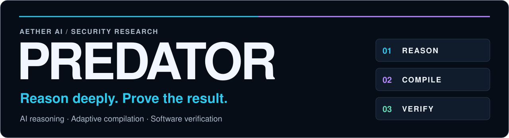

  
  
  

# Predator

**AI security research, software repair, and authorized VM workflows.**

### Where Predator is today (November 2026)

| When | What happened | What it showed |
| :--- | :--- | :--- |
| **March 2026** | Predator starts as a [Gen2](#generations-in-plain-english) project: AI- and quantum-assisted vulnerability analysis. | The idea. |
| **October 2026** | One-week sprint. Predator Drive ran end to end through MCP for the first time, across several private security sprints and Predator's first bounty missions outside open-source research. | Predator can run a full mission and turn up findings within days. |
| **Late October – November** | Gen3 [quantum comm ops](#gen3-quantum-comm-ops): 400 agent briefings sent in one IBM job billed at 5 seconds, 400 of 400 intact, repeated on three message sets (*measured on IBM hardware*). | Hundreds of agents can be coordinated cheaply through IBM hardware, every message checked. No quantum advantage: the saving is IBM's billing for batched circuits. |
| **November 2026** | Training our own small models on results the software verified (Experiments K–O, then Model-1). | A 2-billion-parameter model trained on 138 replies from a 9-billion-parameter model went from 5 to 62 correct on 108 new fixture tasks, above the larger model's 39.8 % (*measured on fixtures*); it learned the answer format, not a new skill. **Model-1** (9 billion parameters, small adapter, CPU cluster): November 11, **91 %** on 400 held-out synthetic cases against **49 %** untrained (the always-HIT score), every reply stopped cleanly; November 12, a second adapter on the same base drove every stage of a whole 400-pin synthetic mission (selection was the verifier's, solved on CPU), **1,995 of 1,995** proposals valid, **172 of 178** findings at 3 false alarms against the scripted rule's 156, preregistered **BEATS THE RULE** (*measured on fixtures*). One seed each, synthetic code, Phase A's few-shot and random-adapter controls not run; a fixture shortcut found afterwards means the gain over the rule is not yet shown to be tracing skill. [Details](#gen3-adaptive-training). |
| **Mid-November 2026** | The [self-improvement loop](#self-improvement-loop), Gen3 → Gen4 (design): meant to turn Model 1's failures into proven, replayable steps, then train them in. | First test (PL1, *measured on fixtures*): on Model 1's own stuck points, only the teacher's hint cleared the noise floor over a placebo; Nano's lockpick did no better than a random hint; where the evidence was already on screen, every hint verified 0 or 1 of 50. Our reading: the bottleneck is the decision. Next: train the decision (D1, preregistered, not yet run). No self-improvement shown yet. |

**Not there yet.**
- **No bounty has paid.** The October reports were closed as informational: no impact shown inside each program's rules. Next: a written authorization boundary per program and a stricter evidence check before anything is submitted.
- **The 2-billion-parameter model is not stable; nothing is promoted; no self-improvement yet.** The 2-billion-parameter rounds ran to the length limit more often (3.8 % → 12.2 % of prompts; **NOT MET**); a dose study found no dose that removes the looping; a stop-at-goal round (November 8) raised correct answers **2 → 42–46 of 96** but cut-offs **6 → 16–19**, so nothing was promoted; the frontier-model repair is *built, not yet run*. Model-1 stops cleanly and beat the rule on one synthetic mission, but one seed, no few-shot or random-adapter control, no real code: no general skill is claimed. The loop's first test found the decision, not the search, is the bottleneck; no generation has yet been trained on its own rescues.
- **Comm ops is not in the everyday mission path.** Its message bus is built and passed three of four shadow-mode gates (**MET**, one **NOT RUN**); it is not switched on. See [Status, November 8](#status-november-8-2026).

Source pins: the model result is `bench/qcomms/o_frame/REPORT_O.md` at private AETHER-PREDATOR-M commit `58ecf3db412feef68022cc4e88372567dd588f11`; the later rounds and the bus are pinned in the comm-ops [JSON](docs/research/quantum-comm-ops.json) (block `status_2026_11_08`); the IBM numbers are in [Gen3 Quantum Comm Ops](#gen3-quantum-comm-ops); Model-1 pins are in [its section](#gen3-adaptive-training).

### Start here

- **What Predator is.** A security research and repair system: AI models get persistent context and reviewed tool use, and only results the software itself confirms are banked.
- **What is public.** This repository is the showcase and evidence collection. The CLI and operator engines are private, with [reviewed research access](#developers-join-the-research-program).
- **Two kinds of text.** *Measurements* (numbers from runs, each labelled) and *how we think about it* (method, plans, hypotheses). Sections marked "built, not yet run", "design" or "as far as we can see" are the second kind.
- **Where the evidence lives.** Each study has a plain-English guide in [`docs/research/`](docs/research/) and a JSON file of aggregate data with source pins; see [Read the evidence](#read-the-evidence).

### How to read our numbers

| Label | Meaning |
| :--- | :--- |
| **MET** / **NOT MET** / **NOT RUN** | Every gate was preregistered before the run; the verdict is reported either way, misses included. |
| **measured on IBM hardware** | A run on a real IBM quantum device, with IBM's billed time and signed receipt. |
| **measured on a simulator** | A classical simulation of a quantum circuit (FakeFez models one IBM device). No hardware time. |
| **measured on fixtures, no quantum-computer time** | A run on fixture tasks: tasks with a known answer, scored by a deterministic checker. |
| **modelled** | Arithmetic from measured per-unit costs; not a run. |
| **built, not yet run** | Code exists and passed offline tests; nothing paid has executed. |
| **scripted agents** | Stand-ins that follow a fixed script; not reasoning models. |

Predator's research engine, **Crucible**, works like a lockpick: hold verified evidence steady, test candidate chains against the real software, and bank only what holds.

[How search works](#how-predator-chooses-the-next-move) · [P-BOX / HTB training](#p-box-htb-training) · [Gen3 Private Security](#gen3-private-security) · [Crucible](#crucible-adaptive-quantum-threat-modeling) · [MITRE chains](#mitre-attck-chain-library) · [CVE catalog](#cve-research-catalog) · [CodePro & System-2](#codepro-and-system-2) · [Generations](#generations-in-plain-english) · [Self-improvement loop](#self-improvement-loop) · [Quantum Comm Ops](#gen3-quantum-comm-ops) · [joint5 & IBM Fez](#joint5-compiler-the-ibm-fez-hardware-result) · [Results](#banked-scientific-results) · [Work with Aether](#ways-to-work-with-aether) · [Gen3 access](#predator-r3d-and-predator-blu3) · [Glossary](#glossary) · [Docs](docs/README.md)

## How Predator chooses the next move

**Ordinary computer search stays in charge; quantum experiments must earn a role with evidence.** The [tests described here](docs/research/search-scaling.md) have not shown a quantum advantage.

Predator picks from a menu of next moves that help, block or conflict with each other. A **QUBO** is the scorecard for those yes/no choices; **energy** is the score, lower is better. The score ranks candidates; only checks against the real software decide. Every run records which solver it used, including any quantum simulation or hardware.

[See the joint5 charts and measured limits →](#joint5-compiler-the-ibm-fez-hardware-result)

## P-BOX / HTB training

### [P-BOX] Predator's disposable Linux VM

**Give Predator a goal, confirm the VM, and watch it work.** P-BOX is a disposable Linux pwnbox for authorized CTF and HTB missions, spawned when a hosted Pwnbox is unavailable.

| What you can do | How it works |
| :--- | :--- |
| **Confirm and start** | You confirm the VM before Predator starts the approved mission. |
| **Work toward longer goals** | Predator runs reviewed terminal actions, reads fresh guest output, picks the next step inside the approved mission. |
| **Watch, take over, resume** | Watch live, take control, hand it back, or stop. |
| **Clean up automatically** | The VM's disk is removed when you stop it or its lease expires. |

*The recording below includes challenge spoilers and visible lab command history.*

  <a href="docs/htb/machines/ghostlink/README.md">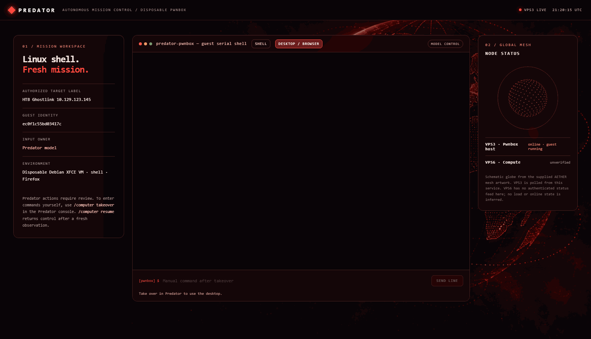</a> 
  P-BOX in action · Predator / GLM-5.3 · 670 recorded guest frames · <a href="docs/htb/machines/ghostlink/README.md">Ghostlink evidence and execution roles</a>

<strong>About this GLM-5.3 replay</strong>

The GIF is from **Predator's GLM-5.3 Ghostlink mission in P-BOX**: 670 recorded guest frames at 1600 × 920, blank browser-loading frames removed. The [frame provenance](docs/htb/machines/ghostlink/replay-provenance.json) records the retained source-frame hashes and GIF hash. The [machine guide](docs/htb/machines/ghostlink/README.md) separates GLM-5.3's research from the operator's later actions; the recorder stopped before the final user and root challenge-file reads, which are documented separately.

### Hack The Box: training and evidence

**HTB is the test and training ground for Predator's agent and VM workflows.** Two examples: autonomous VM command work, and saved lab research with completion records and execution roles.

*The Satellite replay includes challenge spoilers. Both GIFs are assembled evidence replays.*

<table>
  <tr>
    <th width="50%">Nmap course · autonomous VM work</th>
    <th width="50%">Satellite Exploitation · recorded lab work</th>
  </tr>
  <tr>
    <td width="50%" valign="top"><a href="docs/htb/academy/README.md">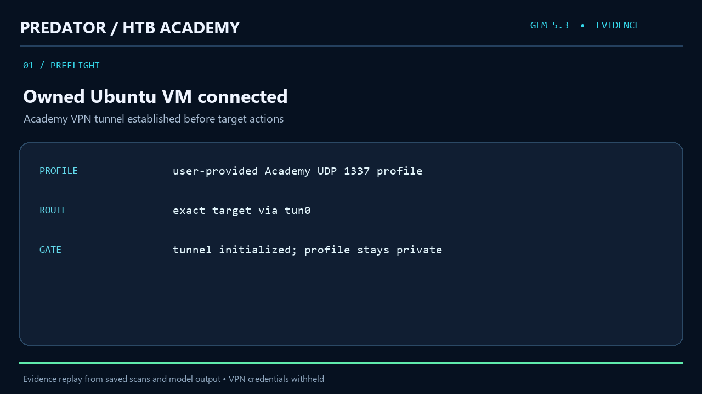</a></td>
    <td width="50%" valign="top"><a href="docs/htb/satellite-exploitation/README.md">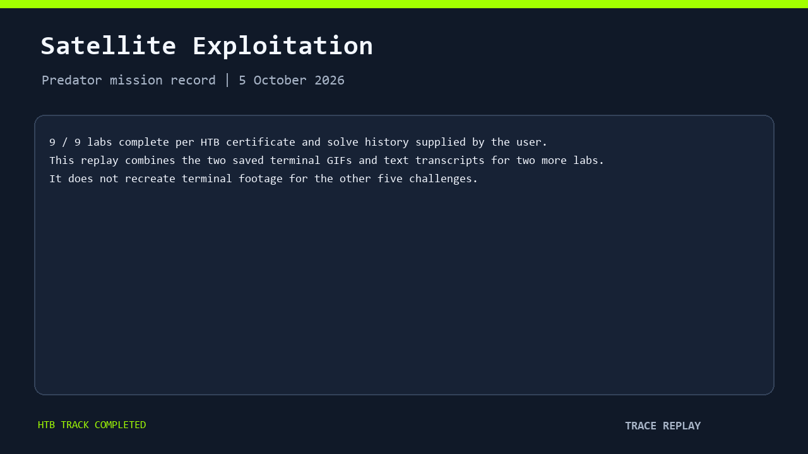</a></td>
  </tr>
  <tr>
    <td width="50%" valign="top"><strong>12/12 Academy sections completed.</strong> Predator through GLM-5.3 ran the VM commands autonomously; the owner supplied prompts and exercise questions and entered the answers. <a href="docs/htb/academy/README.md">Course record and replays →</a></td>
    <td width="50%" valign="top"><strong>9/9 labs completed.</strong> Certificate and account activity support completion; the replay covers four saved lab records. <a href="docs/htb/satellite-exploitation/README.md">Certificate, lab list, and replays →</a></td>
  </tr>
</table>

<strong>More HTB records and replay notes</strong>

| Module or track | Recorded progress | Open the guide |
| :--- | :--- | :--- |
| **Academy: Network Enumeration with Nmap** | **12/12 sections completed** · October 3, 2026 | [Completion record and two replays](docs/htb/academy/README.md) |
| **Satellite Exploitation** | **9/9 labs completed** · October 5, 2026 | [Certificate, lab list, and replays](docs/htb/satellite-exploitation/README.md) |
| **AI and ML Exploitation** | **1/17 labs HTB-accepted** · in progress | [Lab status and three replays](docs/htb/ai-ml-exploitation/README.md) |
| **Machine: BlockSynergy** | **User and root challenge files read** · October 5, 2026; owner confirmed | [Machine record and sanitized replay](docs/htb/machines/blocksynergy/README.md) |
| **Machine: Ghostlink** | **User and root challenge files read** · October 5, 2026; HTB submission unobserved | [Machine record and full-screen pwnbox replay](docs/htb/machines/ghostlink/README.md) |

The [earlier Pwnbox console preview](docs/media/predator-pwnbox-ttl-preview.gif) shows a separate reviewed guest-session check. AI/ML counts only HTB-accepted results. The machine guides separate Predator research from operator execution and say what each recording contains.

**[Browse all HTB modules, certificates, and replays →](docs/htb/README.md)**

## Gen3 Private Security

**Five scoped research records from October 2026, each with validation and disclosure status kept separate.** Gen3 names Predator's current research workflow and the evidence it leaves; it is a method, not a measured quantum advantage.

| Target | Public material | Status |
| :--- | :--- | :--- |
| **Vercel AI SDK** | [Redacted local P-BOX replay](docs/pbox-vercel-ai-sdk-showcase.md) | Verified local result with synthetic values; no production access. |
| **Gemini CLI** | [Sanitized Crucible sprint graphic](docs/assets/gemini-cli-crucible-sprint.svg) | Three private Google Cloud VRP reports under triage; no assigned severity or reward. |
| **GitLab Duo** | [Private-research tactic map](docs/assets/gitlab-duo-crucible-private.svg) | Owner-controlled local validation; no vulnerability report filed. |
| **GitLab for VS Code** | [Predator P-BOX research visual](docs/pbox-gitlab-extension-research-visual.md) | Private report filed; technical record private. |
| **Anthropic SDK** | [Conditional AX research map](docs/assets/anthropic-sdk-crucible-private.svg) | Three owner-controlled local paths from one shared boundary; no report filed. |

<strong>The five records, one by one (figures and disclosure limits)</strong>

### Vercel AI SDK: redacted local P-BOX replay

A **local security test of the Vercel AI SDK** in Predator's P-BOX. The public replay shows the disposable Linux desktop and a verified local result, with synthetic values; no Vercel production account or service was accessed.

  <a href="docs/pbox-vercel-ai-sdk-showcase.md">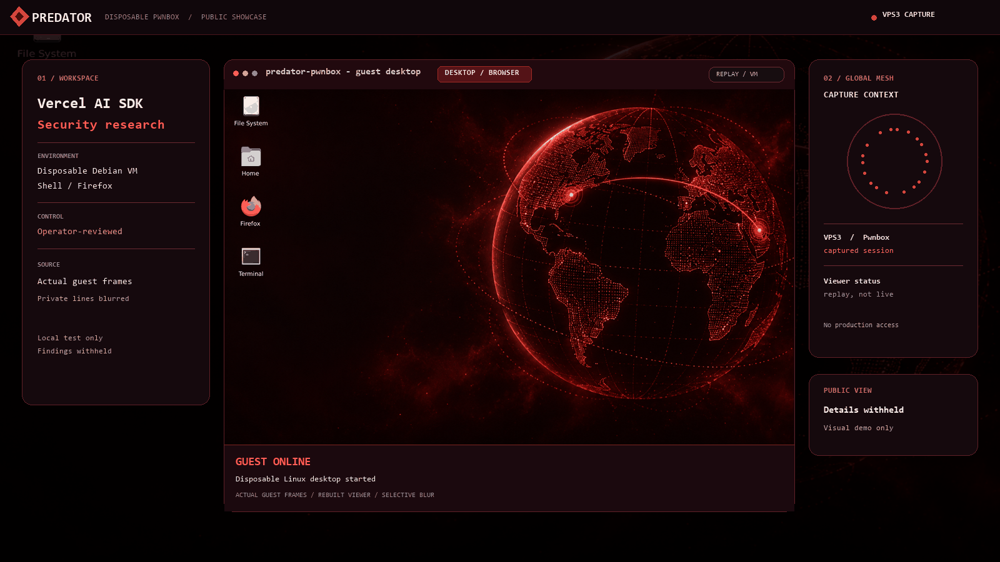</a> 
  Five actual guest captures · seven replay frames · selective FFmpeg blur · <a href="docs/pbox-vercel-ai-sdk-showcase.md">provenance and disclosure limits</a>

### Gemini CLI: private Crucible sprint

On **October 9, 2026** Predator's manual research workflow ran a deep Gemini CLI Crucible sprint across the **C1 → Q173 checkpoint span**. Three reports were filed privately with Google Cloud VRP that day; they remain under triage with no severity or reward assigned.

  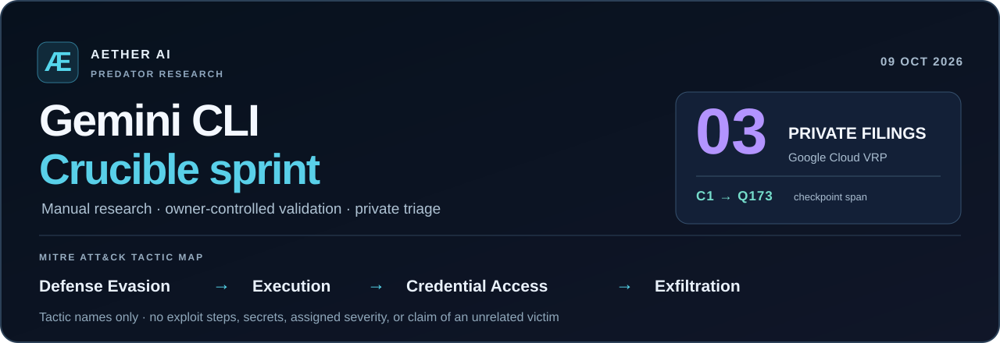 
  Public taxonomy only: Defense Evasion → Execution → Credential Access → Exfiltration. No reproduction details or credential material.

#### Sanitized research energy

  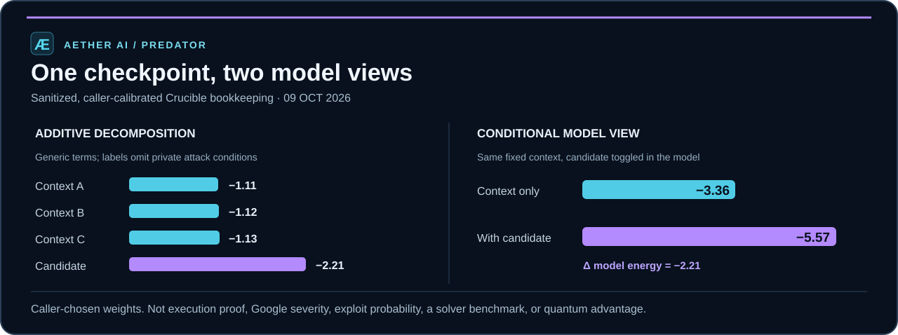

Two views of **one caller-calibrated model checkpoint**, private attack-condition labels removed. Its weights are research bookkeeping: they do not verify a finding, measure exploit probability, establish quantum advantage, or set a Google bounty tier. Validation evidence stays in the private reports while triage is pending.

### GitLab Duo: private Crucible research

An owner-controlled GitLab Duo sprint began **October 9, 2026**; the graphic is a **C1 → Q48 snapshot from October 10**; later manual checkpoints remain private. Labels mark research checkpoints, not executed quantum interventions or a paid CFC run. The local result maps at the [MITRE ATT&CK](https://attack.mitre.org/tactics/) tactic level to **Execution → Credential Access → Exfiltration**: a research map of an owned test, not a claim about an attack on another user.

**Private findings: technical details not disclosed, no vulnerability report filed, no severity or bounty assigned.** The saved evidence does not establish zero-click execution or a sandbox escape.

  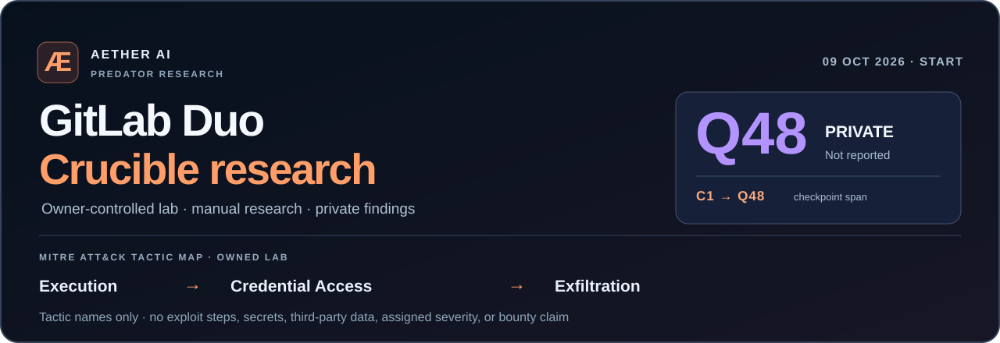 
  October 10 snapshot · owner-controlled validation · tactic names only · no reproduction steps, secrets, or third-party data

### GitLab for VS Code: private report filed

An owner-controlled research record was banked and a private report filed. Technical details and evidence stay private while disclosure is coordinated.

### Anthropic SDK: private Crucible research

On **October 10, 2026** Predator banked **AX001–AX003**: three conditional outcomes of one shared trust boundary in owner-controlled local fixtures, with public [MITRE ATT&CK](https://attack.mitre.org/tactics/) lenses **Collection**, **Credential Access** and **Execution**. Parallel research paths, not one attack sequence or three confirmed vulnerabilities. The evidence does not establish a deployed lower-trust writer route, Claude-selected tool action, real credential exposure, or deployed code execution. **No vulnerability report filed; no severity or bounty assigned.** Reproduction details private.

  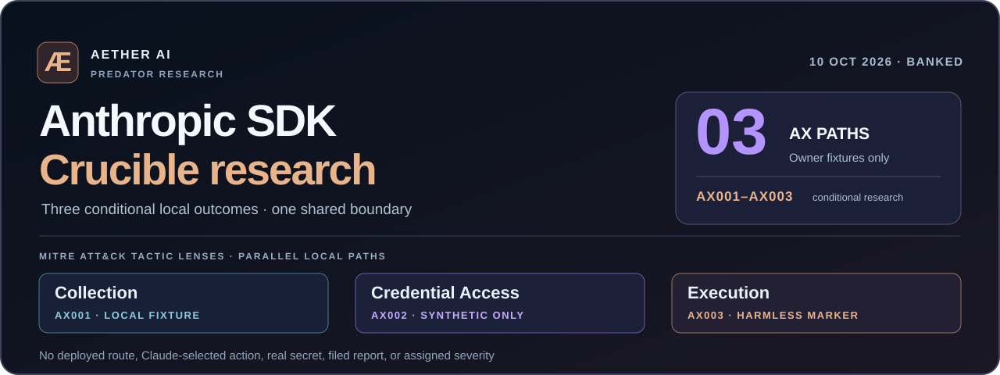 
  Owner-controlled fixtures · parallel tactic lenses · no reproduction steps, secrets, or third-party data

## Crucible: adaptive quantum threat modeling

**Think of a lockpick. Hold tension, test one pin at a time, keep every pin that sets.** Crucible starts from a pinned source revision, a defined question and fixed acceptance checks; nothing already verified can slip while the next candidate is tested.

  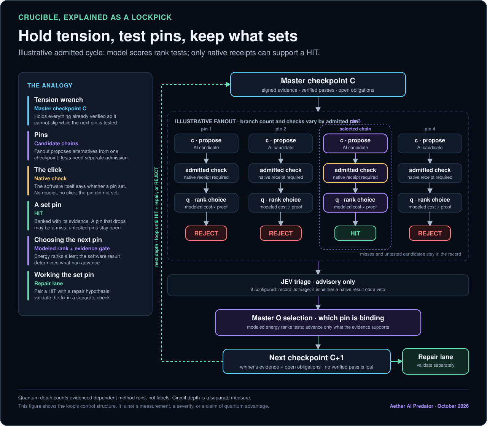 
  One depth step of the loop, drawn as a lockpick. Visual by Mythos 5.1.

The four pins show a **research design**, not four measured workers or native checks in every run. The [execution and evidence guide](docs/research/crucible-evidence-contract.md) separates the CFC selector, an admitted exploit ratchet and manual research, and defines the minimum candidate record and the native effect a zero-click claim needs. A model score, a worker proposal and a native result are different records.

<strong>The lock, part by part</strong>

### The lock, part by part

| In the lock | In Crucible | What it does |
| :--- | :--- | :--- |
| **Tension wrench** | **Master checkpoint (C)** | Holds verified evidence with provenance, signatures where present, passes that must not be lost, and open obligations. A manual checkpoint is not signed merely because it has a C label. |
| **Pins** | **Candidate chains** | Fanout proposes alternatives from a checkpoint. A proposal and its QUBO ranking do not imply a native check ran. |
| **The click** | **Native check** | The software itself says whether a pin set. No native receipt, no click. |
| **A set pin** | **HIT** | Banked only with a native receipt. Misses, refutations and inconclusive results stay in the record with their limits. |
| **Choosing the next pin** | **QUBO selection and evidence gate** | Modeled energy ranks a test; native outcomes decide. JEV participates only when an admitted stage records a typed call and its usage; its decision is advisory. |
| **Working the set pin** | **Repair lane** | Pair a supported attack observation with a repair hypothesis and regression plan. A fix counts only after its own check. |

<strong>What happens in one cycle</strong>

### What happens in one cycle

| Step | What happens |
| :--- | :--- |
| **Pin** | Freeze the source revision, scope, evidence and acceptance checks. The tension. |
| **Fan out** | Open several small candidate chains; each proposes a threat path or repair. |
| **Model** | State target facts, choices, constraints and provenance. A bounded QUBO can rank tests; not every library chain has a populated energy profile. |
| **Search** | Record the solver actually used. A classical minimum is valid; a simulator or quantum device is a separate, evidenced run. |
| **Validate** | Run the admitted native check and keep its receipt. A proposal without that check remains a hypothesis. Record HIT, miss, refutation or inconclusive accurately. |
| **Select and carry** | Carry supported evidence and open obligations into the next checkpoint. Verify any repair separately. |

<strong>Quantum depth: how cycles chain together</strong>

### Quantum depth

Each cycle leaves a checkpoint; each checkpoint seeds the next intervention. A failed check can reveal a missing constraint or a repair obligation that shapes the next pin.

**C0 → Q1 → C1 → Q2 → C2 → Q3 → C3**

| Label | Meaning |
| :--- | :--- |
| **C** | A saved evidence checkpoint. The tension at that depth. |
| **Q** | A dependent quantum-method intervention when one actually ran. Manual C/Q shorthand can label research stages; the label alone is not an execution receipt. |
| **Quantum depth** | How many evidenced, dependent quantum-method interventions ran in one chain. Circuit depth is a different number: the size of the circuit inside one intervention. |

The **ratchet** keeps verified earlier results and negative evidence visible while the next candidate is checked; it does not guarantee the next candidate passes. In the [CharLS case](docs/research/charls-q3.md), Q3 used C2's remaining repair obligation to move from **16/24 to 24/24** protected test passes, keeping all 16 earlier passes.

[Generations in plain English, triggers for Gen4, sources →](docs/research/generations.md)

<strong>Methods, evidence, and current limits</strong>

QUBO stands for quadratic unconstrained binary optimization; its energy is the modeled cost to minimize. Low energy is a reason to test a candidate, not proof it works; only the native check sets a pin.

The public CharLS and QPACK studies used quantum-circuit simulation; the [joint5 pilot](docs/research/ibm-fez-pilot.md) is a separate hardware record. [Jev](https://docs.typesafe.ai/introduction) can provide structured triage only after the stage path is enabled, qualified and deployed; a `NOT_CONFIGURED` field, an adapter in source, or an offline preflight is not a provider call. A participating run records its typed decision, call count and spend; JEV never terminates a chain on its own.

Where issued, signed custody binds research stages to source and artifacts. Manual notes and C/Q labels are not signed receipts. Live signed acceptance, server-side stage minting and variable-depth custody remain under validation. Each continuation needs its own scope, budget and admission.

Gen3 seeks attributable quantum advantage over credible AI-only and classical alternatives, with matched resources and independent replication. Quantum advantage and a measured Jev contribution remain unestablished. The lockpick figure shows control structure, not a measurement, a severity or a claim of advantage.

### Where the pins come from: the ATT&CK chain library

**424 source-bank chains · 18 routing buckets · October 10, 2026 V16 registry snapshot.** The library supplies chain definitions, prerequisites and references for candidate generation. 424 is **catalog coverage**, not 424 tested exploits or calibrated energy models; most profile slots are unmodeled. The map shows the [15 current MITRE ATT&CK Enterprise tactics](https://attack.mitre.org/tactics/) beside Aether's AI injection, [MCP](https://owasp.org/www-project-mcp-top-10/) and memory-safety research areas; Predator's routing labels are kept separate from MITRE's tactic names.

  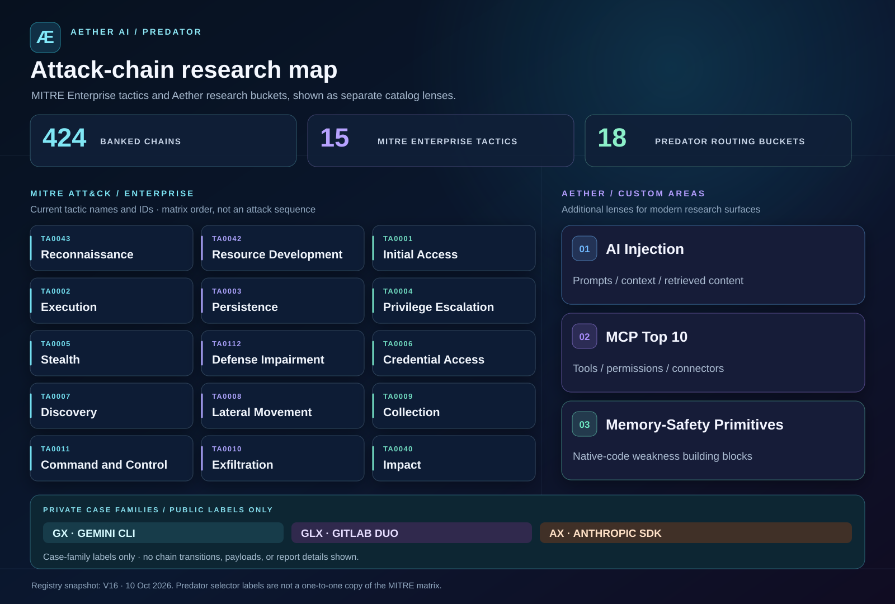 
  <a href="docs/assets/attack-buckets-v16.svg">Open the full-size research map</a> · GX, GLX, and AX are public case-family labels; no exploit steps are shown.

<strong>What a chain contains, research mode, and the AX family</strong>

| What a chain contains | Why it helps |
| :--- | :--- |
| **Connected steps** | Show how a proposed path depends on earlier conditions. |
| **Prerequisites and references** | Keep the model tied to stated assumptions and cited sources. |
| **Routing category** | Organize the review around the relevant research surface. |

**Research mode** follows chain and CVE references to develop cited hypotheses, counterexamples and proposed extensions; it is the c-stage of a pin. Source review and checks on the software must establish observed behavior before a modeled path becomes a finding.

#### AX · Anthropic SDK

AX001, AX002 and AX003 mark conditional local research paths with **Collection**, **Credential Access** and **Execution** tactic lenses. They share one trust boundary and are shown separately in the [Anthropic research card](docs/assets/anthropic-sdk-crucible-private.svg). The map does not claim a sequential exploit, a deployed integration or a vendor-confirmed finding.

### CVE catalog and database

**The vulnerability records the chains anchor to.** Predator keeps a catalog of CVE records, affected products, advisories, problem types and scoring data; CVE IDs tie those records to chain anchors so an investigation can follow the evidence.

| Part of the catalog | What it contributes |
| :--- | :--- |
| **CVE source records** | [CVE JSON 5.x](https://github.com/CVEProject/cvelistV5) imports and affected-product information. |
| **Separate enrichment** | NVD, CISA KEV and FIRST EPSS data beside the source records. |
| **Research review** | Deep-cycle integration reads shortlisted full CVE cards before ranking and records what was reviewed. |

**Drive** uses the approved mission's pinned evidence for investigation and validation. Coverage and freshness depend on completed imports and pinned snapshots.

## CodePro and System-2: how the fanout runs

**Many workers, one evidence trail.** CodePro gives several workers the right context at once and reads their answers back as one record.

| Part | What it does, in plain terms |
| :--- | :--- |
| **CodePro fanout** | In an admitted run, starts scoped workers and records each returned claim and provider receipt. A manual turn or unavailable dispatch path is not a completed fanout. |
| **System-2 shared IR** | Aligns claims, evidence references and open questions from workers using the same intermediate representation. |
| **Clean model worktrees** | Source-backed runs can isolate model work in pinned Git worktrees; the run record names the actual checkout and revision. |
| **[Unlimited Context (UCL)](https://github.com/AetherAI3/Unlimited-Context-LLM)** | Keeps source-backed evidence in named memory pools across sessions and models. "Unlimited" means retrieval reach: relevant slices enter the model's normal attention window. |

**Evidence-accounting update:** a tested System-2 draft counts supporting sources rather than repeated statements; integration pending. [What was tested →](docs/research/quantum-comm-ops.md#system2-evidence-accounting)

<strong>CodePro implementation links</strong>

[System-2 orchestration](https://github.com/AetherAI3/AETHER-CLOUD/tree/main/lib/orchestrator/system2) · [Native compiler](https://github.com/AetherAI3/AETHER-CLOUD/tree/main/native) · [Benchmarks](https://github.com/AetherAI3/AETHER-CLOUD/tree/main/bench)

*Implementation links require repository access.*

<strong>The private CLI around it</strong>

### The private CLI around it

The private **Predator CLI** brings research, tools and persistent evidence into one conversation: choose an available Aether model, keep each run attached to its sources and approved scope, continue from saved work. Restart checks verify the task, worktree and memory-pool identity.

| Capability | What it does |
| :--- | :--- |
| **Research and Drive** | Cross-reference chains and CVEs, review candidates, run approved investigation and validation stages. |
| **Predator RC** | Follow browser and CLI activity through an encrypted relay, take over, hand control back. |
| **[P-BOX](#p-box)** | Spawn a disposable Linux pwnbox for a confirmed mission, with live viewing, operator control and automatic cleanup. |
| **Guest consoles** | Work through supported Pwnbox/noVNC sessions or an owned VM in an authorized training lab. |

<strong>Browser, RC, and guest-session status</strong>

Supported Pwnbox/noVNC sessions have recorded attachment, observation, reviewed input, human takeover, resume and cleanup. An owned Ubuntu VM supplied the Academy workflow shown earlier. Other CTF, Sherlock, VM and VPN environments need their own scope and validation.

RC is in controlled private preview: the production viewer and relay have been exercised in an owner validation; the complete sign-in, mission selection and controller hand-back journey remains under validation. Browser and guest sessions need a fresh check after interruption.

## Generations in plain English

**Aether's own labels for how its work has evolved**, not an industry standard, and not a ranking of anyone else's work.

| Generation | What it means |
| :--- | :--- |
| **Gen1** | Chat and copilot help: one model, one answer. |
| **Gen2** | Agent loops: models that use tools, run multi-step tasks and check their own work. Most public agent work is here. |
| **Gen3** | **Where Aether works now.** The system around the models, built to turn failures into verified, reusable capability. AI and quantum workflows run together across the Aether stack (Aether Agent, Aether Cloud, Nano, ATLAS, UCL, CodePro, AQRC, Predator) with a shared verified evidence bank, signed receipts, swarm coordination of hundreds of small agents, and Predator lanes for bounty, open-source (OSS), mission and training work. Predator is the public showcase. |
| **Gen4** | Conditional. It starts when a trigger below fires; no date is predicted. Predator's route toward it is the [self-improvement loop](#self-improvement-loop); not shown yet. |

**What Gen3 is, concretely.** Aether does not train models from scratch; it builds systems around models:

- **Weight adaptation.** A frontier model proposes an edit to at most 1 % of a small local model's weights; a judge it cannot see scores hidden tasks; only a clean gain is promoted. *Built, not yet run* on the real model.
- **Model-1 and the self-improvement loop.** A 9-billion-parameter model with small adapters, trained on Predator's own verified synthetic cases: the first adapter transferred to a held-out code pattern; a second, trained on 804 teacher rows, drove a whole 400-pin synthetic mission and beat the scripted rule (172 against 156 at 3 false alarms). Around it, the loop searches, verifies, remembers, replays and retrains (*design*; first test: only the teacher's hint cleared the noise floor over a placebo). *Measured on fixtures, no quantum-computer time*; one seed, synthetic code, near transfer, controls not run, a fixture shortcut found afterwards, no real code. [Self-improvement loop](#self-improvement-loop).
- **API model systems** (CodePro, AQRC, Predator). Fanout, compilation and evidence accounting around API models. *Measured on IBM hardware* (joint5 pilot, 400-agent delivery), *measured on a simulator* (CharLS, QPACK, search scaling), *measured on fixtures, no quantum-computer time* (agent lanes).
- **Local model modifications.** Patch and model-switch plumbing for small open-weight models. Plumbing *measured on fixtures, no quantum-computer time*; the patch itself *built, not yet run*.
- **Quantum cybersecurity research.** Crucible, the chain library, matched classical-vs-quantum selection on security tasks. *Measured on a simulator* and *on IBM hardware*; no quantum route has beaten the classical one so far.

<strong>What ends Gen3, and Gen4 as far as we can see</strong>

**What ends Gen3.** Any one of these, whoever causes it:

- Predator shows a quantum route beating the best classical route on a security task, preregistered, at matched budget, reproduced independently. Not shown so far; nothing here claims quantum advantage.
- Another team shows the same on a relevant workload.
- A lab demonstrates models that improve themselves without human-written training runs, and it holds up under review. Predator's own attempt is the [self-improvement loop](#self-improvement-loop); it has not shown this.

Another lab may reach Gen4 first; that is why the map is drawn now. Model labs now publish threat-intelligence reports on AI-assisted operations; sources are in [why now](docs/research/generations.md#why-now).

**Gen4, as far as we can see** (a direction, not a measurement):

- Quantum-safe and post-quantum defense for the evidence bank and receipts, using the NIST post-quantum standards (FIPS 203, 204 and 205, finalized August 2024).
- Authorized research into when quantum hardware becomes relevant to cryptography: resource estimation and testing post-quantum implementations.
- The central hypothesis: hybrid AI/quantum workflows may matter before raw quantum hardware does.
- No date is predicted.

[The long version: generations, triggers and sources →](docs/research/generations.md#plain-english)

## Gen3 → Gen4: the self-improvement loop

**Gen3 is not a smarter model. It is the system we are building around the model, meant to turn failure into verified capability and verified capability into a stronger model.** By design it watches where Model 1 fails, finds what was missing, proves the fix, remembers it, replays it without the model, and trains the next model on it. Some parts are measured (table below); the loop as a whole has not run, and no self-improvement is shown. On our own map, Gen4 starts when a loop like this improves the model with no person writing the training runs. We are not there: today people preregister every run and the owner approves its spend. Numbers here are *measured on fixtures, no quantum-computer time* (synthetic code with planted answers) unless marked **design**, **built** or **preregistered**.

  

### What each part does

| What it does | Picture it as | Our name | Where it stands |
| :--- | :--- | :--- | :--- |
| Reasons and acts on each step of a mission | the student | **Model 1**: a 9-billion-parameter open model (Qwen3.5-9B) with a small trained adapter | *measured*: drove a whole 400-pin mission, 172 of 178 findings |
| Saves the exact point where the model got stuck | a bookmark | **halt** | *measured*: 164 halts in 240 pins |
| Squeezes that stuck point into a small search, scoring how promising each candidate is | the assistant's map | **adaptive energy tokenizer**, part of **Nano** | *measured once*: its first version, the lockpick, did no better than a random hint |
| Tries candidates fast and answers miss, colder, warmer or hit | the assistant's hands | **search engine**; optionally a **quantum oracle** | classical engine in use; the quantum oracle is optional and not in the loop |
| Proves a result is really right, apart from whoever found it | the teacher grading the work | **verifier** | *measured*: holds on its checks; tightened after our attack; still blind to indirect calls |
| Keeps every proven step and where it came from | the notebook | **Atlas** bank | **built**: a bank and a promotion gate exist; nothing from the loop promoted yet |
| Turns a proven step into something the system runs again without asking the model | a recipe card | **AQRC** step and **replay** | *partly measured*: see replay below |
| Teaches the model the decisions it got wrong | studying | **training**; first run **D1** | **preregistered**: go given, not yet run |
| Chooses what to search or train next | the planner | **controller** | today people and a frontier model write each plan; the owner approves each run |

### Two doors when Model 1 fails

| Model 1 failed because… | Door | What happens |
| :--- | :--- | :--- |
| it was missing a piece of evidence | **Search** (discovery) | the tokenizer makes a small search, the engine tries candidates, the verifier checks a hit |
| it had the evidence on screen and still decided wrong | **Absorb** (training) | train the decision itself |

The first test of the loop (PL1, below) found that 102 of Model 1's 164 stuck points were the second kind; on the 50 of them tested, every hint verified 0 or 1. So the next run trains the decision (D1); the search door is not shown to help yet, and D1 adds no Nano arm.

### Replay at ~0 inference: solve once, run again without the model

  

- **First time (design):** Model 1 reasons, a search finds the way, the verifier proves it, AQRC turns it into a replayable step, Atlas stores it.
- **Next time (design):** the system matches the situation to a stored step and replays it. Model inference needed: about zero. Today this works only for hand-written steps.
- **Not retrieval.** Retrieval (RAG) hands the model notes to read and reason about again. Replay runs the proven step itself.
- **Why it could matter for a small model (hypothesis).** The bank of runnable steps could grow far larger than the model; the model would only decide when a stored step applies, and when to make a new one.
- **Where it stands.** A hand-written replay step answered 8,400 of 8,400 pins on its home ground with no model, but asserted false things on 5 of 11 unfamiliar code shapes; a check on what the tools showed stops that, except for hidden calls. Templates compiled from 400 verified traces of the hand-written walker (stand-ins for model traces; no model ran) answered 0 % of unseen pins. Replaying part of a proven path paid only when it handed over the decision itself (27 of 32 findings against 13 to 14). Nothing yet turns the model's own behavior into a replayable step.

### Three ways the system learns

| Level | What learns | Where it stands |
| :--- | :--- | :--- |
| **Neural** | Model 1's weights | *measured*: adapters trained on teacher rows (Phase A, R1, T2); synthetic code only |
| **Procedural** | the bank of replayable steps | *partly measured*: hand-written steps replay on home ground; templates from the walker's traces answered 0 %; not yet tried on the model's own |
| **Discovery** | the search backend finds what neither knows | *measured once*: no better than a random hint on Model 1's own stuck points |

### What would count as self-improvement

The shape we are looking for across trained generations. **Not data**: no generation has been trained on its own rescues yet.

| | Generation 1 → 2 → 3 |
| :--- | :--- |
| Rescues the model needs | fewer each time |
| Replayable steps in the bank | more each time |
| The model alone, without rescue | stronger each time |
| Verified frontier (how far it gets, proven) | keeps moving forward |

A bigger bank alone is not the signal. All four have to move together.

### What we have measured so far

  <a href="docs/research/quantum-comm-ops.md#self-improvement-loop">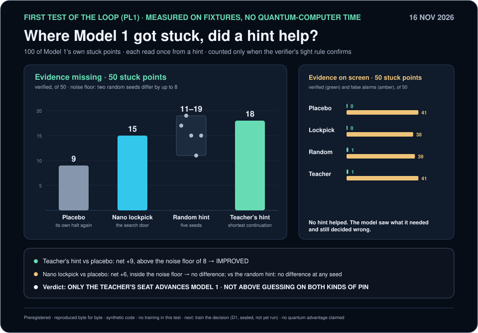</a>

| When | Step of the loop | Result | Verdict |
| :--- | :--- | :--- | :--- |
| Nov 11 | Model 1 decides one pin | 0.91 correct on 400 held-out cases, against 0.49 untrained (the always-HIT score) | **TRANSFERS** |
| Nov 12 | Model 1 runs a whole mission | 1,995 of 1,995 steps valid; 172 of 178 findings at 3 false alarms, against a scripted rule's 156 | **BEATS THE RULE** |
| Nov 13 | Replay without the model | hand-written step: 8,400 of 8,400 at home, false on 5 of 11 new shapes; templates from 400 walker traces: 0 % | as predicted |
| Nov 14 | Model 1 on a harder mission (tracing across functions) | 18 of 46 findings verified; below a coin-guessing operator once both kinds of pin count | **USES THE FORM** |
| Nov 15 | Replay part of a proven path | 13–14 of 32 from any partial start; 27 of 32 only when the decision itself is handed over | **DEPTH PAYS** |
| Nov 16 | First test of the loop (PL1) | 50 evidence-missing stuck points: teacher's hint 18, Nano lockpick 15, random hint 11–19, placebo 9. 50 evidence-on-screen stuck points: every hint verified 0 or 1 | **ONLY THE TEACHER'S SEAT ADVANCES MODEL 1, NOT ABOVE GUESSING ON BOTH KINDS OF PIN** |
| next | Train the decision (D1) | 1,216 decisive rows; does Model 1 decide right with the evidence on screen? | **preregistered**, not yet run |

**What it means, plainly.**
- PL1's harness held (stuck point → hint → one read → verifier): every run played back byte for byte, and a separate re-run of the analysis from rebuilt inputs gave the same verdict file byte for byte. The bank, replay of model-found steps and training on rescues have not run.
- Our reading, not a rule: the bottleneck is the decision, not the search. With the evidence on screen, Model 1 still claimed findings on protected pins.
- The search door is not shown yet: Nano's lockpick did no better than a random hint on Model 1's own stuck points.
- Replay works so far only for hand-written steps on their home ground.
- Self-improvement itself is not measured: it needs at least two trained generations.
- One seed each, synthetic code, no real-code result. Predator does not find vulnerabilities on real code by itself.

<strong>The quantum oracle and the ATLAS pieces, honestly</strong>

**The quantum oracle is an instrument, not a mind.** A small, bounded piece of a search problem is encoded so a quantum computer can sample or score it. The measurements come back as ordinary numbers (scores, candidate states, rankings) that can guide the search, hint Nano, or become training evidence. It never holds Model 1's reasoning. Today it is optional and not used in this loop: the owner froze the loop as classical while the basics are tested. ATLAS's QAOA runs, on simulation and on IBM hardware, never beat the classical solver. Predator's other IBM hardware runs carry messages or test circuit compilation (joint5); none is this oracle.

| ATLAS piece | Job in the loop | Where it stands |
| :--- | :--- | :--- |
| **AQRC** | turn a proven step into a checkable, runnable unit | its joint5 compilation path was measured on IBM hardware in the joint5 pilot; nothing compiles a model reasoning step today |
| **Observatory** | notice which steps keep solving which kinds of problem | toy networks only (parity, addition, 3-SAT); never a language model |
| **QOTC** | quantum-assisted choice among steps | a 3-qubit, depth-4 simulation on toy tasks (parity no gain, p = 0.70; a composed task 0.85 vs 0.40) |
| **Real code** | the target | 4,118 real vulnerable/fixed function pairs held as a test set only; none used for training; no result yet |

Pins: the read-only ATLAS survey [`014b5fca…`](https://github.com/AetherAI3/AETHER-PREDATOR-M/blob/014b5fcaf1f1708fff2bffaf08e7ed1f3e3cbfce/model/pm1/experiments/PM1-ATLAS-SURVEY_2026-11-13.md); owner note 9, which froze the loop as classical and asked for one pin-level test first, [`ebfae763…`](https://github.com/AetherAI3/AETHER-PREDATOR-M/blob/ebfae763b68b41985a2c32c53133ec836b445e29/model/pm1/experiments/PM1-FRONTIER_OWNER_NOTE_9_PIN_LEVEL_EXPERIMENT.md).

<strong>Phase A in detail (November 10–11): the first adapter and its preregistered held-out read</strong>

LoRA rank 8, 1,000 training rows, one pass, float32 on CPU. Task: decide **HIT / MISS / REJECT**, name the **sink line**, stop. The read was preregistered and the split sealed before any held-out row was rendered: 400 held-out cases, a code pattern never in training, alias chains up to 8 hops where training stopped at 4, zero overlap by the manifest's pattern-keyed count (2,846 of the 6,000 frozen rows share a pattern-blind code shape with training).

| | untrained 9B | trained (one adapter) |
| :--- | :--- | :--- |
| Valid reply with no trailing text | 1.00 | **1.00** |
| Outcome correct, all 400 cases | 0.4925 | **0.91** |
| Outcome correct, 5–8-hop chains (n = 189) | — | **0.952** |
| Outcome and sink line both correct | 0.43 | **0.9075** |

Rule **TRANSFERS**: at least 0.80 overall, at least 0.70 on 5–8 hops, trailing text at most 0.02, gain at least 0.25 (measured 0.4175); all five predictions inside range. Of the 36 errors, 32 are safe code called HIT (19 of 95 decoys, 13 of 108 guarded), 1 of 197 planted findings missed, 3 MISS/REJECT mix-ups; false alarms sit on **short** chains (13 of 49 at 0–1 hops against 7 of 88 at 5–8), the opposite of the prediction; cause not investigated. Fourteen more sealed seeds were unread at the time (R1 has since spent one). Cost about **$1.85** for the read (about 1.4 h of one CPU work node), about **$5.80** of a $25 line for the phase. Recurrent-depth ("think longer") reasoning was tested earlier and rejected (0 of 12 at depths 4, 8 and 16); it is not on this path. Pins: preregistration `model/pm1/experiments/PM1-9B-FROZEN-E001_PREREG.md` at private commit `83b40d4581e6042fe4302cb72ce1fc505f95fdc2` (draft [PR #492](https://github.com/AetherAI3/AETHER-PREDATOR-M/pull/492)); result as a [PR comment](https://github.com/AetherAI3/AETHER-PREDATOR-M/pull/492#issuecomment-6787424740); **its result file is not yet committed**. [Guide](docs/research/quantum-comm-ops.md#model-1-phase-a) · JSON block `model1_phase_a_2026_11_11`.

<strong>Lane run R1 in detail (November 12): the model takes the operator's seat</strong>

  

Six Crucible stages in order (C1 pin, C2 analyse, C3 search, selection, Q1 optimise, Q2 refine, Q3 decide), one proposal per pin per stage, each verified before the next stage. The adapter was trained, from a later refinement of the Phase A adapter, on **804 teacher rows**: the scripted oracle's own proposals for 134 training pins, one pass. Mission: a sealed held-out seed, 400 pins, 178 planted findings (54 in two-sink functions), 222 safe pins. Rules, predictions, floor and ceiling runs were committed before the job existed.

| Operator on the same 400-pin mission | Findings found of 178 | False alarms of 222 safe pins | Two-sink findings found of 54 |
| :--- | :--- | :--- | :--- |
| Oracle, no selection (ceiling) | 178 | 0 | 54 |
| Oracle with selection | 176 | 0 | 53 |
| **Trained 9B model with selection** | **172** | **3** | **49** |
| Scripted rule with selection (floor) | 156 | 0 | 33 |

1,995 proposals (400 at each of C1–C3, 265 at each of Q1–Q3), every one valid, none refused; 255 of the 265 pins that ran to the end ended right. R1-a, drives the lane (valid share ≥ 0.98 every stage, ≤ 8 refused) **MET** at 1.00 and 0; R1-b, beats the rule (≥ 160 found, ≤ 3 false alarms) **MET at its edge** (172 and exactly 3; one more and the verdict drops to DRIVES THE LANE); R1-c, the scorer holds (nothing above the oracle; replay through the real compiler and comm-ops bus reproduces the report, transport 1.0) **HOLDS**. Seven of eight predictions held (six inside range; the training-loss prediction had no range and happened); the miss was the floor arm (the starting checkpoint, never trained on stage prompts), which wrote 396 valid first-stage reports of 400 against a guess of 120.

Where it was wrong: it found 21 findings the rule missed and lost 5 the rule found (net +16; the 5 by subtraction from the record's 21). Two misses were parked by selection (the oracle loses the same two); four reached the final stage with the true sink targeted and "no guard" in hand, yet closed MISS or REJECT. Three false alarms were decoys claimed HIT (the verifier closed all three REJECT). Within a function the model does follow the data (guard predictions agreed with the verifier on 363 of 377 single-sink targets, against 231 and 280 for two alias-blind rules), but each function holds one short chain, whole in the prompt. Training loss 0.0875 → 0.00005 over 804 steps reflects a regular teacher, not mission ability. Not comparable with the earlier one-shot reads (those had no verifier evidence). Cost about **$8.67** (6.67 h of one 32-core CPU node at $1.30 per hour; $9.11 if billed by whole hours) of a $15 line, excluding the standing system node and storage volume. No GPU, no quantum-computer time, no model-API spend.

Pins: preregistration [`3139642c…`](https://github.com/AetherAI3/AETHER-PREDATOR-M/blob/3139642c6db4380b3a3a02dae42c8f0b5f756bc9/model/pm1/experiments/PM1-9B-LANE-E001_PREREG.md), result record [`b68d812f…`](https://github.com/AetherAI3/AETHER-PREDATOR-M/blob/b68d812fedf90478de5cee1db9c2f79830fc72c0/model/pm1/experiments/PM1-9B-LANE-E001_RESULT.md) with run-file digests, next-mission plan draft [`9e0e97b7…`](https://github.com/AetherAI3/AETHER-PREDATOR-M/blob/9e0e97b73c049ce45dd9f5ab96477595af9fe6cc/model/pm1/experiments/PM1-9B-LANE-E002_PLAN_DRAFT.md), draft [PR #492](https://github.com/AetherAI3/AETHER-PREDATOR-M/pull/492) ([preregistration](https://github.com/AetherAI3/AETHER-PREDATOR-M/pull/492#issuecomment-6824757735), [result](https://github.com/AetherAI3/AETHER-PREDATOR-M/pull/492#issuecomment-6834578835), [plan](https://github.com/AetherAI3/AETHER-PREDATOR-M/pull/492#issuecomment-6840842060) comments). Full commits `3139642c6db4380b3a3a02dae42c8f0b5f756bc9`, `b68d812fedf90478de5cee1db9c2f79830fc72c0`, `9e0e97b73c049ce45dd9f5ab96477595af9fe6cc`. [Guide](docs/research/quantum-comm-ops.md#model-1-lane-run-r1) · JSON block `model1_lane_run_r1_2026_11_12`.

<strong>Compiled pathways, first read (November 13): how far a verified pathway can be trusted without the model</strong>

Preregistered, $0 on a laptop, no model. The skill under test was a hand-written tool-only walker (trace a sink back to its entry), promoted after 8,400 of 8,400 right answers on its own generator. Off that generator, on 11 held-out code structures of 2,000 pins each, it asserted something false on 5: parameter names swapped 100 %, hidden call 53.5 %, helper signature 41.6 %, helper body 41.6 %, guard flipped 19.1 %. A precondition checked only on what the tools showed brought false assertions to 0 on every structure except the hidden call, at no cost on the home generator, but threw away 47 % of right answers on a harmless change. Templates compiled from 400 verified traces gave 400 exact templates (362 merged); none reached VERIFIED, none was promoted, and promoted templates answered 0 % of unseen pins; guard-free skeletons without the ladder answered 98 % and were wrong on 36 %; the ladder refused every one. Preregistered lines L1 not met, L2 met apart from hidden calls, L3 not met, L4 met, all as predicted. Reading: replay is safe only inside a declared scope with a precondition, and not by replaying traces; next idea is to compile the rule (which code forms protect a value), not the run. Pins: preregistration [`d5fef772…`](https://github.com/AetherAI3/AETHER-PREDATOR-M/blob/d5fef7723aa77bc1d46f9dff4cd4010d80ea45d9/model/pm1/experiments/PM1-COMPILED-C001_PREREG.md), result [`fbaa09c7…`](https://github.com/AetherAI3/AETHER-PREDATOR-M/blob/fbaa09c70eb7a6a9f204135cf7498fca6a2cc7ee/model/pm1/experiments/PM1-COMPILED-C001_RESULT.md), draft [PR #493](https://github.com/AetherAI3/AETHER-PREDATOR-M/pull/493). JSON block `model1_compiled_c001_2026_11_13`.

<strong>The harder mission: run T2 and the depth ladder (November 13–15)</strong>

The harder mission is built so that tracing should be needed: value chains across 2–4 functions in up to 3 files, generated as twins (the same text, with one change that flips the answer); three read-only tools (resolve a function name, list call sites, read a span); and claims recorded before the verifier answers. Gates G3 and G5 **MET**; G2 **MET** on the fourth read, after one NOT MET (generator fixed), one that met on a gate later found too weak, and one NOT VALID (gate made stricter twice); dev seeds, not preregistered; the probes found nothing, which does not prove no shortcut exists. Trace run T1's first attempt was killed for lack of memory in its first probe step, before training, and holds no result.

**Run T2 (November 13–14, preregistered).** Model 1, trained on 1,200 teacher rows from the scripted walker's paths on 400 pins (each pin's claim row plus two tool-call rows drawn at random), read 100 sealed held-out pins with 46 planted findings, from scratch: 901 of 901 replies in form, **18 of 46** findings verified, 44 false alarms; the walker verifies 46 of 46. Starting it halfway down the teacher's path changed nothing (18 again). Verdict **USES THE FORM** (T2-a and T2-d MET; T2-b and T2-c NOT MET). About $16.1, CPU.

**Attacking our own scorer.** A climb that never opens a function body still verified 28 of 46 findings, and the lane's judge confirmed 190 of 190 verified claims that had one false statement added. A tight rule (one path a finding, no call site the tool did not list) now gates every count; it does not close every gap. Read on both kinds of pin, the trained model sat below a coin-guessing operator on T2's pins (balanced share 0.074 against 0.239) and level with it on the next run's pins (0.214 against 0.219).

**The depth ladder, T3 stage A (November 15, preregistered).** The same model, started at five depths of the teacher's path on 60 dev pins (32 findings), verified 13, 13, 13 and 14 findings from the start, a quarter, half and three quarters of the way, and 27 from the very end. Verdict **DEPTH PAYS** (T3A-a, T3A-b, T3A-d MET), but the shape is the lesson: replaying part of a path bought nothing; only a start that already holds the decision doubled the count. About $3.1, CPU.

Pins: T2 preregistration [`6994e1e9…`](https://github.com/AetherAI3/AETHER-PREDATOR-M/blob/6994e1e959eaf0260cfaf6f9d9600fa372ac2fc9/model/pm1/experiments/PM1-9B-TRACE-E002_CHECKPOINT_START_PREREG.md) and result [`b53a2464…`](https://github.com/AetherAI3/AETHER-PREDATOR-M/blob/b53a24649a03275210948ec29f7e6a128e2b0e44/model/pm1/experiments/PM1-9B-TRACE-E002_RESULT.md); T1 hold record [`bf379683…`](https://github.com/AetherAI3/AETHER-PREDATOR-M/blob/bf379683a300515eb5271adf90829985f79fa390/model/pm1/experiments/PM1-9B-TRACE-E001_HOLD.md); depth ladder [`4e7e2290…`](https://github.com/AetherAI3/AETHER-PREDATOR-M/blob/4e7e229056941abbd25d3f50c3b4545258e3af9d/model/pm1/experiments/PM1-9B-TRACE-E003_STAGE_A_RESULT.md); scorer attack [`f121e626…`](https://github.com/AetherAI3/AETHER-PREDATOR-M/blob/f121e626b4c8e73cfb9adcb61a8fd31c4d1ab10c/model/pm1/experiments/PM1-FRONTIER-DYNAMICS_ATTACKS.md) (a pushed branch); build notes and gate reads [`014b5fca…`](https://github.com/AetherAI3/AETHER-PREDATOR-M/blob/014b5fcaf1f1708fff2bffaf08e7ed1f3e3cbfce/model/pm1/experiments/PM1-9B-LANE-E002_BUILD_NOTES.md). JSON block `model1_trace_runs_2026_11_14_15`.

<strong>PL1 in detail (November 16): the first test of the loop</strong>

**Stage 1.** Model 1 (with T2's adapter) read 240 fresh training pins from scratch to find its own stuck points: **164 halts**, 102 with the evidence already on screen and 62 missing a call. Verdict STATES BOUGHT (S1-a, S1-b, S1-c MET). About $8.3: the first job was cut by its deadline after a pricing error, and a second job finished the read from kept replies.

**Stage 2 (preregistered, sealed before it ran).** 100 halts, 50 of each kind. At each one, seats (hint states) were made six ways and Model 1 read from each once; the rules read four (two reference kinds, still being read, cannot change the verdict): a **placebo** (its own halt, with its last call made once more), the **Nano lockpick**, **random search** (five seeds), and the **teacher's** shortest continuation. A claim counted only if the verifier's tight rule confirmed it.

| Seat | Verified, 50 evidence-missing | Verified, 50 evidence-on-screen | False alarms, evidence-on-screen |
| :--- | :--- | :--- | :--- |
| Placebo | 9 | 0 | 41 |
| Nano lockpick | 15 | 0 | 38 |
| Random search, 5 seeds | 17, 19, 15, 11, 15 | 1 (first seed) | 39 |
| Teacher's continuation | **18** | 1 | 41 |

The noise floor is 8 stuck points: the widest gap between two random seeds (19 against 11); the model's own repeat read moved 0. Teacher against placebo: net +9 (11 only under the teacher, 2 only under the placebo), p 0.022, above the floor: **IMPROVED**. Lockpick against placebo: net +6, not above the floor; lockpick against random search: no difference at any seed. Rules: PL1-a, the harness holds, **MET**; PL1-b, the search matters, **NOT MET**; PL1-c, more than a prompt change, **NOT MET**; PL1-d, as good as the teacher, **MET**; PL1-e, both kinds of pin and no listing, **NOT MET** (not worse on no-finding pins; 5 loose confirmations); PL1-f, above guessing, **NOT MET** (balanced share 0.0492 against a floor of about 0.2051). Verdict: **ONLY THE TEACHER'S SEAT ADVANCES MODEL 1, NOT ABOVE GUESSING ON BOTH KINDS OF PIN**. Both written guesses, made before the read, expected the lockpick to win; both missed. A separate re-run of the analysis, from rebuilt inputs, produced the same verdict file byte for byte. Cost: the first job about $12.6; a second job, capped at about $8.1, re-read the runs and was still reading two reference arms that cannot change the verdict.

Pins: sealed preregistration [`d537e40e…`](https://github.com/AetherAI3/AETHER-PREDATOR-M/blob/d537e40ed8d0874aadf8a17c6fc7779658a4f1b4/model/pm1/experiments/PM1-FRONTIER-PL1_PREREG_DRAFT.md) and stage 1 result [`d537e40e…`](https://github.com/AetherAI3/AETHER-PREDATOR-M/blob/d537e40ed8d0874aadf8a17c6fc7779658a4f1b4/model/pm1/experiments/PM1-FRONTIER-PL1_STAGE1_RESULT.md); stage 2 result [`cdca165c…`](https://github.com/AetherAI3/AETHER-PREDATOR-M/blob/cdca165c1dc88823a327da83bfc264ae12707dd8/model/pm1/experiments/PM1-FRONTIER-PL1_STAGE2_RESULT.md) (first committed at `598a776e…`). JSON block `model1_pl1_2026_11_16`.

<strong>D1, the next run: train the decision (preregistered, not yet run)</strong>

D1 trains Model 1 on 1,216 **decisive rows** (the step where twin cases part, the row after a look there, and every claim row). Its rules then ask whether, with the evidence already on screen (reading from the end of the teacher's path on 200 dev pins), the model gets more no-finding pins right without losing findings, and whether it makes fewer false alarms when it works from scratch. The rows were pinned before PL1 ran; the file was sealed in place on November 17, before the run was applied. The owner said "Yes, run D1"; a note then made "evidence already present" the main target, with no Nano arm and no control arm. CPU only, cap $24. No result yet.

Pins: sealed preregistration [`f121e626…`](https://github.com/AetherAI3/AETHER-PREDATOR-M/blob/f121e626b4c8e73cfb9adcb61a8fd31c4d1ab10c/model/pm1/experiments/PM1-FRONTIER-DYNAMICS_NEXT_RUN_PREREG_DRAFT.md) (a pushed branch); owner note 10 [`4886047f…`](https://github.com/AetherAI3/AETHER-PREDATOR-M/blob/4886047fab36a68c978c23573523727f9b4eeae3/model/pm1/experiments/PM1-FRONTIER_OWNER_NOTE_10_D1_EVIDENCE_PRESENT.md). JSON block `model1_rsi_loop_2026_11_17`.

## Gen3 Quantum Comm Ops

**It sends each agent's briefing through a quantum computer and checks that it arrived intact.** A shared evidence bank holds verified findings; a compiler turns them into a short briefing per agent; each agent checks a tamper seal before using it; adaptive Custom Fanout Controls (CFC) decide which leads get more attention. The route is **Nano → ATLAS → an IBM backend**: first **FakeFez** (*measured on a simulator* of an IBM device), since October 31 the real **ibm_fez** and **ibm_kingston** on IBM's free open plan (*measured on IBM hardware*). A briefing selects or reconstructs a record; whether a model reasons well from it is a separate step, measured on fixtures.

  <a href="docs/research/quantum-comm-ops.md">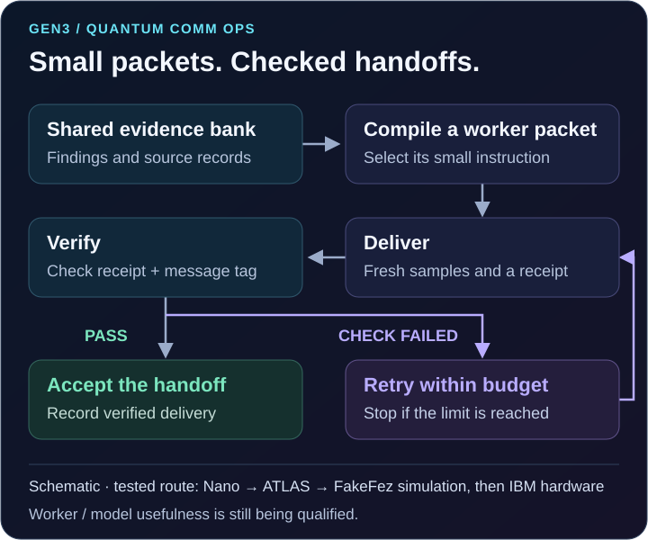</a>

### Status, November 8, 2026

One table for where comm ops stands; each row carries its [legend](#how-to-read-our-numbers) label. Detail sections are folded below; the [guide](docs/research/quantum-comm-ops.md#november-5-8-2026) and [JSON](docs/research/quantum-comm-ops.json) (block `status_2026_11_08`) carry the pins.

| Part | Where it stands | Label |
| :--- | :--- | :--- |
| **Delivery:** 400 briefings to 400 agents | **400 of 400 intact on the first try in all five missions, one IBM job each, 5.0 s billed** (October 31 – November 1). Unchanged since; [details](#measured-on-ibm-hardware-400-agents-400-messages-one-ibm-job-five-seconds). | measured on IBM hardware |
| **The agents either side:** encoder, filter, vote, compounding | Encoder **MET**, weighted vote **MET**, compounding **MET** on fixtures (24 → 38 → 39 of 40 over three cycles); cheap-worker price **NOT MET**; "think longer" model **NOT MET**; deep cells **NOT RUN**; [details](#measured-on-fixtures-no-quantum-computer-time-what-the-agents-measured). | measured on fixtures, no quantum-computer time |
| **One mission, all four lanes** (November 3–4) | 40 agents × 3 cycles sealed into one package. IBM leg: 397 control frames, **371 of 397** first pass, 26 caught by their tag check and re-sent, **397 of 397** after rescue, 23.0 s. **No model was changed**; [details](#first-compounding-mission). | measured on fixtures + measured on IBM hardware |
| **Training our own small model** | Round 1 (November 4): learned the answer format but hit the length cap more often, **NOT MET**. Round 2, dose study (November 5): **no dose removed the looping** (NO_DOSE; judging gates **NOT RUN**; round 1's NOT MET stands). Round 3, stop-at-goal (November 8, one H100 for 24 minutes): correct **2 → 42–46 of 96** but length-cap cuts **6 → 16–19 of 96**, rule failed for every version, held-out judging **NOT RUN**, nothing promoted. Round 4, frontier-model weight patch to round 3's best: *built, not yet run* (its preregistration refuses to create a GPU without H100 capacity; none was offered; on hold). Rounds 5 onward are Model-1 and the [self-improvement loop](#self-improvement-loop): Phase A **TRANSFERS** (0.91 on 400 held-out synthetic cases); lane run R1 **BEATS THE RULE** (172 of 178 findings at 3 false alarms against 156); the loop's first test, PL1, **ONLY THE TEACHER'S SEAT ADVANCES MODEL 1, NOT ABOVE GUESSING ON BOTH KINDS OF PIN**. | measured on fixtures, no quantum-computer time |
| **Comm ops inside the mission path** | The message bus is built and was tested in *shadow mode* (watches and records, never decides) on replayed missions, at $0: frames recompiled bit-identical **379 of 379**; briefings reproduced from cache with a shuffled-reference control passing; a simulator mirror matched **394 of 394** frames at **+0.006 s** on a 90 s stage. Hand-off cost gate **NOT RUN** (80 hand-offs, 100 needed). **Not switched on.** | measured on fixtures / measured on a simulator |
| **Spend to date** | Model calls **$62.72 of the $70 stop** (818 ledger rows). IBM **277 of 600** free seconds. GPU rentals about **$122 estimated** across four rentals, invoices pending; **about $106 of that was one GPU left idle for a day awaiting a sign-in** (19 minutes of work) against a $10 line. | accounting |

No quantum advantage is claimed or demonstrated anywhere on this page. The hardware saving is IBM's billing for batched circuits that carry known bit patterns.

### Measured on IBM hardware: 400 agents, 400 messages, one IBM job, five seconds

**400 scripted worker agents each need a short briefing. Comm ops writes all 400, sends each through an IBM quantum computer, and checks every agent got exactly the briefing meant for it.** Each briefing is a **96-bit message** cut into three tiny circuits (1,200 circuits a mission); the device runs each a few times (**shots**) and a majority vote gives the bits; a 32-bit **check code** acts as a tamper seal and a failed check triggers a re-send; IBM returns a **signed receipt**. "400/400 first try" means every seal matched with no re-send. The agents are **scripted** stand-ins; whether a model can use the briefing is tested separately.

  <a href="docs/research/quantum-comm-ops.md#ibm-hardware-missions">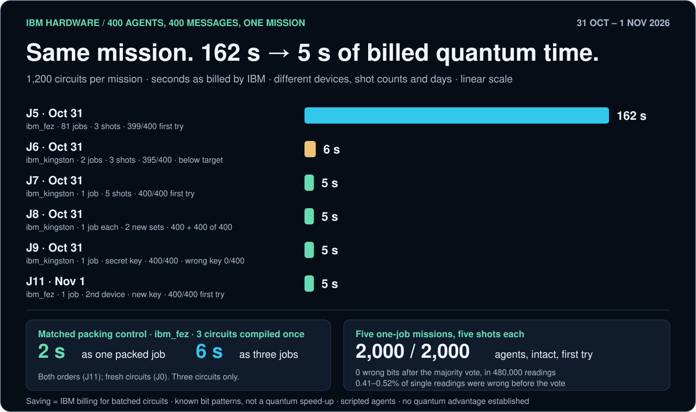</a>

**Misses, kept visible:** a 3-shot one-job run landed below its target (395 and 392 of 400; fixed at five shots); one job was cancelled after eleven hours in the queue and one was stopped by a time limit set too low; no model has been improved; the bus has not carried a live mission.

<strong>The numbers: simulator vs IBM hardware, why it got cheaper, what did not work, where the evidence flowed</strong>

| What we measured | Measured on a simulator (Oct 31) | Measured on IBM hardware (Oct 31 – Nov 1) |
| :--- | :--- | :--- |
| **Agents whose message arrived intact on the first try** (out of 400) | 400, 400 and 399 on three runs | **400 on all five runs**: three message sets on ibm_kingston, then two runs with a secret key (ibm_kingston, then ibm_fez) |
| **After one re-send** | 400 on every run | 400 on every run; no re-send needed |
| **IBM jobs per mission** | 1,200–1,203 | **1** (all 1,200 circuits in one request) |
| **Quantum-computer time IBM billed** | — (simulator) | **5.0 seconds**, down from **162 seconds in 81 jobs** when the mission first ran on ibm_fez |
| **Wrong bits after the majority vote** | 1 wrong piece in three runs | **0 wrong bits in 480,000 readings** across five runs; before the vote 0.41–0.52% of single readings were wrong |
| **Secret key check** | — | Wrong key: **0 of 400** pass (as intended); a scan of the run's files found the secret nowhere |
| **Does packing save money? Three circuits, same device** | — | One job: **2.0 s**. Three jobs: **6.0 s**. Same result in both orders (ibm_fez) |

**Why it got cheaper.** IBM bills by the second and charges much less for 1,200 small circuits in one job than spread over many. The saving is **IBM's billing for batched circuits**, not a quantum speed-up; the circuits carry known bit patterns. The 162 → 5 s comparison mixes devices, days and shot counts; the clean test is the three-circuit row.

**What did not work.** A one-job run at three shots had 395 and 392 of 400 messages arrive intact on the first try, below its target of 396 (a re-send fixed the rest; five shots fixed it for good). A compiler setting that looked better on paper did no better on the device and was dropped. One ibm_kingston job waited eleven hours in the queue and was cancelled; one ibm_marrakesh job was stopped by a time limit set too low. IBM finalized both on November 2: 0 seconds (30-second reservation released) and 5 seconds (settled), so the hardware programme total stays at **254 of the 600 free seconds**.

**Evidence flows onward.** Four hardware-delivered briefings (one from ibm_fez, three from ibm_kingston under the secret key) were re-checked from their signed receipts, decoded, matched to the bank, turned into a compact typed message, read by a frontier model, and scored by a deterministic checker: **4 of 4 correct end to end**. The typed-message format passed **12 of 12 held-out tasks** with zero formatting errors. The hardware programme used **254 of the 600 free seconds** and about **$18.65 of a $50 model budget**.

The simulator milestone it builds on, **three fresh 400-agent runs at three shots with a capped six-shot re-send** (1,199 of 1,200 intact first try, 1,200 of 1,200 after re-send), remains the research baseline, kept in full in the [guide](docs/research/quantum-comm-ops.md#earlier-simulator-milestone).

<strong>Measured on fixtures, no quantum-computer time: what the agents measured (November 1)</strong>

### Measured on fixtures, no quantum-computer time: what the agents measured

On November 1 the programme measured the **agents** on either side of the delivery step, on fixture tasks with known answers, following the same [lockpick](#crucible-adaptive-quantum-threat-modeling) Crucible uses.

| Lockpick | What it means for the 400-agent loop | Measured November 1 (fixtures, no quantum-computer time) |
| :--- | :--- | :--- |
| **Hold tension** | The bank holds every verified record with its receipt; a stronger **encoder** picks each agent's briefing; the **compiler** filters what reaches the agent | **MET for the encoder; the selection-to-agent gate was met only with the compiler filter, not as first registered.** Encoder: about **87%** of an agent's relevant records in its top eight within the agent's evidence pool (keyword search: 38%). A scripted agent verified **5 of 110** briefings without the filter and **99 of 110** with it. [Details](docs/research/quantum-comm-ops.md#agent-lanes-november-1-2026-evening) |
| **Feel many pins** | 400 cheap agents each take one briefing (one IBM job, 5 s) and report **HIT / MISS / REJECT** with a short reason | **NOT MET on price.** Best mid-cost model **12 of 12** at about **63%** of the frontier price; a free-tier model **7 of 12** at about **2%**. Target: 11 of 12 at a quarter of the price or less. [Details](docs/research/quantum-comm-ops.md#agent-lanes-november-1-2026-evening) |
| **Keep the pins that bind** | The program's own check decides; a verdict counts only when it type-checks and its receipt matches; disagreement is recorded as a split | **MET.** Plain majority **9 of 12**; reliability-weighted vote **12 of 12**. [Details](docs/research/quantum-comm-ops.md#agent-lanes-november-1-2026-evening) |
| **Set the binding pin** | Each surviving lead gets a **deep cell**: a "think longer" model plus a frontier model | **NOT MET for the "think longer" model**: **0 of 12** at every depth, so deep cells stay frontier-only. A harder task family was found where the frontier model alone verifies **2 of 12**. [Details](docs/research/quantum-comm-ops.md#agent-lanes-november-1-2026-evening) |
| **Only as many hands as we have** | Deep cells open only up to the machines we have; other leads wait with evidence intact | **NOT RUN.** The narrow-then-deepen comparison stopped at its **$5** cap before any deep cell opened; the mid-cost model verified **9 of the 9** leads it reached, 15 waiting. [Details](docs/research/quantum-comm-ops.md#agent-lanes-november-1-2026-evening) |
| **Next cycle** | Each cycle's verified records feed the next cycle's briefings | **MET on fixtures.** Three cycles over the same 40 fixture chains: first-try verified **24 → 38 → 39 of 40**, cost per verified record **0.45×** cycle one. Fresh, non-fixture tasks still open. [Details](docs/research/quantum-comm-ops.md#agent-lanes-november-1-2026-evening) |

  <a href="docs/research/quantum-comm-ops.md#agent-lanes-november-1-2026-evening">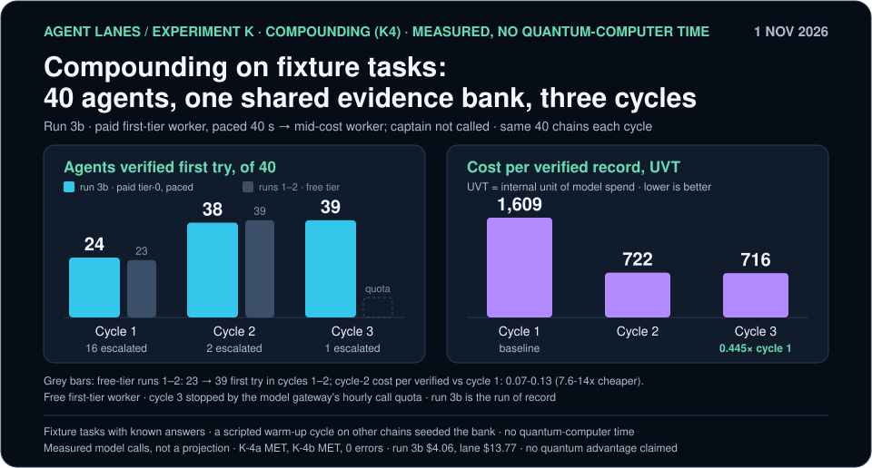</a>

**One cycle now:** bank → encoder → compiler filter → 400 briefings in one IBM job → verified records banked with receipts → weighted vote on disagreements → next cycle from a deeper bank. Delivery *measured on IBM hardware*; encoder, filter, vote and compounding *measured on fixtures*; deep cells **NOT RUN**. The stages were measured separately; no cycle has yet run with the hardware step inside it.

  

Why it matters: a cheap agent that cannot tell a hard lead is real discards it, so a loop that only narrows would find the easy findings and lose the hard ones; deepening on survivors is the untested hypothesis. For scale, the worker survey projects about **$4 of model calls plus 5 seconds of quantum-computer time** for a 400-agent round with the first-tier worker alone (one call per agent, no escalation), against about **$18** with a frontier model on every agent; the measured third cycle implies roughly **$9–10** per 400 verified records with escalation. These are *modelled* from measured per-call costs, not a measured 400-agent mission. The agent lanes cost about **$24** of model calls; **$42.50** of the model budget had been used at that point (cap $50 then, raised to $75 on November 3; the [status table](#status-november-8-2026) carries the current total).

<strong>First compounding mission (November 3–4, 2026): one 40-agent mission, all four lanes, sealed</strong>

### First compounding mission (November 3–4, 2026)

**One 40-agent, three-cycle mission ran all four lanes and sealed them into one package**: 249 records that verify **PASS** with the mission key and **PASS_UNSEALED** without it (Merkle root `sha256:63468836…`; key held off-repo).

- **Attack** (*measured on fixtures, no quantum-computer time*): Qwen3.5-27B on one rented H100; first-try verified **27 → 33 → 34 of 40**, cost per verified 652 → 490 → 467 units (GPU time in the gateway's cost unit, UVT); K-4a **NOT MET** (0.716× where 0.5× was needed), K-4b **MET**.
- **Repair** (*scripted*): a deterministic re-route of each verified path, 100 counterfactual pairs; no model involved.
- **Model** (*measured on fixtures, no quantum-computer time*): the frontier model may edit the weights of Qwen3.5-0.8B, which loops to its 512-token cap on 756 of 756 generations (252 tasks × 3 seeds), on CPU and GPU (L-1a **MET**: the failure is reproducible). Both cycles spent their caps on diagnosis and proposed no patch (L-1b **NOT MET**). **No model was changed.**
- **Communication** (*measured on IBM hardware*): 397 signed control frames carrying evidence references only, over ibm_fez in 6 jobs (3 first-pass, 3 re-send). First pass **371 of 397** intact; the other 26 failed their tag check (bit errors caught, never accepted) and were recovered by a re-send at 10 shots: **397 of 397** bit-exact after rescue, **23.0 s** of a 60 s line on IBM's free open plan. A transport test, not a speed claim.
- **Hosted economics, M2** (*measured on fixtures, no quantum-computer time*): on one rented H100 at $4.41 per GPU-hour, one 40-agent cycle of the 27B verified 32 of 40 at **$0.0217** of GPU time per verified agent (the 9B: 18 of 40 at $0.0118). The gateway's November 1 reference cycle (a mini first-tier model with GLM-5.3 on escalation) verified 40 of 40 at $0.0536. Hosted figures count only each phase's GPU time; setup, loading and idle (about $5 of the estimated $9.08 rental) are left out, so this is not a full cost comparison. M-2a **NOT MET** (best survey 6 of 12 with thinking off; 11 needed). The deep-cell lane stays **NOT RUN**: it needs a promoted patch first.
- **Spend**: model API ledger **$46.68** across the programme ($4.18 in this mission) against the $70 stop; GPU about **$9.08** estimated (invoice pending); **23.0 s** of quantum-computer time.

[What ran, how to check the package, and what it does not show →](docs/research/quantum-comm-ops.md#first-compounding-mission)

<strong>Experiments L and M (November 3, 2026): the model lane, control packets, sealed package, economics and the model switch</strong>

### Built and reviewed offline: Experiments L and M (November 3, 2026)

Built and reviewed offline on November 3, before anything paid ran (0 new IBM seconds, 0 GPU hours at that review). The model lane and the GPU rental have since run in the [first compounding mission](#first-compounding-mission); the rest stands as reviewed.

**Experiment L: four parts** (attack, repair, model and communication lineages).

- **Model lane** (*built, not yet run* on November 3; *measured on fixtures, no quantum-computer time* since November 4). A frontier model may propose an exact edit to at most 1 % of the weights of a 0.8-billion-parameter local model that keeps failing the same way (looping, invalid output, invented steps). A judge the proposer never sees scores the patched model on hidden tasks (36 unseen, 3×40 adjacent). Promotion needs at least 4 more unseen tasks solved, at most 1 adjacent lost, no rise in the length-cap rate. An offline rehearsal with a stand-in model promoted one patch and rejected a repeat. On the real model: baseline (L-1a **MET**) and two programmer cycles that proposed no patch (L-1b **NOT MET**); no model changed. The promotion receipt is sealed with a key kept out of the repository. An independent review found the proposer's sandbox could reach the repository and the hidden tests; closed before any run.
- **Control packets** (*measured on fixtures, no quantum-computer time*). 96-bit signed messages carrying a lane, an operation, a cycle number, a 32-bit evidence fingerprint and a 32-bit tag; a reference, never a payload. **1,200 of 1,200 accepted; wrong key, 0; any flipped bit, 0; replays, 0** (L-2a **MET**). 378 packets point at real earlier records and 822 at ids minted for the test (*scripted*).
- **Sealed research package** (*measured on fixtures, no quantum-computer time*). Every patch, evaluation and message chained by hashes under one root; a 15-check verifier refuses a package where a rejected patch was used as a parent. **147 records PASS; corrupting any one of the 87,304 bytes of its lineage and manifest files fails it** (L-3a **MET**).
- **Scale model** (*modelled*, plus one fixture dry run). A 400-agent, three-lane round costs about **$30 of model calls (modelled)**; limits are the gateway's hourly call quota (about 90 calls an hour, so about 10.7 hours a round) and the frontier model's monthly allowance (about 0.4 of a month), not IBM time. IBM part about **4 jobs, about 20 seconds (modelled from the measured 5-second job)**; the IBM-leg preregistration later corrected this to about 9 jobs (a control frame needs 8 circuits). A 40-agent, three-lane dry run passed: 379 packets, 8 of 8 operations, package verified (L-4a **MET**, *measured on fixtures, no quantum-computer time*).

**Experiment M: economics and the model switch.**

- **Economics** (*modelled, not measured*). No measured token counts yet, so internal cost proxies. A mid-cost model through the gateway costs about **$0.063 per verified result**, cheaper than renting GPUs for a full-size open-weight model (about **$0.118 per verified result** on twelve rented GPUs) unless GPU rent falls to about **$1.25 per GPU-hour** or the gateway's per-call cost rises about threefold above its calibration (about 1.6× above the projected in-situ cost). The gateway's rate limit (about 90 calls an hour) makes a single-lane 400-agent round about **6 hours** (three lanes about 10.7 hours). A batched 9-billion-parameter model would cost about **$1.72 per round**, verified rate unmeasured. The one-GPU rental that measures this (M2) has run on one H100 (M-2a **NOT MET**; see the [first compounding mission](#first-compounding-mission)).
- **Model switch plumbing** (*measured on fixtures, no quantum-computer time*). A registry names sections of a model's weights; two new packet operations, "switch model" and "carry this patch's intent to another model". Weights never move between models; knowledge moves as a patch specification re-derived in the destination model. A Q-step (a small QUBO selection) picks the model and section. **40 + 40 packets, 462 frames, 0 unexpected rejects, 10 of 10 operations, package verified** (M-3a **MET**). The Q-step agreed with the plain rule on 10 of 12 cases, matched a classical control that sees the same evidence-size factor on 12 of 12, and modelled about 1 % lower cost per expected verified result (M-3b **MET**). Honest reading: it wins only because it sees evidence size, which the plain rule ignores.

**Tests and budget.** 300 tests across L and M, all passing offline at the M pin. **$42.50** of model spend used; the cap was raised from $50 to $75 on November 3 to fund the first real model-lane cycle. 0 new IBM seconds, 0 GPU hours at that review.

[Details and source pins →](docs/research/quantum-comm-ops.md#experiments-l-m)

<strong>Still open, in order, and what this section does not show</strong>

**Still open, in order:** a model-lane cycle that reaches a patch the judge can score (the round-4 repair in the [status table](#status-november-8-2026) is next, and a promoted patch is the entry condition for the deep-cell lane); the bus's hand-off cost gate at 100 or more hand-offs (80 today), then its two owner-gated stages (a model line, and switching it on after the shared-IR fence lifts); the 400-agent rung with the communication lane on hardware (about 9 IBM jobs, *modelled*); the narrow-then-deepen comparison at matched budget (above the $5 it ran under); the "width" lever (*built* behind a flag, *not yet run*: needs a simulator sampling change and a rebuilt host); the stronger encoder *inside* a live compounding loop; gating or replacing the cheap first-tier worker above about 20 evidence rows; then the ibm_kingston repeat after a fresh calibration, packing beyond three circuits, real key management, production dispatch. **Superposition multiplexing** (several messages in one circuit) ran on hardware but did not beat ordinary packing for *carrying* messages; whether it helps *choose* between disagreeing agents is untested against a plain vote on hardware (on a simulator a quantum-style selector only matched the weighted vote).

**What this section does not show.** Scripted agents and one synthetic message generator on the hardware missions; two devices, one day each. The agent lanes, the compounding mission's attack and model lanes, and every training round are measured on fixtures, not real software. No model has been improved. The bus has not carried a live mission. The joint5 pilot is separate, below.

**[Plain-English guide, hardware missions and open questions →](docs/research/quantum-comm-ops.md)** · [Public aggregate data and source pins](docs/research/quantum-comm-ops.json)

## joint5 compiler and the IBM Fez result

**joint5 is another way to build a quantum circuit: on the IBM Fez pilot it used 28.5% fewer two-qubit gates, though not at every size in simulation; answer quality is measured separately.** AQRC translates the QUBO scorecard into instructions a simulator or device can run; joint5 is an alternative compilation path.

### The IBM Fez hardware pilot

One six-variable fixture, its vulnerable and fixed poles, four circuits, 1,024 shots per circuit, one hardware job (3 seconds of billed QPU time):

| Measurement | Ordinary → joint5 | Change |
| :--- | :--- | :--- |
| Native two-qubit gates, each pole | **144 → 103** | **28.5% fewer** |
| Distance from ideal output, vulnerable pole | **0.3952 → 0.3165** | **19.9% lower** |
| Distance from ideal output, fixed pole | **0.4039 → 0.3080** | **23.7% lower** |

Lower total-variation distance means closer agreement with the ideal output distribution. **Expected energy worsened on both poles.** One acquisition, no independent confirmation; improved minimization and quantum advantage remain unestablished.

[Measurements and uncertainty →](docs/research/ibm-fez-pilot.md) · [Full-precision data →](docs/research/ibm-pilot.json)

<strong>How the search and compiler scale (measured on a simulator)</strong>

### How the search and compiler scale

An **October 20, 2026 synthetic sweep** asked two questions: how close do sampled answers get to the best score, and does joint5 save hardware instructions as choices grow? Simulator and compilation tests, separate from the IBM Fez acquisition.

  <a href="docs/research/search-scaling.md">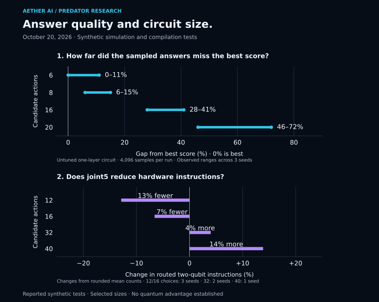</a> 
  Answer quality and circuit size are different measurements. Selected sizes shown; full tables, methods, and limits are linked below.

The proposed upgrade: **compare both circuit layouts, keep the smaller one, use a suitable local simulator for quantum experiments.** Ordinary computer search keeps choosing the next move until another method earns that role in a fair comparison. Design recommendations; the sweep does not establish that they have shipped.

[Scaling tests: plain-English guide and full tables →](docs/research/search-scaling.md) · [Chart data →](docs/research/search-scaling.json)

## Gen3 OSS: banked scientific results

**Two open-source test cases, published with their data and limits.** CharLS and QPACK carry deliberately introduced faults, so the loop can be scored against a known answer. "Banked" means the result and its evidence are kept and checkable.

<table>
  <tr>
    <th width="50%">CharLS Q3 repair</th>
    <th width="50%">QPACK feedback study</th>
  </tr>
  <tr>
    <td width="50%" valign="top"><a href="docs/research/charls-q3.md">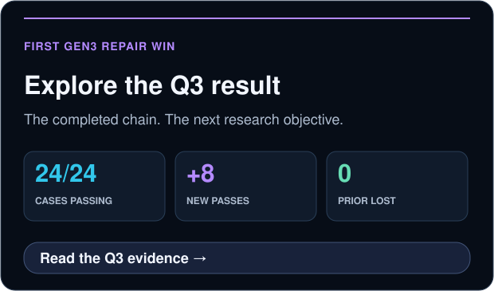</a></td>
    <td width="50%" valign="top"><a href="docs/research/gen3-qpack-experiment1.md">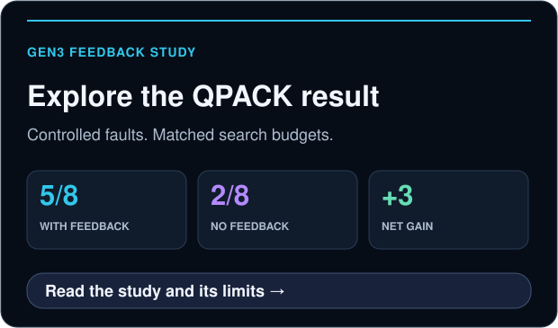</a></td>
  </tr>
</table>

| Study | Recorded result | What it shows |
| :--- | :--- | :--- |
| **[CharLS Q3 repair](docs/research/charls-q3.md)** | **16/24 → 24/24** protected passes; eight gained, all earlier passes kept | The ratchet at work: a dependent repair at depth 3 closed the obligation left by depth 2, on real C++ source, without dropping an earlier pass. |
| **[QPACK feedback study](docs/research/gen3-qpack-experiment1.md)** | **5/8** controlled faults found with feedback, **2/8** without | A second pass informed by the first pass's native checks found more in this exploratory campaign. The adaptive classical comparison was incomplete, so the quantum selector's own contribution was not isolated. |

Both studies used deliberately introduced faults. No newly discovered CVE finding has been published. Discovery, matched comparisons and quantum advantage remain research objectives.

## Ways to work with Aether

**Commission a focused repository mission, qualify a repeatable security profile, or scope an authorized live assessment.**

<table>
  <tr>
    <td width="50%" valign="top"><a href="https://aethersystems.net/strikes/">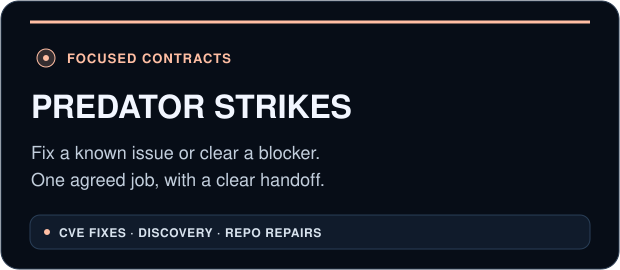</a></td>
    <td width="50%" valign="top"><a href="https://aethersystems.net/actions/design-partner">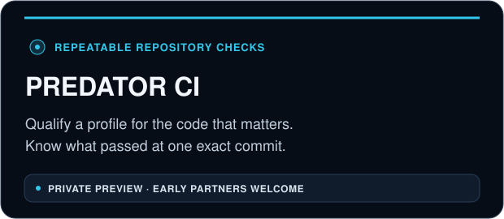</a></td>
  </tr>
</table>

| Path | Best fit | Start here |
| :--- | :--- | :--- |
| **Predator Strikes** | A known CVE fix, focused discovery, or chain analysis for one agreed repository surface | [Discuss a Strike →](https://aethersystems.net/strikes/) |
| **Predator CI** | Repeatable checks against a qualified repository profile and exact commit; private preview | [Qualify a profile →](https://aethersystems.net/actions/design-partner) |
| **Predator Red Team** | An authorized assessment of a live environment, with reviewed findings and remediation | [Scope an assessment →](https://aethersystems.net/defense-stack) |

Agree the surface, acceptance checks and handoff before work begins; live assessments also need approved targets, methods, timing, contacts and stop conditions. The service pages list pricing and terms; broader engineering work starts with a [project inquiry](https://aethersystems.net/contact).

> **[Read the safety model →](SAFETY.md)** Human-approved scope and budgets bound each run. Memory, model suggestions and quantum results supply evidence; authority comes from the approved mission. The guide separates required policy from controls proven in code.

## Join the community

Ask about the studies, suggest a public demo, or share feedback in [GitHub Discussions](https://github.com/AetherAI3/Predator/discussions). Use [issues](https://github.com/AetherAI3/Predator/issues/new/choose) for documentation corrections.

[Contributing guide](CONTRIBUTING.md) · [Community guidelines](CODE_OF_CONDUCT.md) · [Security reporting](SECURITY.md)

## Developers: join the research program

Help build the CLI, repair chains, verification tools, or classical/quantum comparisons. Tell us what you have built and where you want to contribute; private research access is reviewed separately.

[Apply to join →](https://aethersystems.net/contact?intent=general&product=site_wide&cta=footer_updates_contact)

### Predator R3D and Predator BLU3

  
  

**Two authorization gates for Gen3 in the private Predator CLI.** Request access to **Predator R3D** or **Predator BLU3** from the CLI; requests are reviewed separately from developer-program applications.

  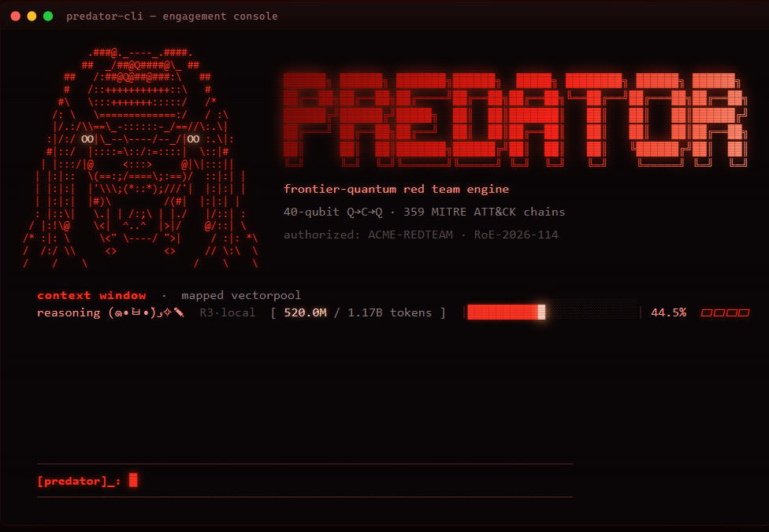 
  Predator CLI console preview · illustrative layout and counters

## Glossary

| Term | Plain English |
| :--- | :--- |
| **shots** | How many times one quantum circuit is run and read out; a majority vote over the readings gives the answer. |
| **receipt** | A signed record that a step happened (an IBM job, a verdict, a message), kept so it can be re-checked. |
| **fixture** | A task with a known answer, scored by a deterministic checker; measures agents without quantum-computer time. |
| **scripted agent** | A stand-in that follows a fixed script; not a reasoning model. |
| **frontier model** | One of the strongest commercial models available; this page never names the product. |
| **mid-cost / free-tier model** | Cheaper models called through a model gateway; mid-cost is well below the frontier price, free-tier costs almost nothing. |
| **CFC** | Custom Fanout Controls: how many candidates to open, how long to look, when to stop. |
| **QUBO / energy** | A scorecard for yes/no choices that interact; energy is the score, lower is better. |
| **packet** | A short signed message (96 bits) telling an agent which record to use; a reference, never the record. |
| **lane** | One stream of Predator work: bounty, open-source (OSS), mission or training. |
| **evidence bank** | The shared store of verified records, each with its receipt, that briefings are built from. |
| **promotion** | Accepting a change, such as a weight patch, because it passed the judge's preregistered gates. |
| **modelled** | Arithmetic from measured per-unit costs; not a run. |
| **pin (Model-1)** | One code function Predator is asked to judge: is the risky value protected before it reaches the sink? |
| **pathway / replayable step** | A proven procedure the system can run again on a known kind of problem without the model; see replay. |
| **halt** | The exact point where Model 1 got stuck on a pin, saved so the system can work from it. |
| **seat** | A hint state built at a halt for Model 1 to read from once; PL1 compared four kinds. |
| **adaptive energy tokenizer** | Squeezes a stuck point into a small search and scores each candidate; part of Nano. |
| **replay (~0 inference)** | Running a proven, stored step again without asking the model to reason it out. |
| **absorption** | Training the model on decisions it got wrong while the evidence was on screen. |
| **noise floor** | The smallest difference a comparison must beat to count; in PL1, 8 stuck points. |
| **quantum oracle** | An optional instrument: a bounded search encoded for a quantum computer, read back as ordinary numbers; design, not used in the loop. |
| **self-improvement loop** | Failure → search → verify → remember → replay → train → a stronger model; design, not shown. |

## Read the evidence

| Start with | Then explore |
| :--- | :--- |
| **[P-BOX feature showcase](#p-box)** | VM lifecycle, operator control, recorded guest session |
| **[HTB training evidence](docs/htb/README.md)** | Courses, tracks, machines, certificates, replay index |
| **[Crucible](#crucible-adaptive-quantum-threat-modeling)** | The loop as a lockpick, with [MITRE chains](#mitre-attck-chain-library) and the [CVE catalog](#cve-research-catalog) |
| **[CodePro and System-2](#codepro-and-system-2)** | How the fanout runs, and the private CLI around it |
| **[Quantum Comm Ops](docs/research/quantum-comm-ops.md)** | [Status, November 8](#status-november-8-2026); [the 400-agent mission on IBM hardware](docs/research/quantum-comm-ops.md#ibm-hardware-missions); [the first compounding mission](docs/research/quantum-comm-ops.md#first-compounding-mission); [the November 5–8 rounds and the bus](docs/research/quantum-comm-ops.md#november-5-8-2026); [aggregate data with pins](docs/research/quantum-comm-ops.json) |
| **[CharLS Q3](docs/research/charls-q3.md)** | [Public data](docs/research/charls-q3.json) and the completed dependent repair |
| **[QPACK study](docs/research/gen3-qpack-experiment1.md)** | [Episode data](docs/research/gen3-qpack-experiment1.json), comparisons, missing outcomes |
| **[joint5 IBM Fez pilot](docs/research/ibm-fez-pilot.md)** | [Public data](docs/research/ibm-pilot.json), uncertainty, the energy regression |
| **[Self-improvement loop](#self-improvement-loop)** | Model-1 Phase A ([guide](docs/research/quantum-comm-ops.md#model-1-phase-a)), lane run R1 ([guide](docs/research/quantum-comm-ops.md#model-1-lane-run-r1)), compiled pathways ([guide](docs/research/quantum-comm-ops.md#model-1-compiled-pathways)), the harder mission, PL1 and D1 ([guide](docs/research/quantum-comm-ops.md#self-improvement-loop)); [JSON](docs/research/quantum-comm-ops.json) blocks `model1_phase_a_2026_11_11`, `model1_lane_run_r1_2026_11_12`, `model1_compiled_c001_2026_11_13`, `model1_trace_runs_2026_11_14_15`, `model1_pl1_2026_11_16`, `model1_rsi_loop_2026_11_17` |
| **[Generations](docs/research/generations.md)** | [Generations in plain English](#generations-in-plain-english), the triggers for Gen4, sources, and the requirements for promoting research into qualified profiles |
| **[Predator safety model](SAFETY.md)** | Required boundaries and the status of implemented controls |
| **[Unlimited Context](https://github.com/AetherAI3/Unlimited-Context-LLM)** | [How it works](https://github.com/AetherAI3/Unlimited-Context-LLM#how-it-works) and [safety measures](https://github.com/AetherAI3/Unlimited-Context-LLM/blob/main/SAFETY.md) |

Public overview and selected research notes · Private operator engines © 2026 Aether AI LLC. All rights reserved. IBM is identified as a hardware provider; no affiliation or endorsement is implied. <a href="docs/assets/SOURCES.md">Visual sources</a>.

