

   
  <strong>AETHER AI · PREDATOR</strong>

  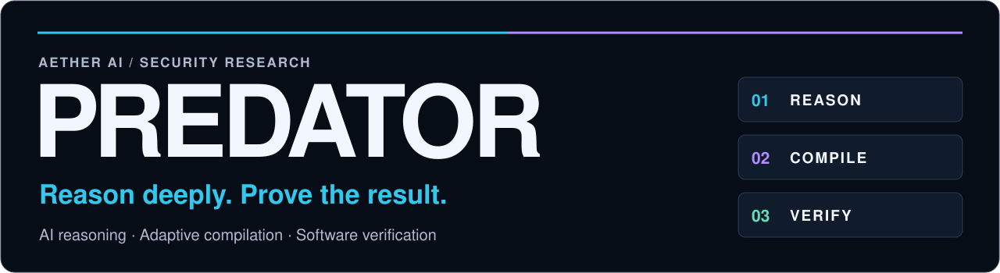

  
  
  

# Predator

**AI security research, software repair, and authorized VM workflows.**

Predator brings AI reasoning, persistent context, and reviewed tool use into security research and software repair. Its research engine, **Crucible**, works like a lockpick: it holds verified evidence steady, proposes candidate chains, checks them against the real software, and banks only supported results.

This is the **public feature showcase and evidence collection**. The CLI and operator engines are private, with [reviewed research access](#developers-join-the-research-program).

[How search works](#how-predator-chooses-the-next-move) · [P-BOX / HTB training](#p-box-htb-training) · [Gen3 Private Security](#gen3-private-security) · [Crucible](#crucible-adaptive-quantum-threat-modeling) · [MITRE chains](#mitre-attck-chain-library) · [CVE catalog](#cve-research-catalog) · [CodePro & System-2](#codepro-and-system-2) · [Quantum Comm Ops](#gen3-quantum-comm-ops) · [joint5 & IBM Fez](#joint5-compiler-the-ibm-fez-hardware-result) · [Results](#banked-scientific-results) · [Work with Aether](#ways-to-work-with-aether) · [Gen3 access](#predator-r3d-and-predator-blu3) · [Docs](docs/README.md)

## How Predator chooses the next move

**Keep Predator’s ordinary computer search in charge, make quantum experiments cheaper, and require evidence before trusting them with decisions.** The [tests described here](docs/research/search-scaling.md) have not demonstrated a quantum advantage.

Think of Predator choosing from a menu of possible next moves. Some moves work well together. Some require another move first. Others conflict. The goal is to pick the best allowed combination.

A **QUBO** is the scorecard for those yes/no choices and how they interact. **Energy** is the score—lower is better. The score helps rank candidates; checks against the actual software establish whether a proposed result holds. Each run records the solver it used, including any quantum simulation or hardware.

[See the joint5 charts and measured limits →](#joint5-compiler-the-ibm-fez-hardware-result)

## P-BOX / HTB training

### [P-BOX] Predator's disposable Linux VM

**Give Predator a goal, confirm the VM, and follow along as it works.**

P-BOX is Predator's disposable Linux pwnbox for authorized CTF and HTB missions. Predator can spawn the VM when a hosted Pwnbox is unavailable, giving it a place to work that you can watch and control.

| What you can do | How it works |
| :--- | :--- |
| **Confirm and start** | You confirm the VM before Predator begins work within the approved mission. |
| **Work toward longer goals** | Predator works autonomously through reviewed terminal actions, reads fresh guest output, and chooses the next step within the approved mission. |
| **Watch, take over, and resume** | Watch the guest live, take control yourself, hand it back to Predator, or stop the mission. |
| **Clean up automatically** | The VM's disk is removed when you stop it or its lease expires. |

*The recording below includes challenge spoilers and visible lab command history.*

  <a href="docs/htb/machines/ghostlink/README.md">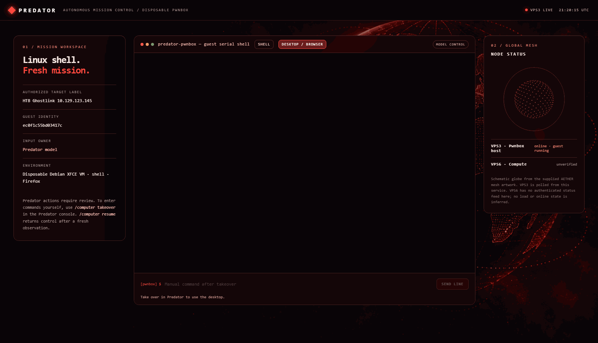</a> 
  P-BOX in action · Predator / GLM-5.3 · 670 recorded guest frames · <a href="docs/htb/machines/ghostlink/README.md">Ghostlink evidence and execution roles</a>

<strong>About this GLM-5.3 replay</strong>

The featured GIF comes from **Predator's GLM-5.3 Ghostlink mission in P-BOX**. It contains 670 recorded guest frames at 1600 × 920, with blank browser-loading frames removed. The [frame provenance](docs/htb/machines/ghostlink/replay-provenance.json) records the retained source-frame hashes and GIF hash.

The [machine guide](docs/htb/machines/ghostlink/README.md) records GLM-5.3's research and the operator's later actions. The screen recorder stopped before the final user and root challenge-file reads; those observations are documented separately.

### Hack The Box: training and evidence

**HTB is a test and training ground for Predator's agent and VM workflows.** These two examples show autonomous VM command work and saved lab research, with completion records and execution roles in their guides.

*The Satellite replay includes challenge spoilers. Both GIFs are assembled evidence replays.*

<table>
  <tr>
    <th width="50%">Nmap course · autonomous VM work</th>
    <th width="50%">Satellite Exploitation · recorded lab work</th>
  </tr>
  <tr>
    <td width="50%" valign="top"><a href="docs/htb/academy/README.md">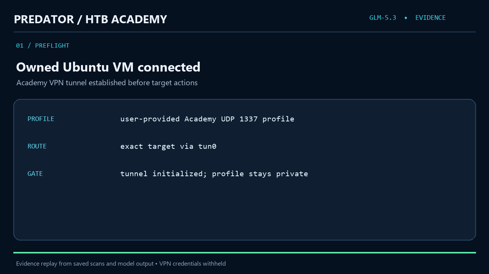</a></td>
    <td width="50%" valign="top"><a href="docs/htb/satellite-exploitation/README.md">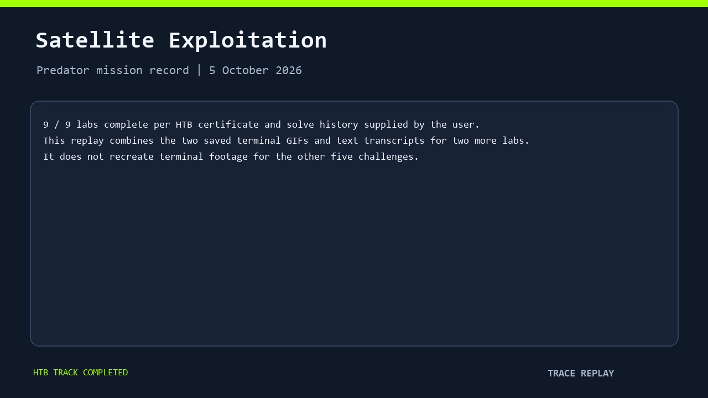</a></td>
  </tr>
  <tr>
    <td width="50%" valign="top"><strong>12/12 Academy sections completed.</strong> Predator through GLM-5.3 ran the VM commands autonomously. The owner supplied prompts and exercise questions, then entered the answers. <a href="docs/htb/academy/README.md">Course record and replays →</a></td>
    <td width="50%" valign="top"><strong>9/9 labs completed.</strong> The certificate and account activity support completion; the replay covers four saved lab records. <a href="docs/htb/satellite-exploitation/README.md">Certificate, lab list, and replays →</a></td>
  </tr>
</table>

<strong>More HTB records and replay notes</strong>

| Module or track | Recorded progress | Open the guide |
| :--- | :--- | :--- |
| **Academy: Network Enumeration with Nmap** | **12/12 sections completed** · October 3, 2026 | [Completion record and two replays](docs/htb/academy/README.md) |
| **Satellite Exploitation** | **9/9 labs completed** · October 5, 2026 | [Certificate, lab list, and replays](docs/htb/satellite-exploitation/README.md) |
| **AI and ML Exploitation** | **1/17 labs HTB-accepted** · in progress | [Lab status and three replays](docs/htb/ai-ml-exploitation/README.md) |
| **Machine: BlockSynergy** | **User and root challenge files read** · October 5, 2026; owner confirmed | [Machine record and sanitized replay](docs/htb/machines/blocksynergy/README.md) |
| **Machine: Ghostlink** | **User and root challenge files read** · October 5, 2026; HTB submission unobserved | [Machine record and full-screen pwnbox replay](docs/htb/machines/ghostlink/README.md) |

The [earlier Pwnbox console preview](docs/media/predator-pwnbox-ttl-preview.gif) shows a separate reviewed guest-session check. AI/ML counts only HTB-accepted results toward completion. The machine guides distinguish Predator research from operator execution and explain what their recordings contain.

**[Browse all HTB modules, certificates, and replays →](docs/htb/README.md)**

## Gen3 Private Security

**Gen3** is the name for Predator's current research workflow and the evidence it leaves behind. It describes a method, not a measured quantum advantage.

Five scoped research records from October 2026, each with its validation and disclosure status kept separate. The Crucible research workflow is described in the next section:

| Target | Public material | Status |
| :--- | :--- | :--- |
| **Vercel AI SDK** | [Redacted local P-BOX replay](docs/pbox-vercel-ai-sdk-showcase.md) | Verified local result with synthetic values; no production access. |
| **Gemini CLI** | [Sanitized Crucible sprint graphic](docs/assets/gemini-cli-crucible-sprint.svg) | Three private Google Cloud VRP reports under triage; no assigned severity or reward. |
| **GitLab Duo** | [Private-research tactic map](docs/assets/gitlab-duo-crucible-private.svg) | Owner-controlled local validation; no vulnerability report filed. |
| **GitLab for VS Code** | [VPS3 Predator P-BOX research visual](docs/pbox-gitlab-extension-research-visual.md) | Private report filed; technical record remains private. |
| **Anthropic SDK** | [Conditional AX research map](docs/assets/anthropic-sdk-crucible-private.svg) | Three owner-controlled local paths from one shared boundary; no vulnerability report filed. |

### Vercel AI SDK: redacted local P-BOX replay

Predator's VPS3 P-BOX also supported a **local security test of the Vercel AI SDK**. The public replay shows the disposable Linux desktop and a verified local result. It uses synthetic values; no Vercel production account or service was accessed.

  <a href="docs/pbox-vercel-ai-sdk-showcase.md">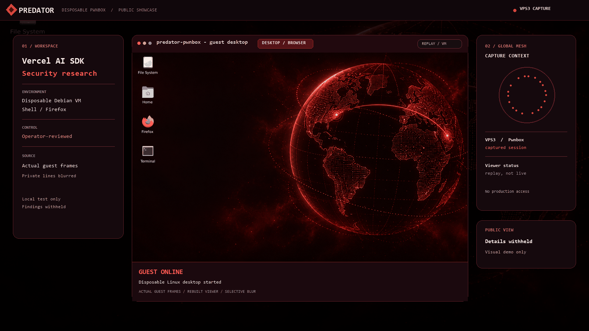</a> 
  Five actual guest captures · seven replay frames · selective FFmpeg blur · <a href="docs/pbox-vercel-ai-sdk-showcase.md">provenance and disclosure limits</a>

### Gemini CLI: private Crucible sprint

On **October 9, 2026**, Predator's manual research workflow ran a deep Gemini CLI Crucible sprint across the **C1 → Q173 checkpoint span**. Three separate reports were filed privately with Google Cloud VRP during the day. They remain under triage; no severity or reward has been assigned.

  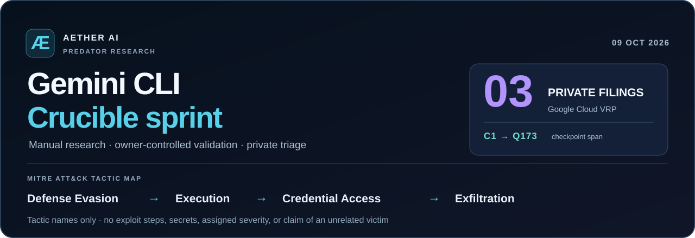 
  Public taxonomy only: Defense Evasion → Execution → Credential Access → Exfiltration. No reproduction details or credential material.

#### Sanitized research energy

  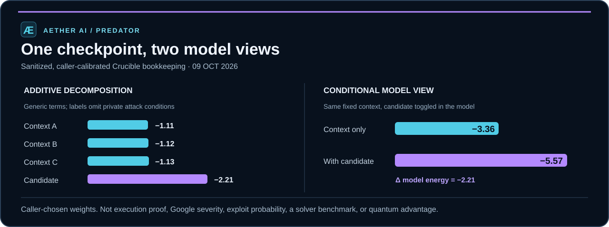

The two views show **one caller-calibrated model checkpoint**, with private attack-condition labels removed. Its weights are research bookkeeping; they do not independently verify a finding, measure exploit probability, establish quantum advantage, or set a Google bounty tier. Validation evidence remains in the private reports while triage is pending.

### GitLab Duo: private Crucible research

Predator began an owner-controlled GitLab Duo research sprint on **October 9, 2026**. The graphic below is a **C1 → Q48 snapshot from October 10**; later manual checkpoints remain private. These labels identify research checkpoints, not executed quantum interventions or a paid CFC run. The local result maps at the [MITRE ATT&CK](https://attack.mitre.org/tactics/) tactic level to **Execution → Credential Access → Exfiltration**. This is a research map of an owned test, not a claim about an attack on another user.

**Private findings: technical details have not been disclosed and no vulnerability report has been filed.** No severity or bounty has been assigned. The saved evidence does not establish zero-click execution or a sandbox escape.

  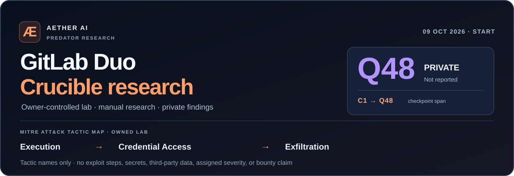 
  October 10 snapshot · owner-controlled validation · tactic names only · no reproduction steps, secrets, or third-party data

### GitLab for VS Code: private report filed

Predator banked an owner-controlled GitLab for VS Code research record and filed a private report. Technical details and evidence remain private while disclosure is coordinated.

### Anthropic SDK: private Crucible research

On **October 10, 2026**, Predator banked **AX001–AX003** as three conditional outcomes of one shared trust boundary in owner-controlled local fixtures. Their public [MITRE ATT&CK](https://attack.mitre.org/tactics/) tactic lenses are **Collection**, **Credential Access**, and **Execution**. These are parallel research paths, not one completed attack sequence or three independently confirmed vulnerabilities.

The saved evidence does not establish a deployed lower-trust writer route, Claude-selected tool action, real credential exposure, or deployed code execution. **No vulnerability report has been filed, and no severity or bounty has been assigned.** Technical reproduction details remain private.

  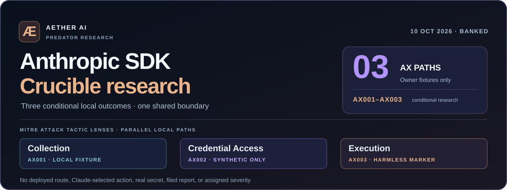 
  Owner-controlled fixtures · parallel tactic lenses · no reproduction steps, secrets, or third-party data

## Crucible: adaptive quantum threat modeling

**Think of a lockpick. Hold tension, test one pin at a time, and keep every pin that sets.**

Crucible is Predator's software research and repair loop. It starts with a pinned source revision, a defined question, and fixed acceptance checks. The easiest way to picture it is a lock being picked: one hand holds tension so nothing already gained can slip, the other tests pins until one clicks, and a pin that sets stays set while the next one is worked.

  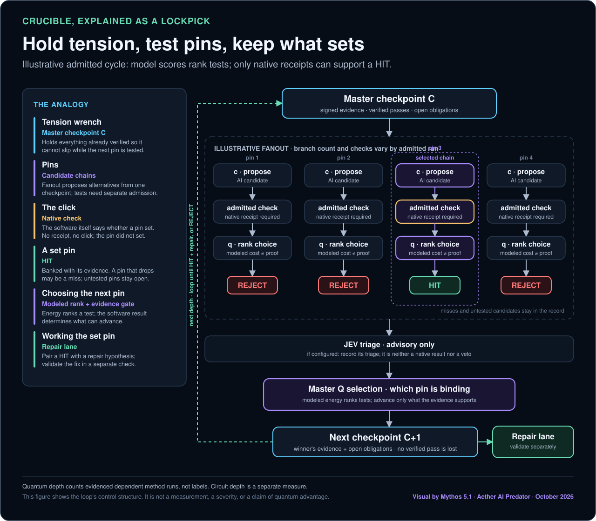 
  One depth step of the loop, drawn as a lockpick. Visual by Mythos 5.1.

The four pins illustrate a **research design**, not four measured workers or native checks in every run. The [execution and evidence guide](docs/research/crucible-evidence-contract.md) separates the CFC selector, an admitted exploit ratchet, and manual research. It also defines the minimum candidate record and the native effect needed for a zero-click claim. A model score, a worker proposal, and a native result are different records.

### The lock, part by part

| In the lock | In Crucible | What it does |
| :--- | :--- | :--- |
| **Tension wrench** | **Master checkpoint (C)** | Holds verified evidence with its provenance, signatures where present, the passes that must not be lost, and obligations still open. A manual checkpoint is not signed merely because it has a C label. |
| **Pins** | **Candidate chains** | Fanout proposes alternatives from a checkpoint. A proposal and its QUBO ranking do not imply that a native check ran. |
| **The click** | **Native check** | The software itself says whether a pin set. A chain with no native receipt did not click, whatever the model thought of it. |
| **A set pin** | **HIT** | Banked only with an appropriate native receipt. Misses, refutations, and inconclusive results stay in the record with their limits. |
| **Choosing the next pin** | **QUBO selection and evidence gate** | A modeled energy can rank a test; native outcomes determine what is supported. JEV participates only when an admitted stage records a typed call and its usage. Its decision is advisory, not an independent software result. |
| **Working the set pin** | **Repair lane** | Pair a supported attack observation with a repair hypothesis and regression plan. A fix counts as validated only after its own check. |

### What happens in one cycle

| Step | What happens |
| :--- | :--- |
| **Pin** | Freeze the source revision, scope, evidence, and acceptance checks. This is the tension. |
| **Fan out** | Open several small candidate chains from the checkpoint. Each proposes a threat path or repair. |
| **Model** | State the target facts, candidate choices, constraints, and provenance. A bounded QUBO can rank tests; not every library chain has a populated energy profile. |
| **Search** | Record the solver actually used. A classical minimum is one valid selection method; a simulator or quantum device is a separate, explicitly evidenced run. |
| **Validate** | Run the admitted native check and retain its receipt. A proposal without that check remains a hypothesis. Record HIT, miss, refutation, or inconclusive outcome accurately. |
| **Select and carry** | Carry the supported evidence and open obligations into the next checkpoint. Pair an attack observation with a repair record; verify the repair separately. |

### Quantum depth

Each cycle leaves a checkpoint, and each checkpoint seeds the next intervention. A failed check is not wasted: it can reveal a missing constraint or a repair obligation that shapes the next pin.

**C0 → Q1 → C1 → Q2 → C2 → Q3 → C3**

| Label | Meaning |
| :--- | :--- |
| **C** | A saved evidence checkpoint. The tension at that depth. |
| **Q** | A dependent quantum-method intervention when one actually ran. Manual C/Q shorthand can label research stages, but the label alone is not an execution receipt. |
| **Quantum depth** | How many evidenced, dependent quantum-method interventions ran in one chain. Circuit depth is a different number: the size of the circuit inside one intervention. |

The **ratchet** is the rule that verified earlier results and negative evidence remain visible while the next candidate is checked. It does not guarantee that a later candidate will pass. In the [CharLS case](docs/research/charls-q3.md), Q3 used C2's remaining repair obligation to move from **16/24 to 24/24** protected test passes, retaining all 16 earlier passes.

[Research roadmap →](docs/research/generations.md)

<strong>Methods, evidence, and current limits</strong>

QUBO stands for quadratic unconstrained binary optimization. Its energy is the modeled cost to minimize; a low energy is a reason to test a candidate, not proof that it works. Only the native check on the software sets a pin.

The public CharLS and QPACK studies used quantum-circuit simulation. The [joint5 pilot](docs/research/ibm-fez-pilot.md) supplies a separate hardware record. [Jev](https://docs.typesafe.ai/introduction) can provide structured triage only after the stage path is enabled, qualified, and deployed. A `NOT_CONFIGURED` field, an adapter in source, or an offline preflight is not a provider call. A participating run must record its typed decision, call count, and spend; JEV never terminates a chain on its own.

Where issued, signed custody binds research stages to source and artifacts. Manual research notes and C/Q labels are not signed receipts. Live signed acceptance, server-side stage minting, and variable-depth custody remain under validation. Each continuation needs its own scope, budget, and admission.

Gen3 seeks attributable quantum advantage over credible AI-only and classical alternatives, with matched resources and independent replication. Quantum advantage and a measured Jev contribution remain unestablished. The lockpick figure illustrates the loop's control structure; it is not a measurement, a severity, or a claim of advantage.

### Where the pins come from: the ATT&CK chain library

**424 source-bank chains · 18 routing buckets · October 10, 2026 V16 registry snapshot**

A pin is only as good as its source and test. The library provides chain definitions, prerequisites, and references for candidate generation; a new source-grounded hypothesis can also be proposed. The 424 count is **catalog coverage**, not 424 tested exploits or 424 calibrated energy models. Most profile slots are explicitly unmodeled. The map shows the [15 current MITRE ATT&CK Enterprise tactics](https://attack.mitre.org/tactics/) alongside Aether's AI injection, [MCP](https://owasp.org/www-project-mcp-top-10/), and memory-safety research areas. Predator's routing labels are maintained separately from MITRE's tactic names.

  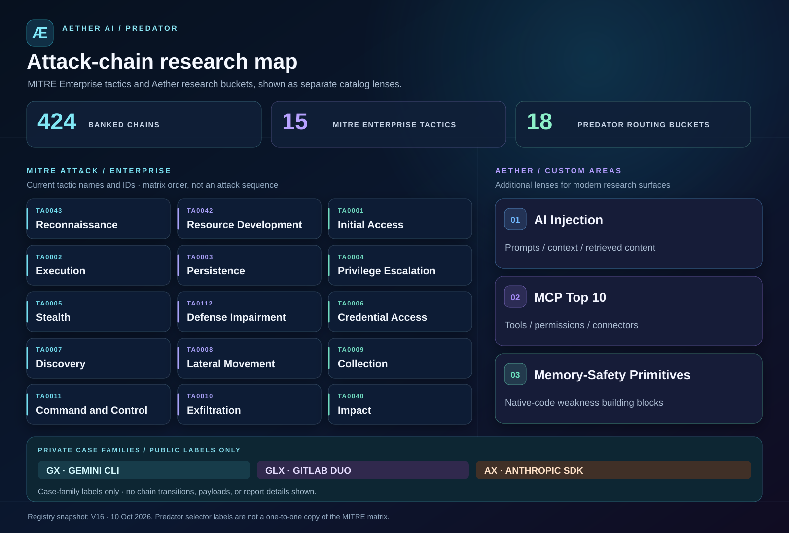 
  <a href="docs/assets/attack-buckets-v16.svg">Open the full-size research map</a> · GX, GLX, and AX are public case-family labels; no exploit steps are shown.

| What a chain contains | Why it helps |
| :--- | :--- |
| **Connected steps** | Show how a proposed path depends on earlier conditions. |
| **Prerequisites and references** | Keep the model tied to stated assumptions and cited sources. |
| **Routing category** | Organize the review around the relevant research surface. |

**Research mode** follows chain and CVE references to develop cited hypotheses, counterexamples, and proposed extensions; it is the c-stage of a pin. Source review and appropriate checks on the software must establish observed behavior before a modeled path becomes a finding.

#### AX · Anthropic SDK

AX001, AX002, and AX003 mark conditional local research paths with **Collection**, **Credential Access**, and **Execution** tactic lenses. The paths share one underlying trust boundary and are shown separately in the [Anthropic research card](docs/assets/anthropic-sdk-crucible-private.svg). The public map does not claim a sequential exploit, a deployed integration, or a vendor-confirmed finding.

### CVE catalog and database

**The vulnerability records the chains anchor to.**

Alongside the chain library, Predator maintains a catalog of CVE records, affected products, advisories, problem types, and scoring data. CVE IDs connect those records to chain anchors so an investigation can follow the underlying evidence.

| Part of the catalog | What it contributes |
| :--- | :--- |
| **CVE source records** | [CVE JSON 5.x](https://github.com/CVEProject/cvelistV5) imports and affected-product information. |
| **Separate enrichment** | NVD, CISA KEV, and FIRST EPSS data alongside the source records. |
| **Research review** | Deep-cycle integration reads shortlisted full CVE cards before ranking and records what was reviewed. |

**Drive** uses the approved mission's pinned evidence for investigation and validation. Catalog coverage and freshness depend on completed imports and pinned snapshots.

## CodePro and System-2: how the fanout runs

**Many workers, one evidence trail.** When Crucible fans out, it needs a way to give several workers the right context at once and to read their answers back as one record. That is CodePro.

| Part | What it does, in plain terms |
| :--- | :--- |
| **CodePro fanout** | In an admitted run, starts scoped workers and records each returned claim and provider receipt. A manual research turn or unavailable dispatch path is not a completed fanout. |
| **System-2 shared IR** | Aligns claims, evidence references, and open questions from workers that use the same intermediate representation. |
| **Clean model worktrees** | Source-backed runs can isolate model work in pinned Git worktrees. The run record identifies the actual checkout and revision rather than assuming isolation. |
| **[Unlimited Context (UCL)](https://github.com/AetherAI3/Unlimited-Context-LLM)** | Keeps source-backed evidence in named memory pools across sessions and models. “Unlimited” describes retrieval reach: relevant slices enter the model’s normal attention window. |

**Evidence-accounting update:** a tested System-2 draft counts supporting sources rather than repeated statements; integration remains pending. [What was tested and what remains open →](docs/research/quantum-comm-ops.md#system2-evidence-accounting)

<strong>CodePro implementation links</strong>

[System-2 orchestration](https://github.com/AetherAI3/AETHER-CLOUD/tree/main/lib/orchestrator/system2) · [Native compiler](https://github.com/AetherAI3/AETHER-CLOUD/tree/main/native) · [Benchmarks](https://github.com/AetherAI3/AETHER-CLOUD/tree/main/bench)

*Implementation links require repository access.*

### The private CLI around it

The private **Predator CLI** brings research, tools, and persistent evidence into one conversation. Choose an available Aether model, keep each run attached to its sources and approved scope, and continue from saved work. Restart checks verify the task, worktree, and memory-pool identity.

| Capability | What it does |
| :--- | :--- |
| **Research and Drive** | Cross-reference chains and CVEs, review candidates, and run approved investigation and validation stages. |
| **Predator RC** | Follow browser and CLI activity through an encrypted relay, take over, and hand control back. |
| **[P-BOX](#p-box)** | Spawn a disposable Linux pwnbox for a confirmed mission, with live viewing, operator control, and automatic cleanup. |
| **Guest consoles** | Work through supported Pwnbox/noVNC sessions or an owned VM in an authorized training lab. |

<strong>Browser, RC, and guest-session status</strong>

Supported Pwnbox/noVNC sessions have recorded attachment, observation, reviewed input, human takeover, resume, and cleanup. An owned Ubuntu VM supplied the Academy workflow shown earlier. Other CTF, Sherlock, VM, and VPN environments need their own scope and validation.

RC is in controlled private preview. The production viewer and relay have been exercised in an owner validation; the complete sign-in, mission selection, and controller hand-back journey remains under validation. Browser and guest sessions require a fresh check after interruption.

## Gen3 Quantum Comm Ops

**Give each worker useful context. Verify every handoff. Focus further work on promising results.**

Quantum Comm Ops is Predator's research into coordinating large agent workflows. A shared evidence bank holds the findings; a compiler prepares small, task-specific messages; receivers check those messages before using them. Adaptive **Custom Fanout Controls (CFC)** decide which branches need more attention next.

The programme compares ordinary delivery with an experimental quantum-search route through **Nano → ATLAS → FakeFez**, a simulator configured to model an IBM device. Compact packets select or reconstruct records from the shared bank. Useful reasoning from those records is a separate model-qualification step.

  <a href="docs/research/quantum-comm-ops.md">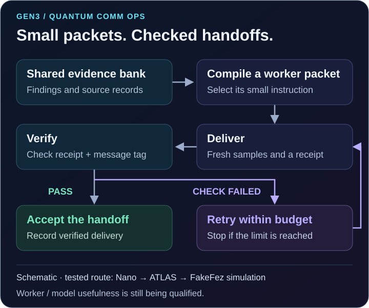</a>

### Current milestone: repeated 400-recipient delivery

**Three fresh datasets, 400 scripted recipients each.** All recipients verified after any required retry. These datasets come from the same generator; the tests measure message delivery.

| Measurement | Recorded result |
| :--- | :--- |
| **First-pass verification** | **400/400, 400/400 and 399/400** across the three datasets |
| **After verified retry** | **400/400 on every dataset** |
| **Jobs, including retries** | **1,200–1,203**, compared with 3,232 in the earlier F2 configuration |
| **Samples (“shots”), including retries** | **3,600–3,618**, compared with 13,056 in F2 |
| **Latest two mission times** | **About 49–51 minutes** on the research host; timing varies with host performance |

Smaller dataset-specific frames, fewer samples, pooled simulator setup and exact compiler checks reduced the work. In one run, a wrong majority vote failed its message-tag check; a six-shot retry recovered that recipient. **Three shots plus capped six-shot rescue is now the adopted research baseline.**

### What comes next

Qualify models that use the delivered evidence, test other dataset constructions, measure a small packed request on IBM hardware, and validate production and independent-sandbox integration. The tested **superposition multiplexing** scheme did not beat ordinary packed circuits in the cost models.

**Status, October 31, 2026:** Comm Ops results are simulator benchmarks, with no demonstrated quantum advantage or IBM billing savings. The separate joint5 hardware pilot is described below.

**[Plain-English guide, history and open questions →](docs/research/quantum-comm-ops.md)** · [Public aggregate data and source pins](docs/research/quantum-comm-ops.json)

## joint5 compiler and the IBM Fez result

**joint5 changes how a quantum circuit is built.** AQRC translates the QUBO scorecard into instructions that a simulator or device can run. joint5 is an alternative compilation path. Fewer native two-qubit gates mean fewer hardware instructions involving a pair of qubits. Answer quality is measured separately against the same scoring problem.

### The IBM Fez hardware pilot

**What was measured.** The joint5 pilot compared ordinary and joint5 compilation on IBM Fez: one six-variable fixture, its vulnerable and fixed poles, four circuits, and 1,024 shots per circuit in one hardware job (3 seconds of billed QPU time).

| Measurement | Ordinary → joint5 | Change |
| :--- | :--- | :--- |
| Native two-qubit gates, each pole | **144 → 103** | **28.5% fewer** |
| Distance from ideal output, vulnerable pole | **0.3952 → 0.3165** | **19.9% lower** |
| Distance from ideal output, fixed pole | **0.4039 → 0.3080** | **23.7% lower** |

Lower total-variation distance means closer agreement with the ideal output distribution. **Expected energy worsened on both poles.** The pilot records one acquisition without independent confirmation. Improved minimization and quantum advantage remain unestablished.

[Measurements and uncertainty →](docs/research/ibm-fez-pilot.md) · [Full-precision data →](docs/research/ibm-pilot.json)

### How the search and compiler scale

An **October 20, 2026 synthetic sweep** asked two separate questions: how close do the sampled answers get to the best score, and does joint5 save hardware instructions as the choices grow? These were simulator and compilation tests, separate from the IBM Fez acquisition above.

  <a href="docs/research/search-scaling.md">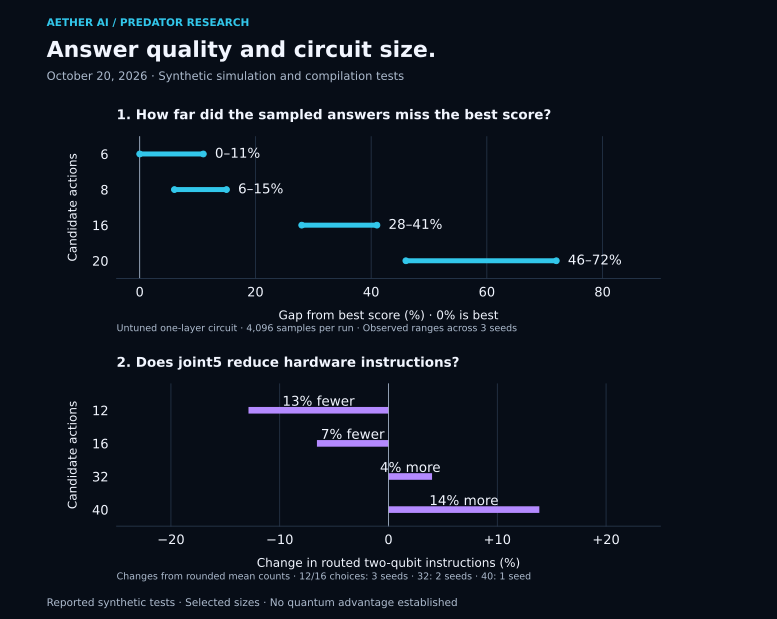</a> 
  Answer quality and circuit size are different measurements. Selected sizes shown; full tables, methods, and limits are linked below.

The proposed upgrade is simple: **compare both circuit layouts, keep the smaller one, and use a suitable local simulator for quantum experiments.** Ordinary computer search keeps choosing the next move until another method earns that role in a fair comparison. These are design recommendations; the sweep does not establish that the upgrades have shipped.

[Scaling tests: plain-English guide and full tables →](docs/research/search-scaling.md) · [Chart data →](docs/research/search-scaling.json)

## Gen3 OSS: banked scientific results

**Two open-source test cases, published with their data and their limits.** CharLS and QPACK carry deliberately introduced faults, so the loop can be scored against a known answer. “Banked” means the result and its evidence are retained and can be checked.

<table>
  <tr>
    <th width="50%">CharLS Q3 repair</th>
    <th width="50%">QPACK feedback study</th>
  </tr>
  <tr>
    <td width="50%" valign="top"><a href="docs/research/charls-q3.md">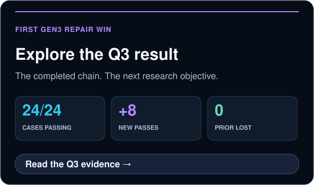</a></td>
    <td width="50%" valign="top"><a href="docs/research/gen3-qpack-experiment1.md">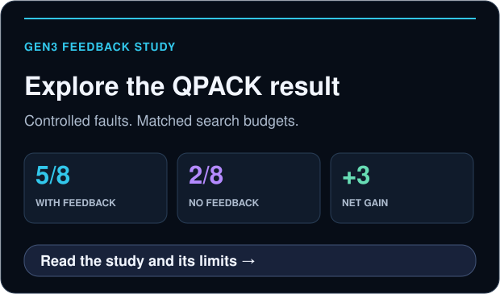</a></td>
  </tr>
</table>

| Study | Recorded result | What it shows |
| :--- | :--- | :--- |
| **[CharLS Q3 repair](docs/research/charls-q3.md)** | **16/24 → 24/24** protected passes; eight gained, all earlier passes retained | The ratchet working as described above: a dependent repair at depth 3 closed the obligation left by depth 2, on real C++ source, without dropping a single earlier pass. |
| **[QPACK feedback study](docs/research/gen3-qpack-experiment1.md)** | **5/8** controlled faults found with feedback, versus **2/8** without it | A second pass at the pins, informed by the first pass's native checks, found more than one pass alone in this exploratory campaign. The adaptive classical comparison was incomplete, so the quantum selector's own contribution was not isolated. |

Both studies used deliberately introduced faults. A newly discovered CVE finding has not been published. Discovery, matched comparisons, and quantum advantage remain active research objectives.

## Ways to work with Aether

Commission a focused repository mission, qualify a repeatable security profile, or scope an authorized live assessment.

<table>
  <tr>
    <td width="50%" valign="top"><a href="https://aethersystems.net/strikes/">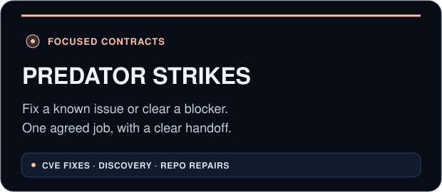</a></td>
    <td width="50%" valign="top"><a href="https://aethersystems.net/actions/design-partner">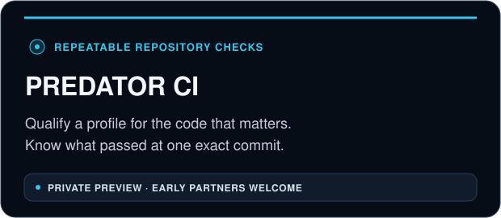</a></td>
  </tr>
</table>

| Path | Best fit | Start here |
| :--- | :--- | :--- |
| **Predator Strikes** | A known CVE fix, focused discovery, or chain analysis for one agreed repository surface | [Discuss a Strike →](https://aethersystems.net/strikes/) |
| **Predator CI** | Repeatable checks against a qualified repository profile and exact commit; private preview | [Qualify a profile →](https://aethersystems.net/actions/design-partner) |
| **Predator Red Team** | An authorized assessment of a live environment, with reviewed findings and remediation | [Scope an assessment →](https://aethersystems.net/defense-stack) |

Agree on the surface, acceptance checks, and handoff before work begins. Live assessments also require approved targets, methods, timing, contacts, and stop conditions. The linked service pages list current pricing and terms; broader engineering work starts with a [project inquiry](https://aethersystems.net/contact).

> **[Read the safety model →](SAFETY.md)** Human-approved scope and budgets bound each run. Memory, model suggestions, and quantum results supply evidence; authority comes from the approved mission. The guide distinguishes required policy from controls proven in code.

## Join the community

Ask about the published studies, suggest a public demo, or share feedback in [GitHub Discussions](https://github.com/AetherAI3/Predator/discussions). Use [issues](https://github.com/AetherAI3/Predator/issues/new/choose) for concrete documentation corrections.

[Contributing guide](CONTRIBUTING.md) · [Community guidelines](CODE_OF_CONDUCT.md) · [Security reporting](SECURITY.md)

## Developers: join the research program

Help build the CLI, repair chains, verification tools, or classical/quantum comparisons. Tell us what you have built and where you want to contribute. Private research access is reviewed separately.

[Apply to join →](https://aethersystems.net/contact?intent=general&product=site_wide&cta=footer_updates_contact)

### Predator R3D and Predator BLU3

  
  

**Two authorization gates for Gen3 in the private Predator CLI.** Request access to **Predator R3D** or **Predator BLU3** from the CLI. Access requests are reviewed separately from developer-program applications.

  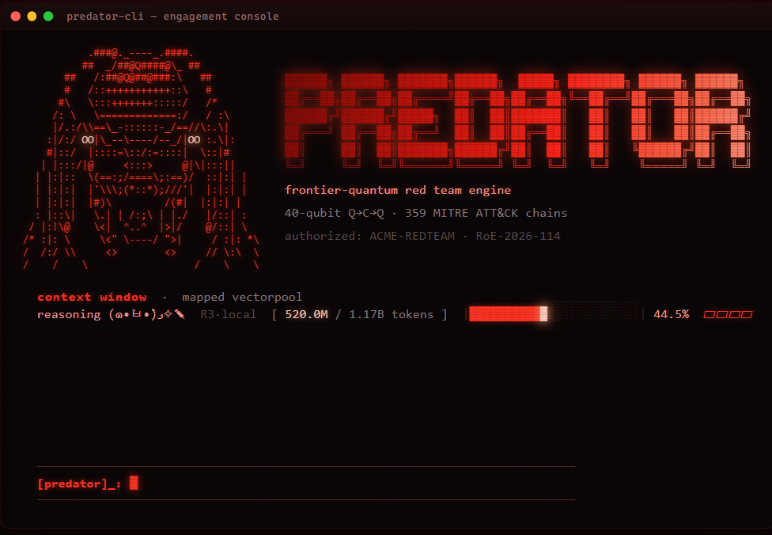 
  Predator CLI console preview · illustrative layout and counters

## Read the evidence

| Start with | Then explore |
| :--- | :--- |
| **[P-BOX feature showcase](#p-box)** | VM lifecycle, operator control, and recorded guest session |
| **[HTB training evidence](docs/htb/README.md)** | Courses, tracks, machines, certificates, and replay index |
| **[Crucible](#crucible-adaptive-quantum-threat-modeling)** | The loop explained as a lockpick, with [MITRE chains](#mitre-attck-chain-library) and the [CVE catalog](#cve-research-catalog) it draws on |
| **[CodePro and System-2](#codepro-and-system-2)** | How the fanout runs, and the private CLI around it |
| **[Quantum Comm Ops](docs/research/quantum-comm-ops.md)** | Agent mailboxes, adaptive CFC, packing and multiplexing; [aggregate data and verification scope](docs/research/quantum-comm-ops.json) |
| **[CharLS Q3](docs/research/charls-q3.md)** | [Public data](docs/research/charls-q3.json) and the completed dependent repair |
| **[QPACK study](docs/research/gen3-qpack-experiment1.md)** | [Episode data](docs/research/gen3-qpack-experiment1.json), comparisons, and missing outcomes |
| **[joint5 IBM Fez pilot](docs/research/ibm-fez-pilot.md)** | [Public data](docs/research/ibm-pilot.json), uncertainty, and the energy regression |
| **[Research roadmap](docs/research/generations.md)** | Generation goals and the requirements for promoting research into qualified profiles |
| **[Predator safety model](SAFETY.md)** | Required boundaries and the status of implemented controls |
| **[Unlimited Context](https://github.com/AetherAI3/Unlimited-Context-LLM)** | [How it works](https://github.com/AetherAI3/Unlimited-Context-LLM#how-it-works) and [safety measures](https://github.com/AetherAI3/Unlimited-Context-LLM/blob/main/SAFETY.md) |

Public overview and selected research notes · Private operator engines © 2026 Aether AI LLC. All rights reserved. IBM is identified as a hardware provider; no affiliation or endorsement is implied. <a href="docs/assets/SOURCES.md">Visual sources</a>.

