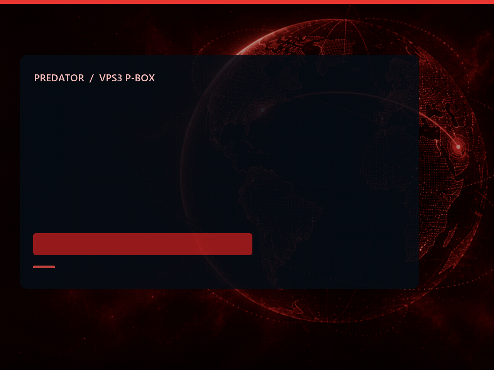

# P-BOX: GitLab for VS Code private research visual

Predator banked an owner-controlled GitLab for VS Code research record and filed a private report. Technical details and evidence remain private while disclosure is coordinated.

This five-second visual uses an icon-free crop of a live VPS3 Predator P-BOX guest desktop. It is an animated research title card, not a recording or demonstration of the finding. It contains no editor screens, commands, logs, configuration, or reproduction steps. The [media manifest](media/predator-pbox-gitlab-extension-research-visual.json) records the published file's hash, dimensions, and timing.
