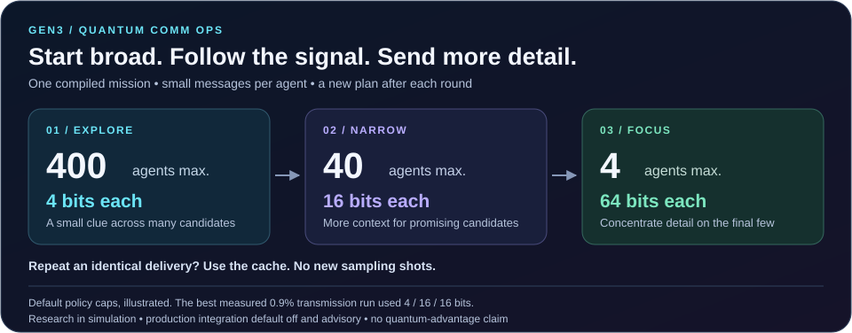

# Gen3 Quantum Comm Ops

**Useful context for each worker. Verified handoffs. Less repeated work.** Quantum Comm Ops is Predator's research into coordinating large agent workflows through compact messages, a shared evidence bank, and controls that concentrate further work on promising branches.

**Current review: October 31, 2026.** The latest configuration completed three fresh 400-recipient simulator missions with every recipient verified after any required retry. Three-shot sampling with capped six-shot rescue is now the adopted **research baseline** on `feat/qcomms-i`; this is not a production rollout. This public review checks committed reports and their arithmetic. It is not an independent experimental rerun. [Public aggregate data](quantum-comm-ops.json) carries the measurements; [current source records](#current-source-records) identify the private evidence inspected.

## Purpose and message path

The goal is to give a worker the evidence needed for its next task without repeatedly sending the full mission history. A shared bank holds the records. A small packet identifies or reconstructs the relevant entries, and the receiver resolves them into structured context. Model usefulness is tested separately from delivery.

1. **Compile assignments.** Choose each recipient's message, encoding and validation requirements before execution.
2. **Deliver.** Compare ordinary delivery with the experimental Nano → ATLAS quantum-search route. In the latter, the message is encoded as a lowest-energy answer and sampled with **FakeFez**, a simulator configured to model an IBM device.
3. **Check and recover.** Verify the receipt, reconstruct the message, and check its keyed tag. A refused message remains unaccepted; a bounded retry can deliver it again.
4. **Continue from supported results.** The intended workflow resolves the accepted message against the evidence bank, runs the next worker task, and preserves evidence for the next planning round.

The demonstrated benchmark uses scripted recipients and synthetic messages. It does not establish that 400 LLMs can reason successfully from the handoffs, transfer model weights or internal states, or operate across independently isolated sandboxes. Communication uses service requests and files. All Comm Ops results below are simulated or dry runs; the separate [joint5 IBM Fez pilot](ibm-fez-pilot.md) is the hardware experiment.

## Current delivery result: three fresh datasets

Each mission starts with 400 recipients and fresh frames, keys and sampling seeds. The datasets come from the **same synthetic generator**, so these repetitions test that configuration rather than generality across workloads. A job requests repeated samples; each sample is a **shot**.

| Three-shot mission | First pass | After rescue | All-in jobs | All-in shots | Reported mission wall |
| :--- | ---: | ---: | ---: | ---: | ---: |
| I2 | 400/400 | 400/400 | 1,200 | 3,600 | 2,828.1 s (47.1 min) |
| I6 repeat 1 | 400/400 | 400/400 | 1,200 | 3,600 | 2,946.9 s (49.1 min) |
| I6 repeat 2 | 399/400 | 400/400 | 1,203 | 3,618 | 3,061.0 s (51.0 min) |

Across the three missions, **1,199/1,200 deliveries passed initially and 1,200/1,200 verified after rescue**. These are observed sample counts, not a production reliability guarantee. In repeat 2, a chunk's majority vote was wrong. Its 32-bit tag refused the message, and resampling that recipient's three chunks at six shots recovered it: three extra jobs and 18 shots. A separate forced-corruption drill also exercised the six-shot rescue successfully; it is not counted as another scored mission.

Three readings cannot tie on a single bit, but they can agree on a wrong value. The tag and receipt checks remain necessary. Compared with four shots on this same three-chunk layout, initial sampling falls from 4,800 to 3,600 shots (**25% fewer**). The run with a rescue used 3,618 shots, saving **24.625% all-in** against that 4,800-shot reference. Fewer shots do not imply an equal reduction in runtime or price.

## What changed since the earlier 400-recipient run

| Improvement | What it contributes |
| :--- | :--- |
| **Denser framing** | This generator's 96-bit chain can be reconstructed from 12 variable bits under the shared prior. Adding a 32-bit tag and padding produces three 16-bit chunks per recipient, instead of eight. The compiler admits only compatible inputs. This is fixture-specific encoding, not arbitrary 96-bit knowledge compressed into 12 bits. |
| **Lower sampling with verified rescue** | Three-shot initial sampling plus one capped six-shot rescue round passed the recorded gates on all three datasets. |
| **Pooled simulator setup** | Eight service processes reuse their expensive backend setup while producing fresh samples and receipts for each job. Backend reuse does not replay earlier evidence. |
| **Exact structural certificates** | The compiler proves the supported QUBO's ground-state properties directly. Every job receives a certificate check; 2% also receive the exhaustive cross-check. The sample audits the implementation rather than replacing per-job certification. |

F2 cycle 4 used **3,232 all-in jobs and 13,056 shots** for 400 final verified recipients, with 396/400 passing initially. The latest missions use **1,200–1,203 jobs and 3,600–3,618 shots**. These are measured mission totals from different configurations and datasets. The earlier F2 timing comprises a 3h16m33s first-pass window and a separate approximately six-minute rescue; the current table uses reported mission wall and excludes separate smoke runs. No matched end-to-end speedup ratio is claimed.

The compiler's earlier **87–170× faster structural check** was a local component microbenchmark. Its effect on a complete mission is smaller. Likewise, the reported **10.614–10.667 verified logical bits per shot** counts reconstructed 96-bit chains under the shared prior; it is not an arbitrary-information capacity measurement.

## Coordination, context and the cost comparison

**Custom Fanout Controls (CFC)** decides how broadly to explore and which candidates receive more detail. The earlier scripted controller benchmark found the same synthetic winners while transmitting about 0.9% of the baseline's estimated tokens. That number measures transmitted information, not actual model processing or LLM bills. Exact repeat deliveries could reuse cached results with zero new samples; other computation still remained.

H3 showed why the baseline matters: its rendered compact hints cost more than a cached full table. I3's **IRv2** revision preserved the resolved facts and passed 40/40 scripted cases at an illustrative 0.442× baseline cost. It used 17–18 benchmark accounting tokens, but **54–60 Qwen tokenizer tokens**. The advantage depends on caching the legend; without that caching, the Qwen-token comparison was 1.064× baseline. Useful real-model continuation remains unqualified in this programme.

H6 also compared superposition multiplexing with ordinary circuits packed under the same assumptions. **The tested superposition scheme did not win at any of the 42 modeled cost points.** Sampling counts were measured on FakeFez; provider usage and prices were modeled. Superposition did not produce the successful framing or backend-pooling gains.

## System2 evidence accounting

A separate **tested draft** repairs how System2 counts support for claims: repeated statements from one source no longer create extra corroboration, and substring matching is removed. The producer reports **314 System2 tests passing** across the Python and native paths. The draft remains unmerged at this review. Its incremental ledger and new caller metadata are not integrated, and full contradiction handling and summary-window retention remain unfinished. This is progress toward trustworthy shared context, not evidence that a complete model handoff workflow has shipped.

## Remaining validation work

- **Model usefulness:** qualify models that use the delivered records and measure total inference, selection, verification and retry cost against cached ordinary delivery.
- **Different data:** test a corpus from another construction and preserve the fallback when the compact layout cannot represent an input.
- **Hardware economics:** the multi-circuit receipt has passed offline tests, but no packed IBM hardware request or billed saving is established. A small admitted request under an owner-written spend cap is the next measurement question.
- **Timing and memory:** the latest host runs stayed below one hour, but calibration showed substantial per-core variability. The slowdown's precise cause remains unidentified. Use paired comparisons and report memory headroom before attributing small runtime changes to code.
- **Deployment and trust:** production dispatch and independent sandbox deployment need their own validation. Keyed receipt seals establish integrity under the configured shared-key trust model; they do not prove hardware execution or establish provenance against another key holder. A 32-bit tag is not a general security-strength guarantee.

## Current source records

The public numbers above are aggregate summaries. The following source links require private repository access; raw messages, keys and full execution artifacts are not published here. Source inspection is distinct from an independent rerun.

| Record | Frozen source |
| :--- | :--- |
| Experiment I status, I1–I6 summaries and research-baseline adoption | [`43f2f8d863113670920da51c019794e1cf2aed37` · REPORT_I](https://github.com/AetherAI3/AETHER-PREDATOR-M/blob/43f2f8d863113670920da51c019794e1cf2aed37/bench/qcomms/skt/REPORT_I.md) |
| I6 repetitions, rescue drill and timing study | [`c090ec666beb15552c73600d57b3d78ae9c060ef` · REPORT_I6](https://github.com/AetherAI3/AETHER-PREDATOR-M/blob/c090ec666beb15552c73600d57b3d78ae9c060ef/bench/qcomms/skt/i6_3shot/REPORT_I6.md) |
| F2 fresh baseline, including rescue accounting | [`43f2f8d…` · REPORT_F2_cycle4](https://github.com/AetherAI3/AETHER-PREDATOR-M/blob/43f2f8d863113670920da51c019794e1cf2aed37/bench/qcomms/skt/f2_plan/REPORT_F2_cycle4.md) |
| H outcomes, including superposition and model limitations | [`43f2f8d…` · REPORT_H](https://github.com/AetherAI3/AETHER-PREDATOR-M/blob/43f2f8d863113670920da51c019794e1cf2aed37/bench/qcomms/skt/REPORT_H.md) |
| Exact product certificate and batch-planner audit | [`571c6e20183d3f926cd4ea144f7c813df7173f52` · compiler report](https://github.com/AetherAI3/AETHER-PREDATOR-M/blob/571c6e20183d3f926cd4ea144f7c813df7173f52/bench/qcomms/skt/compiler_planning/REPORT.md) |
| System2 draft | [AETHER-CLOUD #2168](https://github.com/AetherAI3/AETHER-CLOUD/pull/2168), reviewed head `8a45f120e10f0ed8719a26b13b4954aeca3765af` |

[Back to the current README overview →](../../README.md#gen3-quantum-comm-ops)

## Historical D–F snapshot

The October 28 public note is preserved below, including its then-current branch and queue statuses. It is a historical record; the current results and source records above supersede its status statements. Its resumed 303-plus-97-recipient milestone is separate from the later fresh missions.

<strong>Read the October 28, 2026 public snapshot</strong>

# Gen3 Quantum Comm Ops

**One mission, many agents, smaller messages.** Quantum Comm Ops studies how Predator can coordinate agent swarms through a compiled delivery plan, verifiable mailboxes, and a controller that concentrates information on promising candidates.

This is a public summary of the D → E → F hillclimb recorded on **October 26–27, 2026**, reviewed on **October 28**. Verification here means inspection of committed code, reports, and result records plus arithmetic checks. It does not mean an independent experimental rerun. The implementation and full run artifacts remain in the private research repository; [source pins](#source-pins) identify the exact versions inspected. [Public aggregate data](quantum-comm-ops.json) preserves the numbers and their scope.

## What problem does this solve?

Sending a complete mission prompt and every hint to every worker repeats information. Quantum Comm Ops explores a different delivery pattern: compile the common instructions once, send each agent a compact **shard**—its small piece of information—and use the results to decide who needs more detail next.

The intended use includes workers in different sandboxes. The current experiments demonstrate separate receiver processes and local mailbox files, not deployment across independently isolated operating-system sandboxes. Communication still uses ordinary service requests and files; “quantum” describes how the message is encoded and sampled, not an instant link between machines.

## How the mailbox works

1. **Compile the plan.** Assign a synthetic chain to each agent, pack its bits into jobs, and fix the tags, content digests, and resume map. A digest is a fingerprint used to recognize the same content again. This compiler is the master **C1** planning stage.
2. **Encode and sample.** Make the message the lowest-energy answer of a quantum-search problem. Predator builds the job; an authenticated Nano service compiles it; ATLAS samples it using FakeFez.
3. **Deliver and verify.** Check each recipient's receipt and message tag using the configured keys, reconstruct the message, and record the result. D2 exercised its receiver in a separate process; F2 checks each logical agent's mailbox against the compiled assignment. The runtime executes the plan instead of making new assignments.

**FakeFez is a simulator**, with a model of IBM-device behavior. The tested IBM-compatible service route used a zero-QPU budget. The receipt format's “hardware-sealed” label does not prove hardware execution: these are dry-run receipts authenticated with a shared symmetric key. A holder of that receipt key can produce a seal.

D2 completed **192/192 jobs** without transport refusal or retry. All eight channel/file pairs produced byte-identical model transcripts. This establishes delivery equivalence under the test conditions. Those models failed the task in both arms, so equivalent delivery does not establish useful reasoning.

## Adaptive CFC: send a little, learn, then focus

**Custom Fanout Controls (CFC)** sets three choices per round: the number of workers, the bits each receives, and the threshold for keeping a candidate. “Fanout” means how many workers get the task. In this benchmark, a winning candidate is a known answer in a synthetic task, not a verified vulnerability.

The default caps are **400 × 4 bits → 40 × 16 → 4 × 64**. The best measured configuration used **4 / 16 / 16 bits** instead. Across three random seeds, its actual worker counts were 400→29→4, 400→25→4, and 400→19→3. A seed makes a particular randomized test repeatable.

| F4 result | Evidence and meaning |
| :--- | :--- |
| Same winners, about 0.9% transmitted tokens | Cycle 5: **1,842 / 199,186 = 0.9248%**, pooled across three seeds. Scripted workers, synthetic 400-agent corpus, classical delivery stand-in, classical exact selection. Precision and recall both 1.0 on all three seeds. |
| Two selection rounds | Winners reached at **Q2**; a final **C3 confirmation** still ran. This is not two total processing stages. |
| Repeat without new sampling | Exact reruns had **100% cache hits and zero new shots**. Keys identify shard content and sampling settings. Other processing still exists; zero sampling is not zero total cost. |
| Transfer through the real service | Cycle 8: **40 agents, seed 0, 52/52 jobs verified** through Nano → ATLAS FakeFez. Decoded shards, selected candidates, plans, and cache outcomes matched the control. Two additional seeds were not run. |
| Smaller-run token limit missed | That 40-agent transfer used **154 / 6,846 = 2.2495%** estimated transmitted tokens, above its ≤2% target. It is a partial transfer result, not a full repeat of the 400-agent result. |

The 0.9% metric counts the compiled prompt once and estimates text/shard tokens. It does **not** count each model's actual prompt processing. In the separate Qwen 2.5 0.5B experiment, measured input tokens were **247,986 / 352,316 = 70.3874%** of baseline, and both precision and recall were zero. Effective model-prefix caching and a capable model are still unestablished here. Do not interpret 0.9% as a measured LLM billing ratio.

The production-code seam is behind `PREDATOR_CFC_ADAPTIVE=1`, unset by default. When enabled it is **advisory**: it records a plan beside the receipt without changing solver selection. The inspected production factory still refuses dispatch with `CFC_CODEPRO_SHARED_IR_UNWIRED`. The successful benchmark is not an enabled production swarm service.

## Capacity: useful information per sample

A **job** requests repeated samples; each sample is a **shot**. The early format spent a 12-bit identification tag on every 4 useful bits. The block format shares one 32-bit tag across a 96-bit chain, then splits the 128 bits into eight 16-bit jobs. That yields **12 useful bits per job on average**, including tag overhead.

| Metric | D2 baseline | F2 block scheme at 8 shots |
| :--- | ---: | ---: |
| Useful bits per chain | 96 | 96 |
| Jobs per chain | 24 | 8 |
| Useful bits per job | 4 | 12 |
| Shots per job | 256 | 8 |
| Useful bits per shot | 0.015625 | **1.5** |
| Jobs for a fresh 400-agent plan | 9,600 | **3,200** |

The improvement is **3× better packing × 32× fewer shots = 96×**. F2's committed cycle-3 completion confirms **1.5 useful bits per shot across 303 newly sampled agents and 2,424 jobs**. All 303 agents decoded successfully at eight shots; the other 97 agents in the completed 400-agent bank were sampled earlier at 256 shots. F1 separately verified all 72 chunks for three agents at each tested shot count: **8, 16, 32, 64, 128, 256**. These are measured results for this corpus and backend, not a universal reliability guarantee. All improvements are compiler, framing, and sampling changes in simulation; no hardware changed or ran.

### The 400-agent milestone

**Goal G is complete: 400/400 agents banked unique chains matching their assignments.** The compiler built the delivery plan from **400 unique 96-bit synthetic rule-machine chains**, pinned to a particular generated corpus. These are test messages, not 400 production security missions. [PR #391](https://github.com/AetherAI3/AETHER-PREDATOR-M/pull/391) now contains the completion report, ledger, plan, metrics, run summaries, and six worker logs. Recounting the committed ledger against the plan confirms **400 matches, 400 distinct chains, and zero duplicates or foreign chains**.

The resumed phase ran **303 agents × 8 jobs = 2,424 jobs**, using **19,392 shots** across six service instances. All jobs completed, all six workers exited successfully, and all 2,424 majority-decoded bitstrings matched their planned frames. There were **zero transport refusals or missing jobs**. The final bank combines these **303 newly decoded agents with 97 verified agents carried from cycle 2**. The useful information newly delivered was 29,088 bits: **29,088 / 19,392 = 1.5 bits/shot**.

The resumed run window was **3h30m49s**; acquiring the host lock through the last worker's finish took **3h33m16s**, the rounded **3h33** headline. This is the final phase's elapsed time, not the whole campaign. The run completed on October 27; its report was written on October 28 from retained artifacts because the launching session had stopped before completion. Individual job files and mailboxes remain on the research host; this review checks the committed records, not a fresh replay of those receipts.

The measured campaign total is **782 + 2,424 = 3,206 jobs** and **219,584 shots**, including the earlier 97 agents and partial work. The campaign-wide rate is **38,400 / 219,584 ≈ 0.175 useful bits/shot**. The **1.5** rate belongs to the improved cycle-3 scheme. A fresh 400-agent run entirely under that scheme would use **3,200 jobs and 25,600 shots**; that is a projection, not the job count of this resumed run.

The earlier **~20 hours** estimate belongs to the improved block plan on one service at 256 shots. The original 9,600-job baseline projects to **~61 hours** at the measured 22.7 seconds/job. Comparing 20h with 3h33 mixes a projection, different shot counts, concurrency, and carried work; it is not a measured end-to-end speedup ratio.

## Superposition multiplexing: several possible messages in one job

This is a separate track from block packing. It asks whether a circuit can place several message frames among its equally valid lowest-energy answers—a **degenerate ground-state set**—so repeated samples recover several recipients' messages. A shot produces one observed answer, not every message at once.

**QAOA** is the layered circuit method tested here. Its layer count, **p**, controls circuit depth and is separate from Crucible's C/Q research rounds. One layer was inadequate for the tested multi-frame construction. Deeper, tuned ideal circuits did much better:

| Experiment | Probability on desired answer set | Scope |
| :--- | ---: | :--- |
| F3, two frames, 20 layers | **0.904628** | Best single seed, ideal simulation; three-seed mean 0.8739. |
| F3, four frames, 12 layers, coupling weight 2 | **0.974073** | Best single seed, ideal simulation. |
| E1, two frames, 6 layers | **0.328** | Mean over three seeds with FakeFez noise. |
| E1, four frames, 4 layers | **0.253** | Mean over three seeds with FakeFez noise. |

These are probabilities on an answer set, not agent delivery-success percentages. The noisy QAOA sweep missed its 50% target, although decoding recovered every carrier in the tested cells from two layers onward. Its classical comparison performed better. Stronger couplings reduced required depth in some ideal settings; that benefit has not been established on hardware.

The current construction also limits independent content: **2^m frames carry only m+1 independent payloads**. Four frames therefore carry three independent payloads plus a forced parity frame, not four arbitrary messages.

The next preregistered noisy-depth test covers **6, 8, and 10 layers**. No result is committed at the reviewed F3 head; its model predicts a peak near eight layers but does not predict passing 50%. A pending test is not a measured improvement.

### The hillclimb continues

**October 28 status snapshot:** the owner reports additional **F4 controller seeds running**, **F3's noisy multiplexing runner staged** with an atomic lock-grab poller, and **F1's cycle-4 coding experiment preregistered and pushed**. The committed F1 log records the shared-host order **F4 → F3 → F1**; F2's close-out records the handoff to F4. F3's runner and frozen harness are committed. There are **no newly committed scored outcomes for these follow-ups** in this review, so the controller and multiplexing results above remain unchanged. The next updates depend on their completed reports.

## Limits the hillclimb exposed

| Area | What remains open |
| :--- | :--- |
| **Wider jobs** | Tested wider circuits were blocked by the ATLAS statevector dry run's memory needs; Nano also has a configurable width cap. This is a limit of the tested implementation and host, not a fundamental communication or device limit. |
| **Model use of hints** | The tested small models, including Qwen 2.5 7B under the frozen E2 prompt, failed to use the hint table. The 14B comparison did not run. This is not a claim about every small model or every prompt. Warm-up controls address Ollama's first-generation difference after loading. |
| **Confidentiality** | Tested keyless predictors recovered content only at chance; traffic and metadata remained visible. A holder of a message key can decode frames under that key. These tests are not a general security proof. |
| **Tags and ordering** | The D/E 12-bit tag is an identification check, not a security-strength authenticator. E3 found that its manifest index could be reordered without detection. F2's later whole-chain tag checks the reassembled block; the legacy format's issue must not be presented as universally fixed. |
| **Isolation and provenance** | Receiver-process guards are advisory, not OS sandbox boundaries. Shared receipt keys do not establish provenance against another holder. |
| **Hardware and advantage** | All results here are simulated or dry-run results. No IBM QPU was used and no quantum advantage was established. The separate [IBM Fez compiler pilot](ibm-fez-pilot.md) is a different experiment. |

## Source pins

The links below require access to **AETHER-PREDATOR-M**. They identify private source evidence; this public note and its JSON are an aggregate summary, not a public release of full run artifacts. The cited PRs were open at review; the original F2 and F1 PRs were drafts. The F lanes target `feat/qcomms-f`; **completion PR #391 targets F2's branch and is open and mergeable**, not yet merged. Results must be read at their individual heads rather than assumed merged. The ladder is `bench/qcomms/skt/f_ladder.md` on the respective branches. Runs and follow-ups have preregistrations and reports retain unmet or unestablished outcomes.

| Record | Pinned revision and files |
| :--- | :--- |
| D, PRs [#375](https://github.com/AetherAI3/AETHER-PREDATOR-M/pull/375) / [#376](https://github.com/AetherAI3/AETHER-PREDATOR-M/pull/376) | [`592b235ac921797df1a5f0d23936378ecfbd795e`](https://github.com/AetherAI3/AETHER-PREDATOR-M/blob/592b235ac921797df1a5f0d23936378ecfbd795e/bench/qcomms/skt/REPORT_D2.md): D2 report; `agents_llm.py` and `d2.py` for receipt and isolation behavior. |
| E, PR [#380](https://github.com/AetherAI3/AETHER-PREDATOR-M/pull/380) | [`4da32b6212ca1e5dd16cda7e7ec212ecebc7902a`](https://github.com/AetherAI3/AETHER-PREDATOR-M/tree/4da32b6212ca1e5dd16cda7e7ec212ecebc7902a/bench/qcomms/skt): `e1_depth/REPORT_E1.md`, `e2_models/REPORT_E2.md`, `e3_leakage/REPORT_E3.md`. |
| F4, PR [#384](https://github.com/AetherAI3/AETHER-PREDATOR-M/pull/384) | [`f75d00635c1c689b9dc05197a535f960eb7bb6e7`](https://github.com/AetherAI3/AETHER-PREDATOR-M/tree/f75d00635c1c689b9dc05197a535f960eb7bb6e7/bench/qcomms/skt/f4_cfc): cycle 5, 7, and 8 reports and result files; `predator/drive/cfc_adaptive_policy_v1.py`, `cfc_convergence_v1.py`, `cfc_production_factory_v1.py`. |
| F2, PR [#386](https://github.com/AetherAI3/AETHER-PREDATOR-M/pull/386) | [`a5aa6db4077380f7b0532d5f7ff2f9a146b7fa4c`](https://github.com/AetherAI3/AETHER-PREDATOR-M/tree/a5aa6db4077380f7b0532d5f7ff2f9a146b7fa4c/bench/qcomms/skt/f2_plan): `MISSION_LOG.md`, cycle 1 report, cycle 3 preregistration, compiler and block framing; `fixtures/skt/corpus.py`. |
| F2 completion, PR [#391](https://github.com/AetherAI3/AETHER-PREDATOR-M/pull/391) | [`655a5edc8aed37b43b66b75b759d787a1320a8c2`](https://github.com/AetherAI3/AETHER-PREDATOR-M/tree/655a5edc8aed37b43b66b75b759d787a1320a8c2/bench/qcomms/skt/f2_plan): `REPORT_F2_cycle3.md`, `MISSION_LOG.md` P11, and `results/cycle3/` ledger, plan, metrics, run summaries, and worker logs. |
| F1, PR [#389](https://github.com/AetherAI3/AETHER-PREDATOR-M/pull/389) | [`8815696e7cd99e823d1d44da4756ef31a4d4dd03`](https://github.com/AetherAI3/AETHER-PREDATOR-M/tree/8815696e7cd99e823d1d44da4756ef31a4d4dd03/bench/qcomms/skt/f1_width): cycle 1 and 2 reports. |
| F3, PR [#390](https://github.com/AetherAI3/AETHER-PREDATOR-M/pull/390) | [`2087aeb01bec9e3f4f822e2d1045222003c20cbb`](https://github.com/AetherAI3/AETHER-PREDATOR-M/tree/2087aeb01bec9e3f4f822e2d1045222003c20cbb/bench/qcomms/skt/f3_skt): cycle 1b report, result summary, cycle 2 preregistration and mission log; `../multiplex.py`. |
| F3 follow-up preparation | [`48ec000b75593e1226770a2dae3162e5f950cdae`](https://github.com/AetherAI3/AETHER-PREDATOR-M/tree/48ec000b75593e1226770a2dae3162e5f950cdae/bench/qcomms/skt/f3_skt): cycle 2 preregistration §7a, `c2.py`, and `run_c2_host.sh`; no completed cycle-2 report. |
| F1 follow-up preparation | [`931c21b5039acaa79b5e5ff9f237d4d20acb2bb5`](https://github.com/AetherAI3/AETHER-PREDATOR-M/tree/931c21b5039acaa79b5e5ff9f237d4d20acb2bb5/bench/qcomms/skt/f1_width): `PREREGISTRATION_F1_cycle4.md` and `MISSION_LOG.md` P3, including queue order; no completed cycle-4 report. |

[Back to the Quantum Comm Ops overview →](../../README.md#gen3-quantum-comm-ops)

